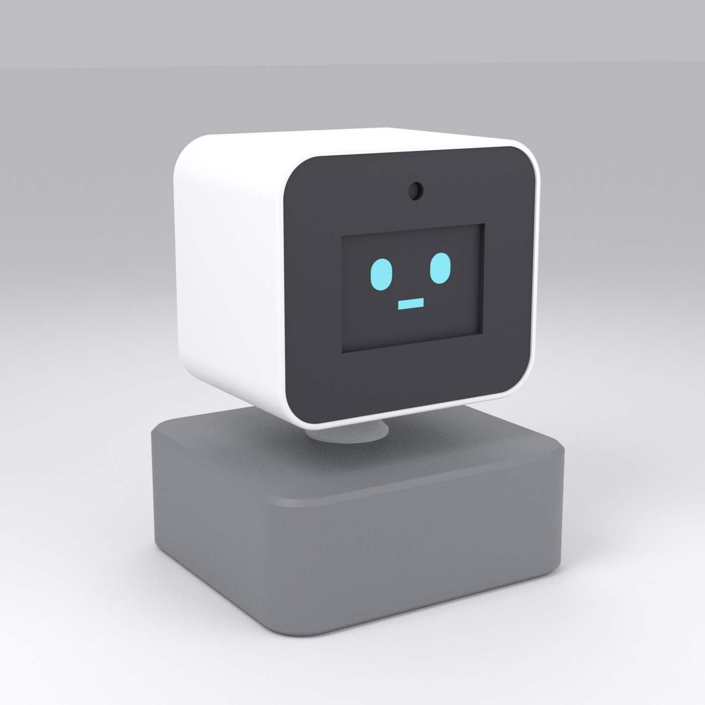

# robos-impressos — the body of your pet robot, to print at home

**🇧🇷 [Português](README.md) · 🇺🇸 [English](README.en.md) · 🇪🇸 [Español](README.es.md)**

## What it is

You want to build a friendly robot at home, but you don’t know where to start with its body. **robos-impressos** is a set of three robot bodies to 3D print: a dinosaur and a capybara about 33 cm tall that roll across the floor, plus a square tabletop robot with a screen for a face. Each one has the right places for the motors, servos (small motors that rotate to an angle and stop), battery, and Arduino and Raspberry Pi boards. It’s for anyone with access to a 3D printer with a 256 mm build plate who wants to build, learn, or teach robotics. This is phase 1, covering only the body and its fittings: wiring, voice, and intelligence are planned for phase 2. And an honest note: this is a digital project checked by a script; no one has printed these parts yet.

## 📖 User guide

Complete guide (what it is, how they move, step by step): **https://inematds.github.io/robos-impressos/guia/en/**

Detailed plan (decisions, parts, measurement sources, assembly screw by screw, phase 2): [PLANO.md](PLANO.md) (in Portuguese)

| Dinosaur | Capybara | Square robot |
|---|---|---|
|  |  |  |

The images are **renders** of the project parts. The banner is an AI-generated illustration.

<!-- TABELA:resumo -->
| Model | Height (mm) | Parts | Plates (print jobs) | Total filament (g)* | Total print time (h)* | Assembled robot (g)* |
|---|---|---|---|---|---|---|
| Dinosaur | 329 | 38 | 12 | 1107 | 44 | 1666 |
| Capybara | 326 | 39 | 13 | 1049 | 42 | 1581 |
| Square robot | 201 | 14 | 8 | 638 | 25 | 1020 |

* estimate from volume, no slicer
<!-- /TABELA -->

## What’s included

| Path | Contents |
|---|---|
| `PLANO.md` | Project decisions, parts list, measurement sources, assembly, and what’s already prepared for phase 2 |
| `comum/cad/parametros.py` | **All measurements** in one file: clearances, components (with sources), each robot’s shape |
| `comum/cad/gerar.py` | Generates STL, 3MF, `montagem.json`, `montagem.glb`, and `mesas.json` for each model |
| `comum/cad/verificar.py` | 9 tests for exported files (watertight mesh, fits the build plate, walls, interference, loose parts, balance, assembly path) |
| `comum/cad/comum/` | Shared framework (chassis, trays, neck), animal shells, components, and geometry |
| `projetos/<modelo>/modelo.py` | The model of each robot: `dino`, `capivara`, `cubo`, `cubo-rodas` |
| `projetos/<modelo>/stl` e `3mf` | Parts for each model, already positioned for printing |
| `projetos/<modelo>/mesas/` | One 3MF per build plate (parts grouped by color and material) |
| `comum/pecas/` | Parts shared by both animals (chassis, trays, fork, cradle, ball cover, pin, bushing, test piece) |
| `projetos/TABELAS.md` | Parts tables and verifier output (generated) |
| `projetos/<modelo>/imagens/` | Renders: assembled, four views, exploded, skeleton, and build plates |
| `guia/` | Guide page in PT, `guia/en/`, and `guia/es/` (built by `guia/src/montar.py`) |

## The three models at a glance

- **Dinosaur:** wheels (2 TT motors in the legs + ball under the tail) · pan + tilt neck · mouth · 2 arms.
- **Capybara:** wheels (inside the thighs, ball in the tail) · pan + tilt neck · mouth · same framework as the dinosaur.
- **Square robot:** tabletop · cube head with a 3.5" screen and Raspberry Pi · pan ±170° via 2:1 gears · tilt.

## The process, start to finish

Legend: 🧠 you · ⚙️ command/script · 🤖 `claude -p`

| # | Step | Command | Who |
|---|---|---|---|
| 1 | Download the project (or the [ZIP](https://github.com/inematds/robos-impressos/archive/refs/heads/main.zip) if you only want to print) | `git clone https://github.com/inematds/robos-impressos.git && cd robos-impressos` | ⚙️ |
| 2 | Choose a model and read the parts list | [PLANO.md › Peças impressas](PLANO.md#2-peças-impressas) (in Portuguese) | 🧠 |
| 3 | Print the test piece and check the servo, threaded insert, and pin | `comum/pecas/stl/comum-teste-encaixe.stl` in your slicer | 🧠 |
| 4 | Measure the components marked **NC** and correct the measurements | edit `comum/cad/parametros.py` | 🧠 |
| 5 | Create the Python 3.12+ environment (only if regenerating) | `python3 -m venv .venv && .venv/bin/pip install -r requirements.txt` | ⚙️ |
| 6 | Generate the parts | `.venv/bin/python comum/cad/gerar.py todos` | ⚙️ |
| 7 | Verify (the process must end with "TUDO PASSOU") | `.venv/bin/python comum/cad/verificar.py todos` | ⚙️ |
| 8 | Update tables and renders | `.venv/bin/python comum/cad/tabelas.py && comum/cad/renders.sh dino` | ⚙️ |
| 9 | Print by color: one 3MF per build plate | `projetos/<modelo>/mesas/*.3mf` in your slicer | 🧠 |
| 10 | Buy the components | [PLANO.md › Peças compradas](PLANO.md#3-peças-compradas-estimativa-de-preço-nov2026-lojas-brasileiras) (in Portuguese) | 🧠 |
| 11 | Assemble from the inside out | [PLANO.md › Montagem](PLANO.md#6-montagem-passo-a-passo) (in Portuguese) | 🧠 |
| 12 | If the guide changes: rebuild and translate it | `python3 guia/src/montar.py && python3 guia/src/traduzir.py && python3 guia/src/montar.py && .venv/bin/python comum/cad/tabelas.py` | ⚙️ |
| 13 | Publish | `git add -A && git commit && git push` (GitHub Pages) | 🧠 |

No step currently uses `claude -p`.

## Status

Version **v1.0.2**. All three models pass the verifier’s 9 tests. **Nothing has been printed or assembled**: clearances, measurements without sources (marked NC), and print times are starting points. Phase 2 (electronics, voice, vision, navigation, AI) has not begun.

---

Made by [INEMA.CLUB](https://inema.club).
