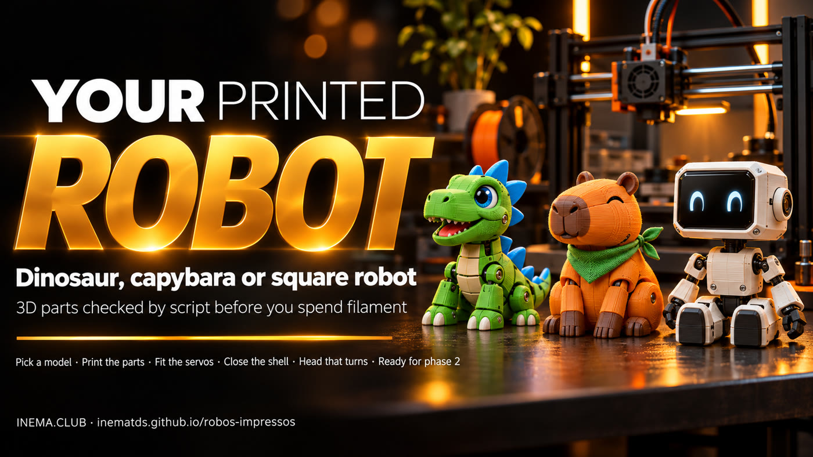
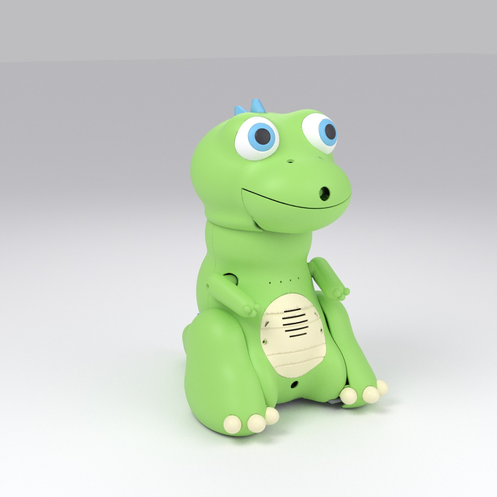
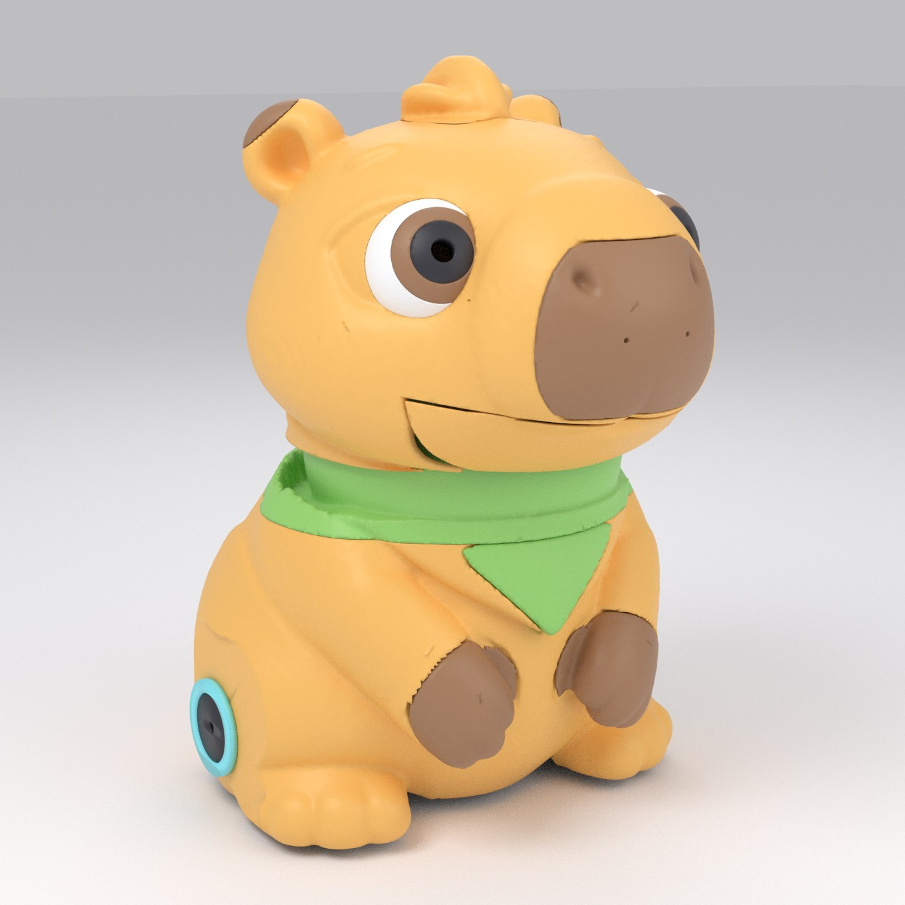
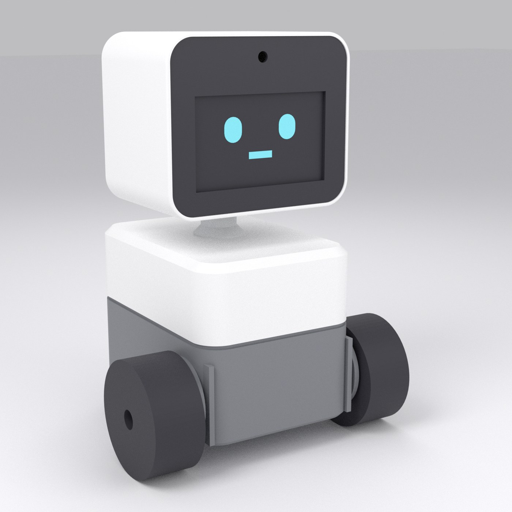

# robos-impressos — your pet robot’s body, ready to print at home

**🇧🇷 [Português](README.md) · 🇺🇸 [English](README.en.md) · 🇪🇸 [Español](README.es.md)**

## What it is

You want to build a friendly robot at home, but don’t know where to start: which parts to print, what to buy, or where each wire goes. **robos-impressos** is a set of four robots to 3D print: a 30 cm dinosaur and capybara that move across the floor; a square desktop robot with a screen for a face; and a 30 cm square robot on wheels. Each has its own folder, with files already positioned for printing, a shopping list with estimated prices and links, a printing guide, and a wire-by-wire wiring diagram. It’s for anyone with access to a 3D printer with a 256 mm build plate who wants to build, learn, or teach robotics. This is phase 1: the printed body, assembled and wired. The program (movement, voice, camera, intelligence) is phase 2 and hasn’t been built yet. And an honest heads-up: this is a digital project checked by script. No one has printed these parts yet, and the electronics haven’t been tested on the bench.

## 📖 User guide

Complete guide (what each robot is, how it moves, step by step): **https://inematds.github.io/robos-impressos/guia/en/**

## The four robots

| Dinosaur | Capybara | Square desktop robot | Square robot on wheels |
|---|---|---|---|
|  |  |  |  |
| Moves, turns, tilts its head, opens its mouth, and moves both arms | Moves, turns, tilts its head, and opens its mouth | Desktop: head with a 3.5" screen, rotates ±170° and tilts | Moves with 2 encoder motors; head with a 5" screen, rotates ±170° and tilts |
| [projetos/dino/](projetos/dino/README.md) | [projetos/capivara/](projetos/capivara/README.md) | [projetos/cubo/](projetos/cubo/README.md) | [projetos/cubo-rodas/](projetos/cubo-rodas/README.md) |
| [buy](projetos/dino/LISTA-DE-COMPRAS.en.md) · [print](projetos/dino/IMPRIMIR.en.md) · [wire](projetos/dino/LIGACAO.en.md) · [plan](projetos/dino/PLANO.md) | [buy](projetos/capivara/LISTA-DE-COMPRAS.en.md) · [print](projetos/capivara/IMPRIMIR.en.md) · [wire](projetos/capivara/LIGACAO.en.md) · [plan](projetos/capivara/PLANO.md) | [buy](projetos/cubo/LISTA-DE-COMPRAS.en.md) · [print](projetos/cubo/IMPRIMIR.en.md) · [wire](projetos/cubo/LIGACAO.en.md) · [plan](projetos/cubo/PLANO.md) | [buy](projetos/cubo-rodas/LISTA-DE-COMPRAS.en.md) · [print](projetos/cubo-rodas/IMPRIMIR.en.md) · [wire](projetos/cubo-rodas/LIGACAO.en.md) · [plan](projetos/cubo-rodas/PLANO.md) |

The images and banner are **renders** of the project parts.

<!-- TABELA:resumo -->
| Model | Height (mm) | Parts | Plates (print jobs) | Total filament (g)* | Total print time (h)* | Assembled robot (g)* |
|---|---|---|---|---|---|---|
| Dinosaur | 300 | 34 | 12 | 1010 | 40 | 1605 |
| Capybara | 300 | 32 | 11 | 1129 | 44 | 1714 |
| Square robot | 200 | 15 | 7 | 735 | 28 | 1147 |
| Square robot on wheels | 306 | 19 | 8 | 1143 | 43 | 2214 |

* estimate from volume, no slicer
<!-- /TABELA -->

## What’s in each robot

Each `projetos/<robô>/` folder (`dino`, `capivara`, `cubo`, `cubo-rodas`) is a complete project:

| File | What it’s for |
|---|---|
| `README.md` | What the robot is, step-by-step assembly, how to open it, power, and verification |
| `LISTA-DE-COMPRAS.md` | What to buy: quantity, purpose, price range, and search link. Phase 2 is listed separately |
| `IMPRIMIR.md` | How to print: build plate order, orientation, supports, walls, and infill for each part |
| `LIGACAO.md` + `ligacao.pt.svg` | Wiring diagram and wire-by-wire table, with bench preparations |
| `PLANO.md` | The robot project decisions and why, phase 2, and open items |
| `<robô>-stl.zip` | Everything to print in one file: STL, build plate 3MF files, Arduino program, and guides |
| `stl/`, `3mf/`, `mesas/` | One part per file, already positioned for printing, and one 3MF per build plate (parts grouped by color) |
| `firmware/` | Arduino program that centers the servos before assembly |
| `imagens/` | Model renders: assembled, 4 views, exploded, skeleton, and build plates |
| `modelo.py`, `montagem.json`, `verificacao.json` | The robot design in code, the generated result, and the test results |

The shopping, printing, and wiring guides are also available in English (`.en.md`) and Spanish (`.es.md`). The README and plan for each robot are only in Portuguese.

## What the four have in common

The [`comum/`](comum/README.md) folder (in Portuguese) contains what the robots share:

- **The code** (`comum/cad/`): all measurements in one file (`parametros.py`), the shape library, the parts generator, and the verifier.
- **The shared parts** (`comum/pecas/`): the test coupon (for all 4 robots) and, for the two creatures, the neck fork, tilt cradle, and ball cover.
- **The same rules**: fits on a 256 mm build plate, walls of 2 mm or thicker, no supports whenever possible, screws only from below, behind, or inside.
- **The same basic electronics**: Raspberry Pi, Arduino Uno with Sensor Shield, MG996R servos, 18650 batteries with protection board and USB-C charging.

The decisions that apply to all, the similarity table with the references, and the printability summary are in [PLANO.md](PLANO.md) (in Portuguese).

## The process, from start to finish

Legend: 🧠 you · ⚙️ command/script · 🤖 `claude -p`

**To build a robot** (no installation needed):

| # | Step | Command or file | Who |
|---|---|---|---|
| 1 | Choose a robot and read the summary | `projetos/<robô>/README.md` | 🧠 |
| 2 | Download the files | `projetos/<robô>/<robô>-stl.zip` (or `git clone https://github.com/inematds/robos-impressos.git`) | 🧠 |
| 3 | Read the risks and buy the parts | `projetos/<robô>/LISTA-DE-COMPRAS.md` | 🧠 |
| 4 | Print the test coupon and check threaded inserts, screws, and servo | `comum/pecas/stl/comum-teste-encaixe.stl` in the slicer | 🧠 |
| 5 | Measure the components marked **NC** | caliper; if the measurement doesn’t match, go to step 9 | 🧠 |
| 6 | Print the build plates in the suggested order | `projetos/<robô>/IMPRIMIR.md` and `projetos/<robô>/mesas/*.3mf` | 🧠 |
| 7 | Prepare the bench: power, centered servos, cables, Raspberry Pi card | `projetos/<robô>/LIGACAO.md` and `projetos/<robô>/firmware/` | 🧠 |
| 8 | Seat the threaded inserts and assemble | `projetos/<robô>/README.md › Montagem` | 🧠 |

**To change the project** (measurement, part, or text):

| # | Step | Command | Who |
|---|---|---|---|
| 9 | Create the Python 3.12+ environment | `python3 -m venv .venv && .venv/bin/pip install -r requirements.txt` | ⚙️ |
| 10 | Change a measurement or the design | edit `comum/cad/parametros.py` or `projetos/<robô>/modelo.py` | 🧠 |
| 11 | Generate the parts | `.venv/bin/python comum/cad/gerar.py <id\|todos>` (id: `dino`, `capivara`, `cubo`, `cubo_rodas`) | ⚙️ |
| 12 | Verify: it must end with "TUDO PASSOU" | `.venv/bin/python comum/cad/verificar.py <id\|todos>` | ⚙️ |
| 13 | Rebuild the images (requires Blender) | `comum/cad/renders.sh <id>` | ⚙️ |
| 14 | Rebuild the tables in the root documents | `.venv/bin/python comum/cad/tabelas.py --docs` | ⚙️ |
| 15 | Rebuild the robot documents in Portuguese | `.venv/bin/python guia/src/pagina_robo.py docs <robô> pt` | ⚙️ |
| 16 | Translate into English and Spanish (only what changed) | `.venv/bin/python guia/src/pagina_robo.py traduzir <robô>` | ⚙️ |
| 17 | Rebuild the translated documents, diagram, and zip | `.venv/bin/python guia/src/pagina_robo.py docs <robô>`, then `esquema <robô>` and `zip <robô>` | ⚙️ |
| 18 | Rebuild the entire guide (entry page, page for each robot, and design evolution page) and check every page | `.venv/bin/python guia/src/tudo.py` | ⚙️ |
| 19 | Or rebuild just one robot’s page and check links, languages, and zip | `.venv/bin/python guia/src/pagina_robo.py pagina <robô>` → `conferir <robô>` | ⚙️ |
| 20 | Translate this README | `.venv/bin/python guia/src/traduzir_readme.py && .venv/bin/python comum/cad/tabelas.py --docs` | ⚙️ |
| 21 | Publish | `git add`, `git commit`, and `git push` (GitHub Pages) | 🧠 |

In steps 15 to 19, `<robô>` is the folder name: `dino`, `capivara`, `cubo`, or `cubo-rodas`. Translation uses the `inema-traduz` command, which is on the project maintainer’s machine. No step uses `claude -p` today.

## Status

Version **v1.1.2**. All four robots pass the verifier’s 11 tests: closed mesh, build plate fit, wall thickness, interference, loose parts, balance, assembly path, and printability. **Nothing has been printed or assembled, and the electronics haven’t been tested on the bench**: clearances, measurements without a source (marked NC), prices, and print times are starting points. Phase 2 (program, voice, vision, navigation, AI) hasn’t started; the parts already have space for the camera and sensors.

---

Made by [INEMA.CLUB](https://inema.club).
