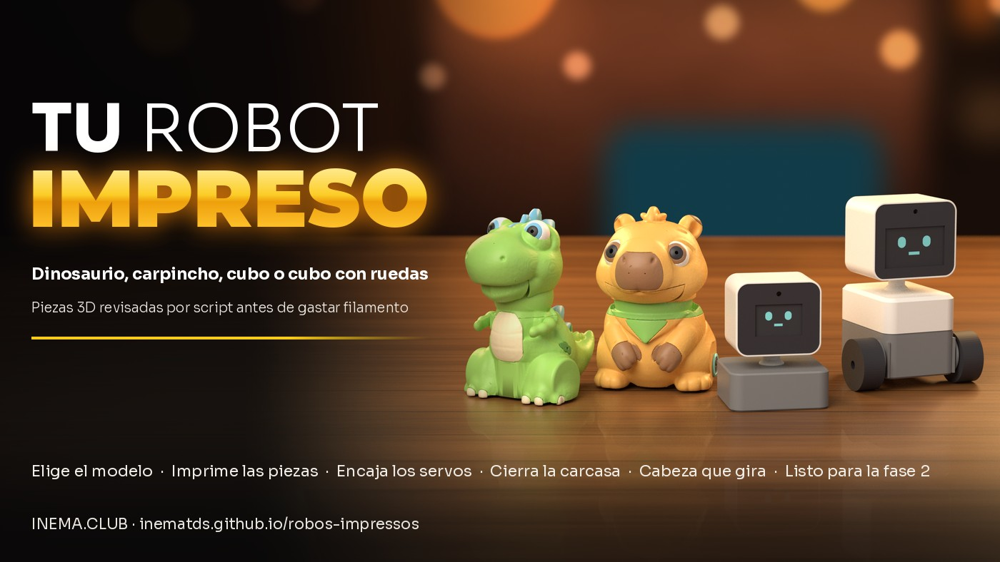

# robos-impressos — el cuerpo de tu robot de compañía, para imprimir en casa

**🇧🇷 [Português](README.md) · 🇺🇸 [English](README.en.md) · 🇪🇸 [Español](README.es.md)**

## Qué es

Quieres armar un robot simpático en casa y no sabes por dónde empezar con el cuerpo. **robos-impressos** es un conjunto de tres cuerpos de robot para imprimir en 3D: un dinosaurio y un carpincho de unos 33 cm, que se desplazan por el suelo, y un robot cuadrado de escritorio con una pantalla en la cara. Cada uno ya tiene el espacio adecuado para los motores, los servos (pequeños motores que giran hasta cierto ángulo y se detienen), la batería y las placas Arduino y Raspberry Pi. Es para quienes tienen acceso a una impresora 3D con una cama de 256 mm y quieren armar, aprender o enseñar robótica. Esta es la fase 1, solo el cuerpo y los encajes: el cableado, la voz y la inteligencia quedan para la fase 2. Y una advertencia honesta: es un proyecto digital revisado con un script; nadie ha impreso estas piezas todavía.

## 📖 Guía de uso

Guía completa (qué es, cómo se mueven, paso a paso): **https://inematds.github.io/robos-impressos/guia/es/**

Plan detallado (decisiones, piezas, fuentes de las medidas, montaje tornillo por tornillo, fase 2): [PLANO.md](PLANO.md) (en portugués)

| Dinosaurio | Carpincho | Robot cuadrado |
|---|---|---|
|  |  |  |

Las imágenes son **renders** de las piezas del proyecto. El banner es una ilustración hecha con IA.

<!-- TABELA:resumo -->
| Modelo | Altura (mm) | Piezas | Camas (impresiones) | Filamento total (g)* | Impresión total (h)* | Robot armado (g)* |
|---|---|---|---|---|---|---|
| Dinosaurio | 329 | 38 | 12 | 1107 | 44 | 1666 |
| Carpincho | 326 | 39 | 13 | 1049 | 42 | 1581 |
| Robot cuadrado | 201 | 14 | 8 | 638 | 25 | 1020 |

* estimación por volumen, sin laminador
<!-- /TABELA -->

## Qué hay aquí

| Ruta | Contenido |
|---|---|
| `PLANO.md` | Decisiones de diseño, lista de piezas, fuentes de las medidas, montaje y lo que ya está preparado para la fase 2 |
| `comum/cad/parametros.py` | **Todas las medidas** en un solo archivo: holguras, componentes (con la fuente), forma de cada robot |
| `comum/cad/gerar.py` | Genera STL, 3MF, `montagem.json`, `montagem.glb` y `mesas.json` de cada modelo |
| `comum/cad/verificar.py` | 9 pruebas de los archivos exportados (malla cerrada, cabe en la cama, pared, interferencia, pieza suelta, equilibrio, ruta de montaje) |
| `comum/cad/comum/` | Estructura común (chasis, bandejas, cuello), carcasa de los animales, componentes y geometría |
| `projetos/<modelo>/modelo.py` | El modelo de cada robot: `dino`, `capivara`, `cubo`, `cubo-rodas` |
| `projetos/<modelo>/stl` y `3mf` | Piezas de cada modelo, ya en posición de impresión |
| `projetos/<modelo>/mesas/` | Un 3MF por cama de impresión (piezas agrupadas por color y material) |
| `comum/pecas/` | Piezas iguales en los dos animales (chasis, bandejas, horquilla, soporte, cubierta de la esfera, pasador, buje, pieza de prueba) |
| `projetos/TABELAS.md` | Tablas de piezas y resultado del verificador (generadas) |
| `projetos/<modelo>/imagens/` | Renders: ensamblado, cuatro vistas, explotado, estructura y camas |
| `guia/` | Página de la guía en PT, `guia/en/` y `guia/es/` (generada por `guia/src/montar.py`) |

## Los tres modelos en una línea

- **Dinosaurio:** con ruedas (2 motores TT en las piernas + esfera bajo la cola) · cuello pan + tilt · boca · 2 brazos.
- **Carpincho:** con ruedas (ruedas dentro de los muslos, esfera en la cola) · cuello pan + tilt · boca · la misma estructura que el dinosaurio.
- **Robot cuadrado:** de escritorio · cabeza cúbica con pantalla de 3,5" y Raspberry Pi · pan ±170° mediante engranajes 2:1 · tilt.

## El proceso, de principio a fin

Leyenda: 🧠 tú · ⚙️ comando/script · 🤖 `claude -p`

| # | Paso | Comando | Quién |
|---|---|---|---|
| 1 | Descargar el proyecto (o el [ZIP](https://github.com/inematds/robos-impressos/archive/refs/heads/main.zip), si solo vas a imprimir) | `git clone https://github.com/inematds/robos-impressos.git && cd robos-impressos` | ⚙️ |
| 2 | Elegir el modelo y leer la lista de piezas | [PLANO.md › Peças impressas](PLANO.md#2-peças-impressas) (en portugués) | 🧠 |
| 3 | Imprimir la pieza de prueba y revisar el servo, el inserto roscado y el pasador | `comum/pecas/stl/comum-teste-encaixe.stl` en el slicer | 🧠 |
| 4 | Medir los componentes marcados **NC** y corregir las medidas | editar `comum/cad/parametros.py` | 🧠 |
| 5 | Crear el entorno Python 3.12+ (solo si vas a generar todo de nuevo) | `python3 -m venv .venv && .venv/bin/pip install -r requirements.txt` | ⚙️ |
| 6 | Generar las piezas | `.venv/bin/python comum/cad/gerar.py todos` | ⚙️ |
| 7 | Verificar (debe terminar con "TUDO PASSOU") | `.venv/bin/python comum/cad/verificar.py todos` | ⚙️ |
| 8 | Actualizar las tablas y los renders | `.venv/bin/python comum/cad/tabelas.py && comum/cad/renders.sh dino` | ⚙️ |
| 9 | Imprimir por color: un 3MF por cama | `projetos/<modelo>/mesas/*.3mf` en el slicer | 🧠 |
| 10 | Comprar los componentes | [PLANO.md › Peças compradas](PLANO.md#3-peças-compradas-estimativa-de-preço-nov2026-lojas-brasileiras) (en portugués) | 🧠 |
| 11 | Armar de adentro hacia afuera | [PLANO.md › Montagem](PLANO.md#6-montagem-passo-a-passo) (en portugués) | 🧠 |
| 12 | Cambió la guía: volver a generarla y traducirla | `python3 guia/src/montar.py && python3 guia/src/traduzir.py && python3 guia/src/montar.py && .venv/bin/python comum/cad/tabelas.py` | ⚙️ |
| 13 | Publicar | `git add -A && git commit && git push` (GitHub Pages) | 🧠 |

Actualmente, ningún paso usa `claude -p`.

## Estado

Versión **v1.0.2**. Los tres modelos pasan las 9 pruebas del verificador. **No se ha impreso ni armado nada**: las holguras, las medidas sin fuente (marcadas NC) y los tiempos de impresión son valores iniciales. La fase 2 (electrónica, voz, visión, navegación, IA) aún no ha comenzado.

---

Hecho por [INEMA.CLUB](https://inema.club).
