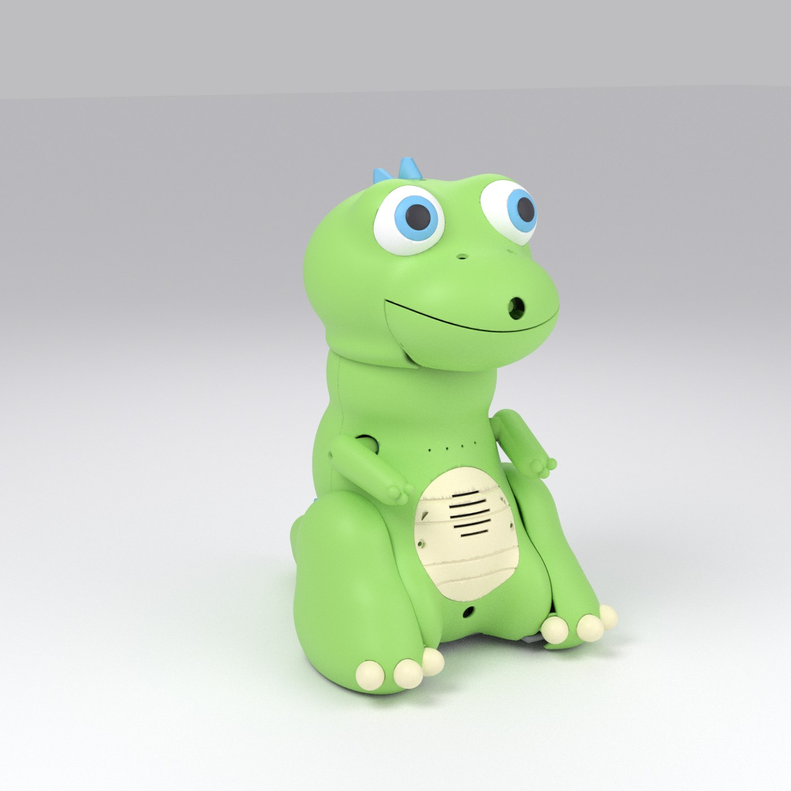
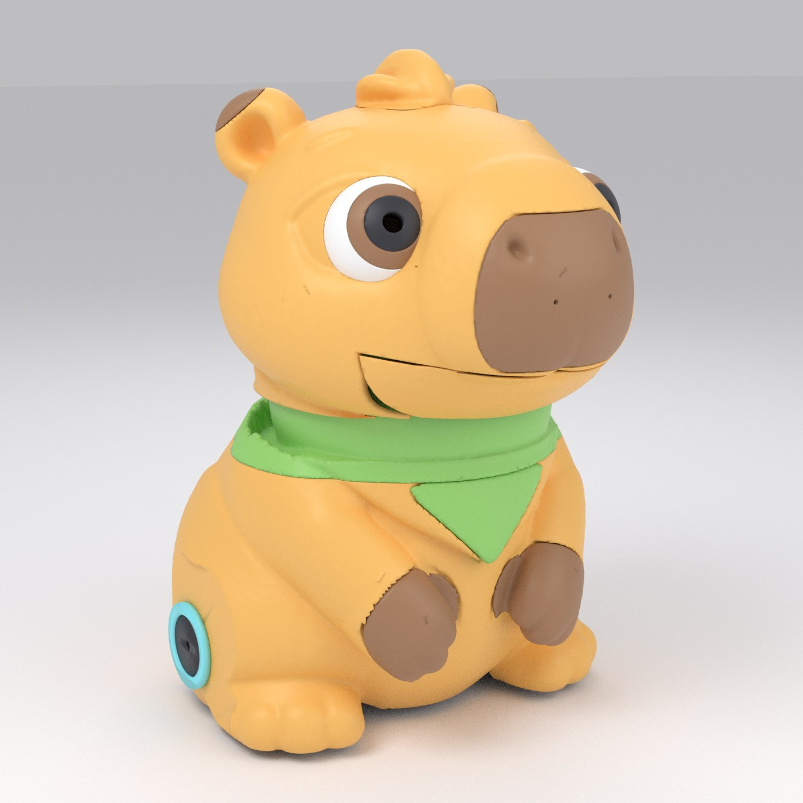
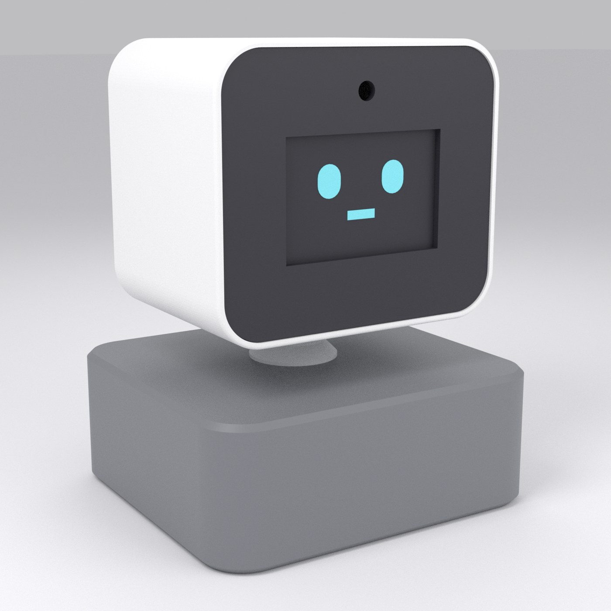
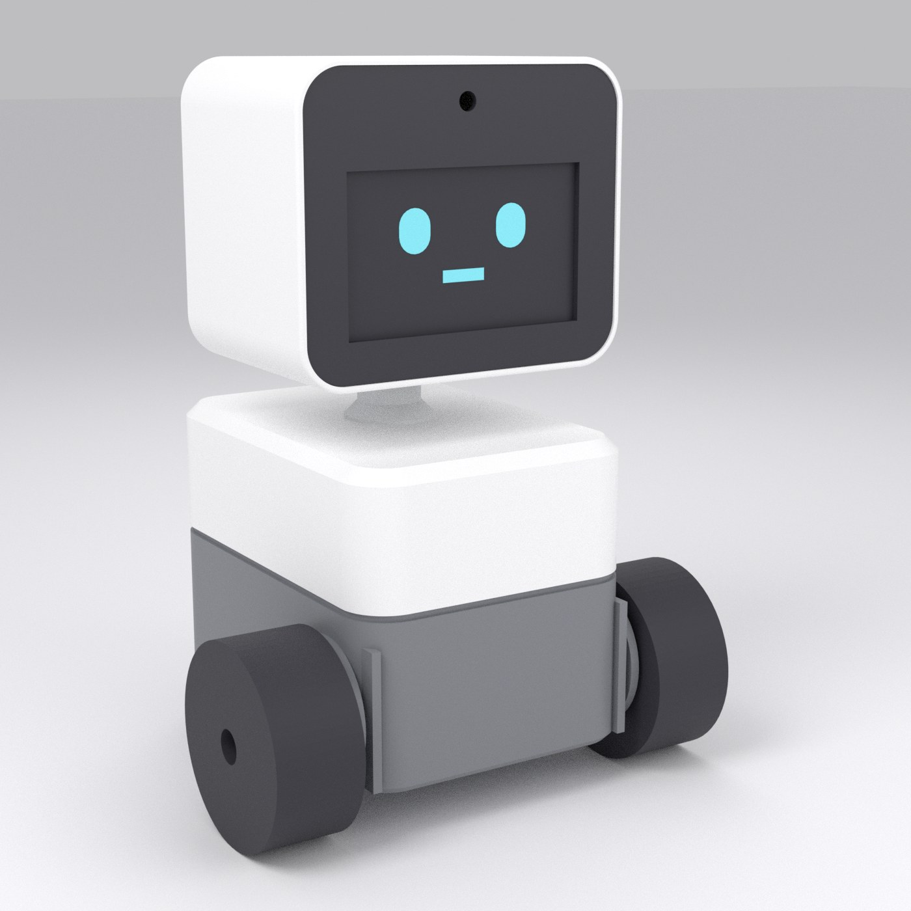

# robos-impressos — el cuerpo de tu robot mascota, para imprimir en casa

**🇧🇷 [Português](README.md) · 🇺🇸 [English](README.en.md) · 🇪🇸 [Español](README.es.md)**

## Qué es

Quieres armar un robot simpático en casa y no sabes por dónde empezar: qué pieza imprimir, qué comprar, dónde va cada cable. **robos-impressos** es un conjunto de cuatro robots para imprimir en 3D: un dinosaurio y un carpincho de 30 cm, que se desplazan por el suelo; un robot cuadrado de mesa, con una pantalla en la cara; y un robot cuadrado de 30 cm, con ruedas. Cada uno tiene su propia carpeta, con los archivos ya orientados para imprimir, la lista de compras con precios estimados y enlaces, la guía de impresión y el esquema de conexión cable por cable. Es para quienes tienen acceso a una impresora 3D con una cama de 256 mm y quieren armar, aprender o enseñar robótica. Esta es la fase 1: el cuerpo impreso, armado y conectado. El programa (desplazamiento, voz, cámara, inteligencia) es la fase 2 y todavía no está hecho. Y una advertencia honesta: es un proyecto digital verificado con un script. Nadie ha impreso estas piezas todavía y la parte eléctrica no se ha probado en el banco de trabajo.

## 📖 Guía de uso

Guía completa (qué es cada robot, cómo se mueve, paso a paso): **https://inematds.github.io/robos-impressos/guia/es/**

## Los cuatro robots

| Dinosaurio | Carpincho | Robot cuadrado de mesa | Robot cuadrado con ruedas |
|---|---|---|---|
|  |  |  |  |
| Se desplaza, gira e inclina la cabeza, abre la boca y mueve los 2 brazos | Se desplaza, gira e inclina la cabeza y abre la boca | De mesa: cabeza con pantalla de 3,5", gira ±170° y se inclina | Se desplaza con 2 motores con encoder; cabeza con pantalla de 5", gira ±170° y se inclina |
| [projetos/dino/](projetos/dino/README.md) | [projetos/capivara/](projetos/capivara/README.md) | [projetos/cubo/](projetos/cubo/README.md) | [projetos/cubo-rodas/](projetos/cubo-rodas/README.md) |
| [comprar](projetos/dino/LISTA-DE-COMPRAS.es.md) · [imprimir](projetos/dino/IMPRIMIR.es.md) · [conectar](projetos/dino/LIGACAO.es.md) · [plan](projetos/dino/PLANO.md) | [comprar](projetos/capivara/LISTA-DE-COMPRAS.es.md) · [imprimir](projetos/capivara/IMPRIMIR.es.md) · [conectar](projetos/capivara/LIGACAO.es.md) · [plan](projetos/capivara/PLANO.md) | [comprar](projetos/cubo/LISTA-DE-COMPRAS.es.md) · [imprimir](projetos/cubo/IMPRIMIR.es.md) · [conectar](projetos/cubo/LIGACAO.es.md) · [plan](projetos/cubo/PLANO.md) | [comprar](projetos/cubo-rodas/LISTA-DE-COMPRAS.es.md) · [imprimir](projetos/cubo-rodas/IMPRIMIR.es.md) · [conectar](projetos/cubo-rodas/LIGACAO.es.md) · [plan](projetos/cubo-rodas/PLANO.md) |

Las imágenes y el banner son **renders** de las piezas del proyecto.

<!-- TABELA:resumo -->
| Modelo | Altura (mm) | Piezas | Camas (impresiones) | Filamento total (g)* | Impresión total (h)* | Robot armado (g)* |
|---|---|---|---|---|---|---|
| Dinosaurio | 300 | 34 | 12 | 1010 | 40 | 1605 |
| Carpincho | 300 | 32 | 11 | 1129 | 44 | 1714 |
| Robot cuadrado | 200 | 15 | 7 | 735 | 28 | 1147 |
| Robot cuadrado con ruedas | 306 | 19 | 8 | 1143 | 43 | 2214 |

* estimación por volumen, sin laminador
<!-- /TABELA -->

## Qué incluye cada robot

Cada carpeta `projetos/<robô>/` (`dino`, `capivara`, `cubo`, `cubo-rodas`) es un proyecto completo:

| Archivo | Para qué sirve |
|---|---|
| `README.md` | Qué es el robot, el armado paso a paso, cómo abrirlo, la alimentación y la verificación |
| `LISTA-DE-COMPRAS.md` | Qué comprar: cantidad, para qué sirve, rango de precio y enlace de búsqueda. La fase 2 está separada |
| `IMPRIMIR.md` | Cómo imprimir: orden de las camas, orientación, soportes, paredes y relleno de cada pieza |
| `LIGACAO.md` + `ligacao.pt.svg` | Esquema de conexión y tabla cable por cable, con los preparativos del banco de trabajo |
| `PLANO.md` | Las decisiones del proyecto del robot y sus motivos, la fase 2 y los pendientes |
| `<robô>-stl.zip` | Todo para imprimir en un solo archivo: STL, 3MF de las camas, programa de Arduino y guías |
| `stl/`, `3mf/`, `mesas/` | Una pieza por archivo, ya orientada para imprimir, y un 3MF por cama (piezas agrupadas por color) |
| `firmware/` | Programa de Arduino que centra los servos antes del armado |
| `imagens/` | Renders del modelo: armado, 4 vistas, explotado, esqueleto y camas |
| `modelo.py`, `montagem.json`, `verificacao.json` | El diseño del robot en código, el resultado generado y el resultado de las pruebas |

Las guías de compra, impresión y conexión también están disponibles en inglés (`.en.md`) y en español (`.es.md`). El README y el plan de cada robot están solo en portugués.

## Qué tienen en común los cuatro

La carpeta [`comum/`](comum/README.md) (en portugués) contiene lo que comparten los robots:

- **El código** (`comum/cad/`): todas las medidas en un solo archivo (`parametros.py`), la biblioteca de formas, el generador de piezas y el verificador.
- **Las piezas iguales** (`comum/pecas/`): el cupón de prueba (de los 4 robots) y, en los dos animales, la horquilla del cuello, la cuna del tilt y la cubierta de la esfera.
- **Las mismas reglas**: cabe en la cama de 256 mm, pared de 2 mm o más, sin soportes siempre que sea posible, tornillos solo por debajo, por detrás o por dentro.
- **La misma electrónica básica**: Raspberry Pi, Arduino Uno con Sensor Shield, servos MG996R, baterías 18650 con placa de protección y carga por USB-C.

Las decisiones que se aplican a todos, la tabla de semejanza con las referencias y el resumen de imprimibilidad están en [PLANO.md](PLANO.md) (en portugués).

## El proceso, de principio a fin

Leyenda: 🧠 tú · ⚙️ comando/script · 🤖 `claude -p`

**Para hacer un robot** (no hace falta instalar nada):

| # | Paso | Comando o archivo | Quién |
|---|---|---|---|
| 1 | Elegir el robot y leer el resumen | `projetos/<robô>/README.md` | 🧠 |
| 2 | Descargar los archivos | `projetos/<robô>/<robô>-stl.zip` (o `git clone https://github.com/inematds/robos-impressos.git`) | 🧠 |
| 3 | Leer los riesgos y comprar las piezas | `projetos/<robô>/LISTA-DE-COMPRAS.md` | 🧠 |
| 4 | Imprimir el cupón de prueba y revisar los insertos roscados, los tornillos y el servo | `comum/pecas/stl/comum-teste-encaixe.stl` en el laminador | 🧠 |
| 5 | Medir los componentes marcados **NC** | calibrador; si la medida no coincide, ir al paso 9 | 🧠 |
| 6 | Imprimir las camas en el orden sugerido | `projetos/<robô>/IMPRIMIR.md` y `projetos/<robô>/mesas/*.3mf` | 🧠 |
| 7 | Preparar el banco de trabajo: alimentación, servos centrados, cables, tarjeta de Raspberry Pi | `projetos/<robô>/LIGACAO.md` y `projetos/<robô>/firmware/` | 🧠 |
| 8 | Colocar los insertos roscados y armar | `projetos/<robô>/README.md › Montagem` | 🧠 |

**Para modificar el proyecto** (medida, pieza o texto):

| # | Paso | Comando | Quién |
|---|---|---|---|
| 9 | Crear el entorno Python 3.12+ | `python3 -m venv .venv && .venv/bin/pip install -r requirements.txt` | ⚙️ |
| 10 | Cambiar la medida o el diseño | editar `comum/cad/parametros.py` o `projetos/<robô>/modelo.py` | 🧠 |
| 11 | Generar las piezas | `.venv/bin/python comum/cad/gerar.py <id\|todos>` (id: `dino`, `capivara`, `cubo`, `cubo_rodas`) | ⚙️ |
| 12 | Verificar: debe terminar en "TUDO PASSOU" | `.venv/bin/python comum/cad/verificar.py <id\|todos>` | ⚙️ |
| 13 | Volver a generar las imágenes (se necesita Blender) | `comum/cad/renders.sh <id>` | ⚙️ |
| 14 | Volver a generar las tablas de los documentos de la raíz | `.venv/bin/python comum/cad/tabelas.py --docs` | ⚙️ |
| 15 | Volver a generar los documentos del robot en portugués | `.venv/bin/python guia/src/pagina_robo.py docs <robô> pt` | ⚙️ |
| 16 | Traducir al inglés y al español (solo lo que cambió) | `.venv/bin/python guia/src/pagina_robo.py traduzir <robô>` | ⚙️ |
| 17 | Volver a generar los documentos traducidos, el esquema y el zip | `.venv/bin/python guia/src/pagina_robo.py docs <robô>`, después `esquema <robô>` y `zip <robô>` | ⚙️ |
| 18 | Rehacer toda la guía (página de inicio, página de cada robot y página de evolución del diseño) y revisar todas las páginas | `.venv/bin/python guia/src/tudo.py` | ⚙️ |
| 19 | O rehacer solo la página de un robot y revisar los enlaces, los idiomas y el zip | `.venv/bin/python guia/src/pagina_robo.py pagina <robô>` → `conferir <robô>` | ⚙️ |
| 20 | Traducir este README | `.venv/bin/python guia/src/traduzir_readme.py && .venv/bin/python comum/cad/tabelas.py --docs` | ⚙️ |
| 21 | Publicar | `git add`, `git commit` y `git push` (GitHub Pages) | 🧠 |

En los pasos 15 a 19, `<robô>` es el nombre de la carpeta: `dino`, `capivara`, `cubo` o `cubo-rodas`. La traducción usa el comando
`inema-traduz`, que pertenece a la máquina de quien mantiene el proyecto. Actualmente, ningún paso usa `claude -p`.

## Estado

Versión **v1.1.2**. Los cuatro robots pasan las 11 pruebas del verificador: malla cerrada, cabe en la cama, pared, interferencia, pieza suelta, equilibrio, secuencia de armado e imprimibilidad. **Nada se ha impreso ni armado, y la parte eléctrica no se ha probado en el banco de trabajo**: las holguras, las medidas sin fuente (marcadas NC), los precios y los tiempos de impresión son puntos de partida. La fase 2 (programa, voz, visión, navegación, IA) aún no ha comenzado; las piezas ya tienen el espacio para la cámara y los sensores.

---

Hecho por [INEMA.CLUB](https://inema.club).
