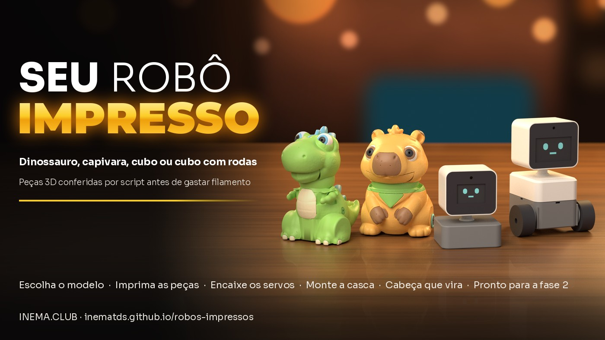
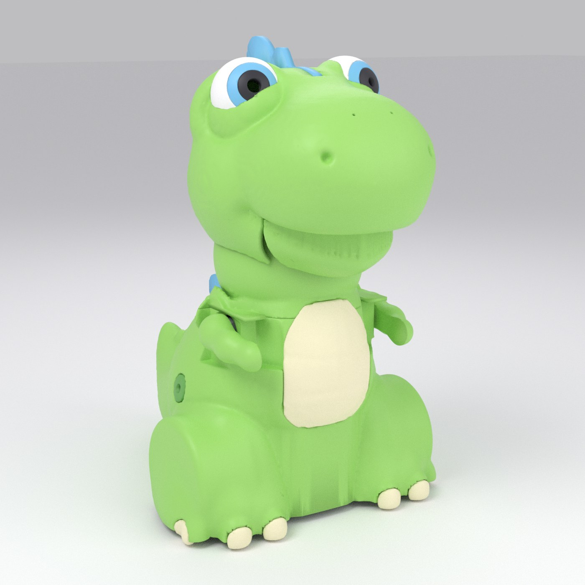
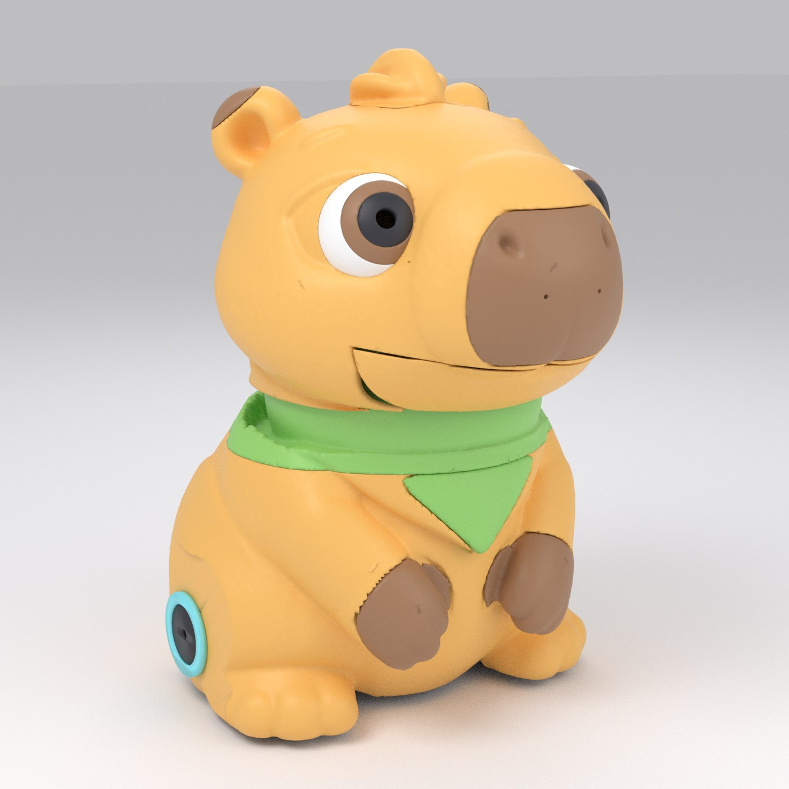
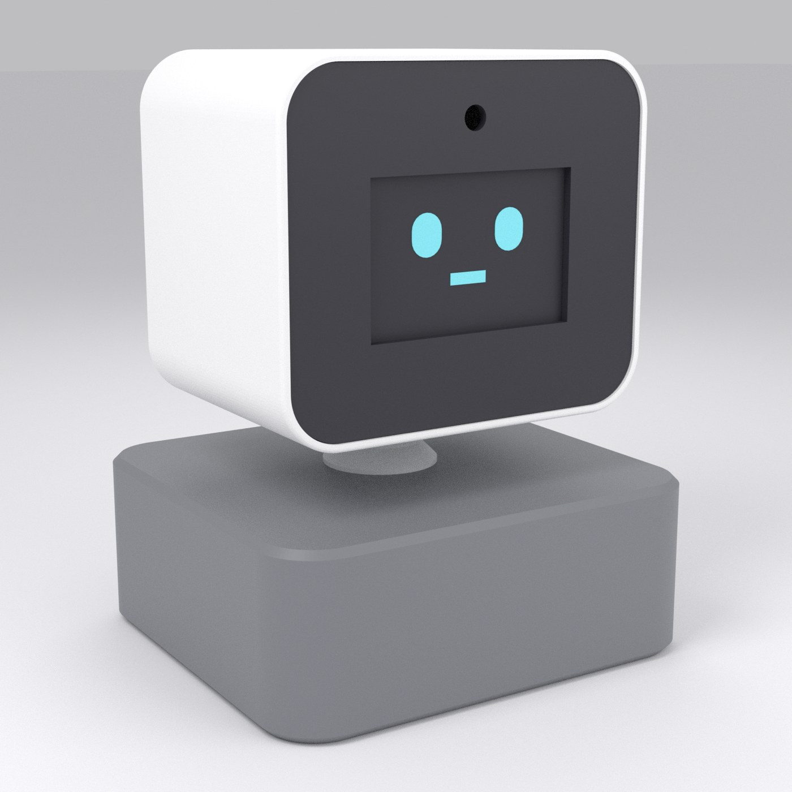
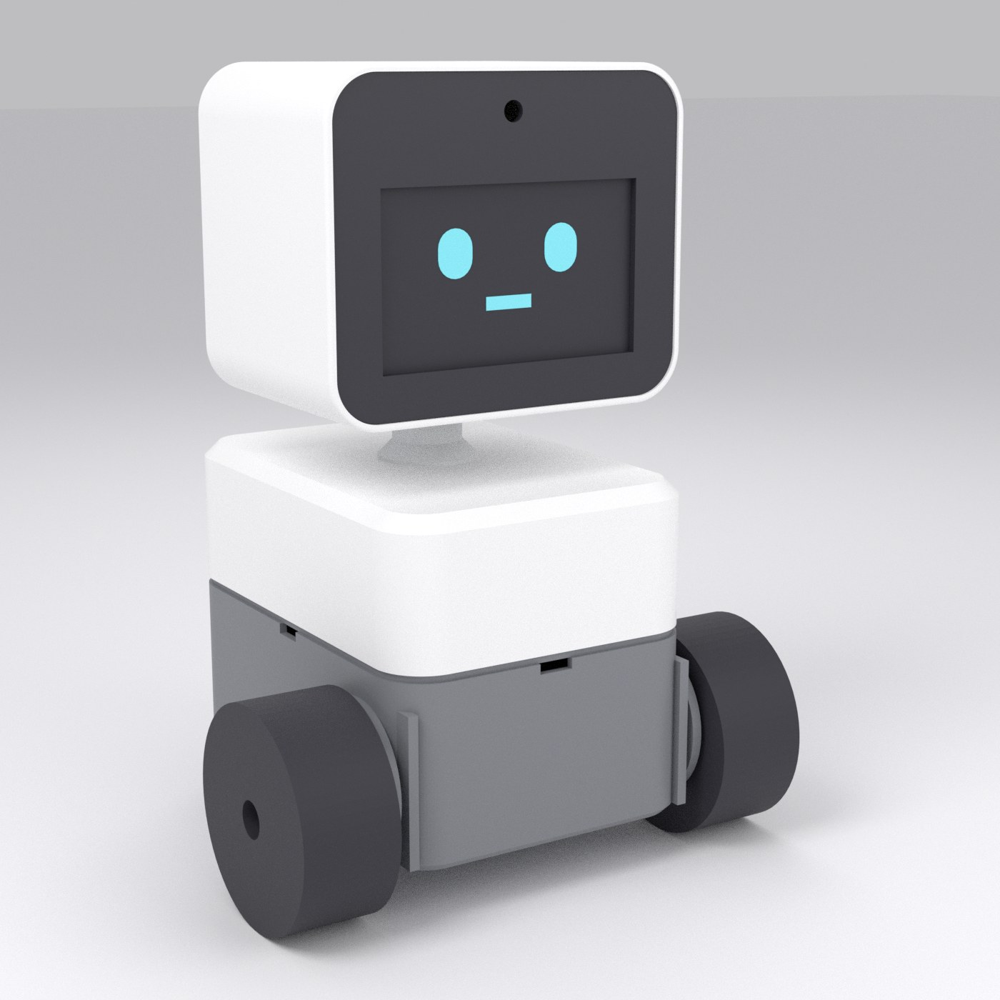

# robos-impressos — o corpo do seu robô de estimação, para imprimir em casa

**🇧🇷 [Português](README.md) · 🇺🇸 [English](README.en.md) · 🇪🇸 [Español](README.es.md)**

## O que é

Você quer montar um robô simpático em casa e não sabe por onde começar: que peça imprimir, o que comprar, onde vai cada fio. O **robos-impressos** é um conjunto de quatro robôs para imprimir em 3D: um dinossauro e uma capivara de 30 cm, que rodam pelo chão; um robô quadrado de mesa, com tela no rosto; e um robô quadrado de 30 cm, que roda. Cada um tem a sua pasta, com os arquivos já na posição de impressão, a lista de compras com preço estimado e link, o guia de impressão e o esquema de ligação fio a fio. Serve para quem tem acesso a uma impressora 3D com mesa de 256 mm e quer montar, aprender ou ensinar robótica. Esta é a fase 1: o corpo impresso, montado e ligado. O programa (andar, voz, câmera, inteligência) é a fase 2 e ainda não foi feito. E um aviso honesto: é um projeto digital conferido por script. Ninguém imprimiu estas peças ainda, e a parte elétrica não foi testada na bancada.

## 📖 Guia de uso

Guia completo (o que é cada robô, como se move, passo a passo): **https://inematds.github.io/robos-impressos/guia/**

## Os quatro robôs

| Dinossauro | Capivara | Robô quadrado de mesa | Robô quadrado que roda |
|---|---|---|---|
|  |  |  |  |
| Roda, vira e inclina a cabeça, abre a boca e mexe os 2 braços | Roda, vira e inclina a cabeça e abre a boca | De mesa: cabeça com tela de 3,5", gira ±170° e inclina | Roda com 2 motores com encoder; cabeça com tela de 5", gira ±170° e inclina |
| [projetos/dino/](projetos/dino/README.md) | [projetos/capivara/](projetos/capivara/README.md) | [projetos/cubo/](projetos/cubo/README.md) | [projetos/cubo-rodas/](projetos/cubo-rodas/README.md) |
| [comprar](projetos/dino/LISTA-DE-COMPRAS.md) · [imprimir](projetos/dino/IMPRIMIR.md) · [ligar](projetos/dino/LIGACAO.md) · [plano](projetos/dino/PLANO.md) | [comprar](projetos/capivara/LISTA-DE-COMPRAS.md) · [imprimir](projetos/capivara/IMPRIMIR.md) · [ligar](projetos/capivara/LIGACAO.md) · [plano](projetos/capivara/PLANO.md) | [comprar](projetos/cubo/LISTA-DE-COMPRAS.md) · [imprimir](projetos/cubo/IMPRIMIR.md) · [ligar](projetos/cubo/LIGACAO.md) · [plano](projetos/cubo/PLANO.md) | [comprar](projetos/cubo-rodas/LISTA-DE-COMPRAS.md) · [imprimir](projetos/cubo-rodas/IMPRIMIR.md) · [ligar](projetos/cubo-rodas/LIGACAO.md) · [plano](projetos/cubo-rodas/PLANO.md) |

As imagens e o banner são **renders** das peças do projeto.

<!-- TABELA:resumo -->
| Modelo | Altura (mm) | Peças | Mesas (impressões) | Filamento total (g)* | Impressão total (h)* | Robô montado (g)* |
|---|---|---|---|---|---|---|
| Dinossauro | 300 | 34 | 12 | 1010 | 40 | 1605 |
| Capivara | 300 | 32 | 11 | 1129 | 44 | 1714 |
| Robô quadrado | 200 | 15 | 7 | 735 | 28 | 1147 |
| Robô quadrado que roda | 306 | 19 | 8 | 1143 | 43 | 2214 |

* estimativa por volume, sem fatiador
<!-- /TABELA -->

## O que tem em cada robô

Cada pasta `projetos/<robô>/` (`dino`, `capivara`, `cubo`, `cubo-rodas`) é um projeto completo:

| Arquivo | Para quê |
|---|---|
| `README.md` | O que é o robô, a montagem passo a passo, como abrir, a energia e a verificação |
| `LISTA-DE-COMPRAS.md` | O que comprar: quantidade, para que serve, faixa de preço e link de busca. A fase 2 vem separada |
| `IMPRIMIR.md` | Como imprimir: ordem das mesas, orientação, suporte, paredes e preenchimento de cada peça |
| `LIGACAO.md` + `ligacao.pt.svg` | Esquema de ligação e tabela fio a fio, com os preparos da bancada |
| `PLANO.md` | As decisões do projeto do robô e os porquês, a fase 2 e as pendências |
| `<robô>-stl.zip` | Tudo para imprimir num arquivo só: STL, 3MF das mesas, programa do Arduino e guias |
| `stl/`, `3mf/`, `mesas/` | Uma peça por arquivo, já na posição de impressão, e um 3MF por mesa (peças juntas por cor) |
| `firmware/` | Programa do Arduino que põe os servos no centro antes da montagem |
| `imagens/` | Renders do modelo: montado, 4 vistas, explodido, esqueleto e mesas |
| `modelo.py`, `montagem.json`, `verificacao.json` | O desenho do robô em código, o resultado gerado e o resultado dos testes |

Os guias de compra, impressão e ligação também existem em inglês (`.en.md`) e em espanhol (`.es.md`). O README e o plano de cada robô estão só em português.

## O que é comum aos quatro

A pasta [`comum/`](comum/README.md) guarda o que os robôs dividem:

- **O código** (`comum/cad/`): todas as medidas num arquivo só (`parametros.py`), a biblioteca de formas, o gerador das peças e o verificador.
- **As peças iguais** (`comum/pecas/`): o cupom de teste (dos 4 robôs) e, nos dois bichos, o garfo do pescoço, o berço do tilt e a capa da esfera.
- **As mesmas regras**: cabe na mesa de 256 mm, parede de 2 mm ou mais, sem suporte sempre que dá, parafusos só por baixo, por trás ou por dentro.
- **A mesma eletrônica de base**: Raspberry Pi, Arduino Uno com Sensor Shield, servos MG996R, baterias 18650 com placa de proteção e carga por USB-C.

As decisões que valem para todos, a tabela de semelhança com as referências e o resumo da imprimibilidade estão em [PLANO.md](PLANO.md).

## O processo, do início ao fim

Legenda: 🧠 você · ⚙️ comando/script · 🤖 `claude -p`

**Para fazer um robô** (não precisa instalar nada):

| # | Passo | Comando ou arquivo | Quem |
|---|---|---|---|
| 1 | Escolher o robô e ler o resumo | `projetos/<robô>/README.md` | 🧠 |
| 2 | Baixar os arquivos | `projetos/<robô>/<robô>-stl.zip` (ou `git clone https://github.com/inematds/robos-impressos.git`) | 🧠 |
| 3 | Ler os riscos e comprar as peças | `projetos/<robô>/LISTA-DE-COMPRAS.md` | 🧠 |
| 4 | Imprimir o cupom de teste e conferir insertos, parafusos e servo | `comum/pecas/stl/comum-teste-encaixe.stl` no fatiador | 🧠 |
| 5 | Medir os componentes marcados **NC** | paquímetro; se a medida não bater, passo 9 | 🧠 |
| 6 | Imprimir as mesas na ordem sugerida | `projetos/<robô>/IMPRIMIR.md` e `projetos/<robô>/mesas/*.3mf` | 🧠 |
| 7 | Fazer os preparos da bancada: energia, servos no centro, cabos, cartão do Raspberry Pi | `projetos/<robô>/LIGACAO.md` e `projetos/<robô>/firmware/` | 🧠 |
| 8 | Assentar os insertos e montar | `projetos/<robô>/README.md › Montagem` | 🧠 |

**Para mudar o projeto** (medida, peça ou texto):

| # | Passo | Comando | Quem |
|---|---|---|---|
| 9 | Criar o ambiente Python 3.12+ | `python3 -m venv .venv && .venv/bin/pip install -r requirements.txt` | ⚙️ |
| 10 | Mudar a medida ou o desenho | editar `comum/cad/parametros.py` ou `projetos/<robô>/modelo.py` | 🧠 |
| 11 | Gerar as peças | `.venv/bin/python comum/cad/gerar.py <id\|todos>` (id: `dino`, `capivara`, `cubo`, `cubo_rodas`) | ⚙️ |
| 12 | Verificar: tem de terminar em "TUDO PASSOU" | `.venv/bin/python comum/cad/verificar.py <id\|todos>` | ⚙️ |
| 13 | Refazer as imagens (precisa do Blender) | `comum/cad/renders.sh <id>` | ⚙️ |
| 14 | Refazer as tabelas dos documentos da raiz | `.venv/bin/python comum/cad/tabelas.py --docs` | ⚙️ |
| 15 | Refazer os documentos do robô em português | `.venv/bin/python guia/src/pagina_robo.py docs <robô> pt` | ⚙️ |
| 16 | Traduzir para inglês e espanhol (só o que mudou) | `.venv/bin/python guia/src/pagina_robo.py traduzir <robô>` | ⚙️ |
| 17 | Refazer os documentos traduzidos, o esquema e o zip | `.venv/bin/python guia/src/pagina_robo.py docs <robô>`, depois `esquema <robô>` e `zip <robô>` | ⚙️ |
| 18 | Refazer a página do robô no guia | `.venv/bin/python guia/src/pagina_robo.py pagina <robô>` | ⚙️ |
| 19 | Conferir links, idiomas e zip | `.venv/bin/python guia/src/pagina_robo.py conferir <robô>` | ⚙️ |
| 20 | Traduzir este README | `.venv/bin/python guia/src/traduzir_readme.py && .venv/bin/python comum/cad/tabelas.py --docs` | ⚙️ |
| 21 | Publicar | `git add`, `git commit` e `git push` (GitHub Pages) | 🧠 |

Nos passos 15 a 19, `<robô>` é o nome da pasta: `dino`, `capivara`, `cubo` ou `cubo-rodas`. A tradução usa o comando
`inema-traduz`, que é da máquina de quem mantém o projeto. Nenhum passo usa `claude -p` hoje.

## Estado

Versão **v1.1.2**. Os quatro robôs passam nos 11 testes do verificador: malha fechada, cabe na mesa, parede, interferência, peça solta, equilíbrio, caminho de montagem e imprimibilidade. **Nada foi impresso nem montado, e a parte elétrica não foi testada na bancada**: folgas, medidas sem fonte (marcadas NC), preços e tempos de impressão são pontos de partida. A fase 2 (programa, voz, visão, navegação, IA) não foi começada; as peças já têm o lugar da câmera e dos sensores.

---

Feito por [INEMA.CLUB](https://inema.club).
