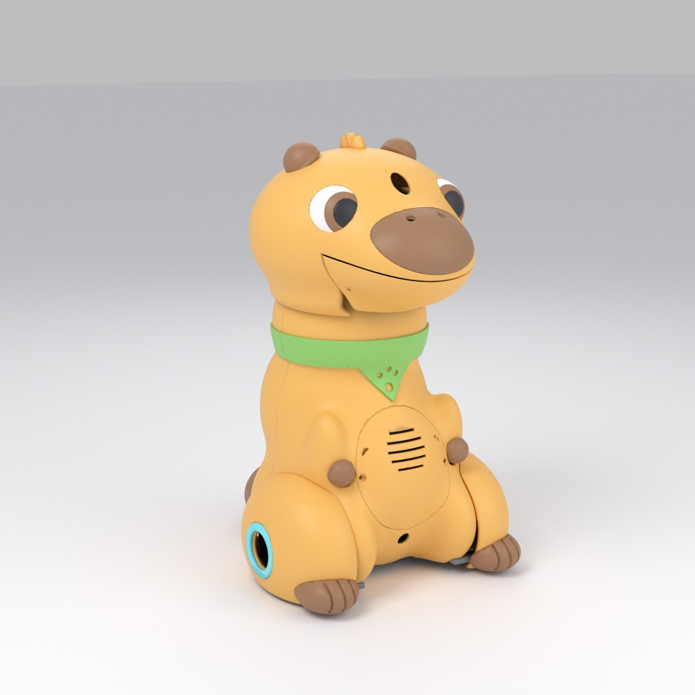
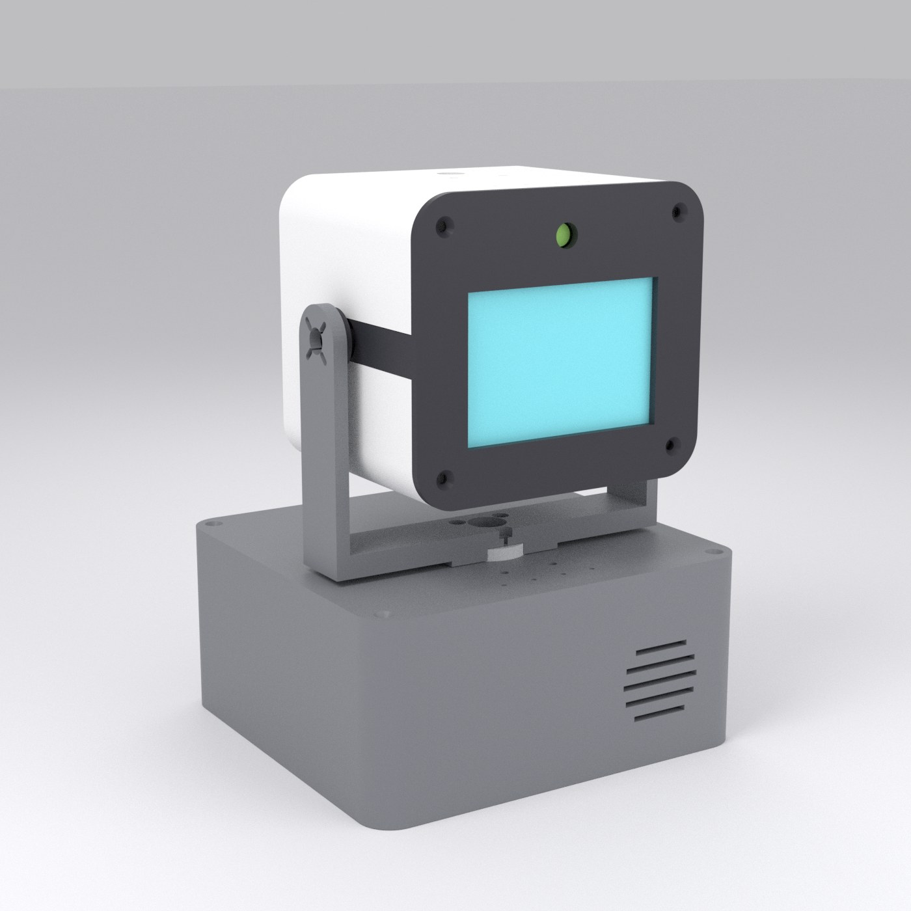

# robos-impressos — o corpo do seu robô de estimação, para imprimir em casa

**🇧🇷 [Português](README.md) · 🇺🇸 [English](README.en.md) · 🇪🇸 [Español](README.es.md)**

## O que é

Você quer montar um robô simpático em casa e não sabe por onde começar o corpo. O **robos-impressos** é um conjunto de três corpos de robô para imprimir em 3D: um dinossauro e uma capivara de uns 33 cm, que rodam pelo chão, e um robô quadrado de mesa com tela no rosto. Cada um já tem o lugar certo para os motores, os servos (motorzinhos que giram até um ângulo e param), a bateria e as placas Arduino e Raspberry Pi. Serve para quem tem acesso a uma impressora 3D com mesa de 256 mm e quer montar, aprender ou ensinar robótica. Esta é a fase 1, só o corpo e os encaixes: fiação, voz e inteligência ficam para a fase 2. E um aviso honesto: é um projeto digital conferido por script, ninguém imprimiu estas peças ainda.

## 📖 Guia de uso

Guia completo (o que é, como se movem, passo a passo): **https://inematds.github.io/robos-impressos/guia/**

Plano detalhado (decisões, peças, fontes das medidas, montagem parafuso por parafuso, fase 2): [PLANO.md](PLANO.md)

| Dinossauro | Capivara | Robô quadrado |
|---|---|---|
|  |  |  |

As imagens são **renders** das peças do projeto. O banner é uma ilustração feita por IA.

<!-- TABELA:resumo -->
| Modelo | Altura (mm) | Peças | Mesa (1 mesa = 1 impressão) | Filamento total (g)* | Impressão total (h)* | Robô montado (g)* |
|---|---|---|---|---|---|---|
| Dinossauro | 329 | 38 | 12 | 1108 | 44 | 1668 |
| Capivara | 326 | 39 | 13 | 1050 | 42 | 1583 |
| Robô quadrado | 201 | 14 | 8 | 638 | 25 | 1020 |

* estimativa por volume, sem fatiador
<!-- /TABELA -->

## O que tem aqui

| Caminho | Conteúdo |
|---|---|
| `PLANO.md` | Decisões de projeto, lista de peças, fontes das medidas, montagem e o que já está preparado para a fase 2 |
| `cad/parametros.py` | **Todas as medidas** num arquivo só: folgas, componentes (com a fonte), forma de cada robô |
| `cad/gerar.py` | Gera STL, 3MF, `montagem.json`, `montagem.glb` e `mesas.json` de cada modelo |
| `cad/verificar.py` | 9 testes sobre os arquivos exportados (malha fechada, cabe na mesa, parede, interferência, peça solta, equilíbrio, caminho de montagem) |
| `cad/comum/` | Esqueleto comum (chassi, bandejas, pescoço), casca dos bichos, componentes e geometria |
| `cad/modelos/` | `dino.py`, `capivara.py`, `cubo.py` |
| `pecas/<modelo>/stl` e `3mf` | Peças de cada modelo, já na posição de impressão |
| `pecas/<modelo>/mesas/` | Um 3MF por mesa de impressão (peças juntas por cor e material) |
| `pecas/comum/` | Peças iguais nos dois bichos (chassi, bandejas, garfo, berço, capa da esfera, pino, bucha, peça de teste) |
| `pecas/TABELAS.md` | Tabelas de peças e saída do verificador (geradas) |
| `imagens/` | Renders: montado, quatro vistas, explodido, esqueleto e mesas |
| `guia/` | Página do guia em PT, `guia/en/` e `guia/es/` (montada por `guia/src/montar.py`) |

## Os três modelos em uma linha

- **Dinossauro:** roda (2 motores TT nas pernas + esfera sob a cauda) · pescoço pan + tilt · boca · 2 braços.
- **Capivara:** roda (rodas dentro das coxas, esfera no rabo) · pescoço pan + tilt · boca · mesmo esqueleto do dinossauro.
- **Robô quadrado:** de mesa · cabeça-cubo com tela de 3,5" e Raspberry Pi · pan ±170° por engrenagens 2:1 · tilt.

## O processo, do início ao fim

Legenda: 🧠 você · ⚙️ comando/script · 🤖 `claude -p`

| # | Passo | Comando | Quem |
|---|---|---|---|
| 1 | Baixar o projeto (ou o [ZIP](https://github.com/inematds/robos-impressos/archive/refs/heads/main.zip), se for só imprimir) | `git clone https://github.com/inematds/robos-impressos.git && cd robos-impressos` | ⚙️ |
| 2 | Escolher o modelo e ler a lista de peças | [PLANO.md › Peças impressas](PLANO.md#2-peças-impressas) | 🧠 |
| 3 | Imprimir a peça de teste e conferir servo, inserto e pino | `pecas/comum/stl/comum-teste-encaixe.stl` no fatiador | 🧠 |
| 4 | Medir os componentes marcados **NC** e corrigir as medidas | editar `cad/parametros.py` | 🧠 |
| 5 | Criar o ambiente Python 3.12+ (só se for gerar de novo) | `python3 -m venv .venv && .venv/bin/pip install -r requirements.txt` | ⚙️ |
| 6 | Gerar as peças | `.venv/bin/python cad/gerar.py todos` | ⚙️ |
| 7 | Verificar (tem que terminar em "TUDO PASSOU") | `.venv/bin/python cad/verificar.py todos` | ⚙️ |
| 8 | Atualizar tabelas e renders | `.venv/bin/python cad/tabelas.py && cad/renders.sh dino` | ⚙️ |
| 9 | Imprimir por cor: um 3MF por mesa | `pecas/<modelo>/mesas/*.3mf` no fatiador | 🧠 |
| 10 | Comprar os componentes | [PLANO.md › Peças compradas](PLANO.md#3-peças-compradas-estimativa-de-preço-nov2026-lojas-brasileiras) | 🧠 |
| 11 | Montar de dentro para fora | [PLANO.md › Montagem](PLANO.md#6-montagem-passo-a-passo) | 🧠 |
| 12 | Mudou o guia: remontar e traduzir | `python3 guia/src/montar.py && python3 guia/src/traduzir.py && python3 guia/src/montar.py && .venv/bin/python cad/tabelas.py` | ⚙️ |
| 13 | Publicar | `git add -A && git commit && git push` (GitHub Pages) | 🧠 |

Nenhum passo usa `claude -p` hoje.

## Estado

Versão **v1.0.0**. Os três modelos passam nos 9 testes do verificador. **Nada foi impresso nem montado**: folgas, medidas sem fonte (marcadas NC) e tempos de impressão são pontos de partida. A fase 2 (eletrônica, voz, visão, navegação, IA) não foi começada.

---

Feito por [INEMA.CLUB](https://inema.club).
