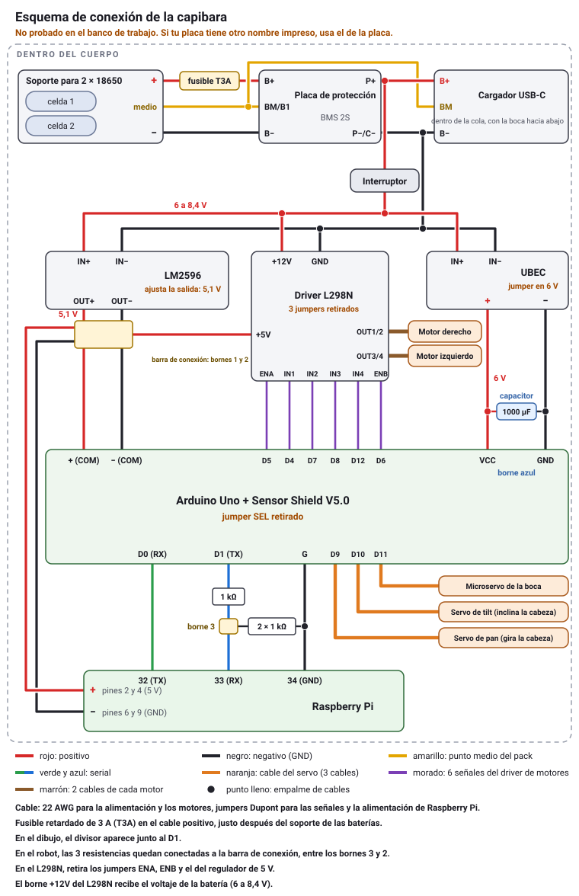

# Conexión eléctrica del carpincho

<!-- GERADO:idiomas -->
[🇧🇷 Português](LIGACAO.md) · [🇺🇸 English](LIGACAO.en.md) · [🇪🇸 Español](LIGACAO.es.md)
<!-- /GERADO -->

**No probado en el banco de trabajo.** Este esquema se elaboró a partir de las fichas de los componentes; todavía no se conectó ningún cable en un robot montado.
Verifica cada conexión con el multímetro antes de encender el interruptor. Si tu placa tiene un nombre impreso diferente del
que aparece aquí, usa el nombre de la placa.

Página con el mismo esquema: https://inematds.github.io/robos-impressos/guia/es/capivara/#energia

Toda la soldadura del robot se hace en la mesa de trabajo, en los preparativos 1, 2 y 3. Durante el montaje solo hay bornes y encajes. Los pasos
numerados de los 4 preparativos son los mismos que aparecen en la página.

## Seguridad con baterías de litio

- **Polaridad:** rojo al positivo, negro al negativo. Mide con el multímetro antes de cada conexión nueva. Un cable invertido quema la placa al instante.
- **Ajuste antes de conectar la carga:** LM2596 a 5,1 V y UBEC a 6 V, medidos con el multímetro, sin el Raspberry Pi, sin el Arduino, sin el driver ni los servos conectados.
- **Un cortocircuito provoca un incendio:** suelda con las celdas FUERA del portapilas y aísla cada empalme con tubo termorretráctil. No debe quedar ningún metal a la vista.
- **Fusible:** 3 A, retardado (marcado T3A), en el cable positivo, a pocos centímetros del portapilas.
- **Celdas iguales:** las dos 18650 deben ser de la misma marca, del mismo modelo y nuevas. Si una celda está abollada, hinchada o caliente, llévala al punto de recolección de pilas, no la pongas en el robot.
- **Primera carga:** quédate cerca, con el robot sobre una superficie que no se queme.

## Qué alimenta cada componente

- **Pack 2S:** dos celdas 18650 en serie, de 6 V (vacía) a 8,4 V (cargada). Pasa por el fusible y la placa de protección (BMS).
- **Cargador USB-C:** queda conectado a la salida de la placa de protección, antes del interruptor. El robot se carga apagado, con una fuente USB-C de 15 W o más. Queda de pie dentro de la cola, con la boca hacia abajo: el enchufe entra por debajo de la cola.
- **Interruptor:** corta el positivo que va a los dos convertidores y al driver de motores. Queda debajo del piso, detrás del motor derecho.
- **LM2596, ajustado a 5,1 V:** la salida va a una barra de conexión dentro del cuerpo. De allí salen los cables del Raspberry Pi (pines 2 y 4, 6 y 9), el par del Arduino (pines + y − del conector COM del Sensor Shield) y el cable de la lógica del driver (borne +5V del L298N).
- **UBEC a 6 V:** alimenta solo los servos (2 servos MG996R (pan y tilt) y 1 microservo (boca)), por el borne azul del Sensor Shield, con el jumper SEL retirado.
- **Driver L298N:** recibe el voltaje de la batería (6 a 8,4 V) y conecta los 2 motores de las ruedas. El driver reduce unos 2 V: los motores, que son de 3 a 6 V, reciben de 4 a 6,4 V.
- **Negativo (GND):** es uno solo para todo el robot.
- **Cables del cargador:** el cargador queda por fuera de la puerta trasera, dentro de la cola. Sus 3 cables atraviesan un agujero de 7 mm de la puerta y deben pasar por allí ANTES de soldarlos al cargador. Quedan con unos 15 cm de holgura, y la puerta queda sujeta al robot por ellos.

Por qué el Arduino recibe los 5,1 V del LM2596 y no el voltaje de la batería: la entrada VIN del Arduino Uno requiere de 7 a 12 V
([ficha del Arduino Uno R3](https://docs.arduino.cc/resources/datasheets/A000066-datasheet.pdf)) y el pack pasa buena
parte de la descarga por debajo de 7 V.

Por qué el Raspberry Pi recibe alimentación por los pines y no por el puerto USB-C: en la bandeja, el puerto USB-C queda a
unos 1 mm de la pared del rack y el enchufe no entra. Es una conexión común, pero no se ha probado en este robot. Son 2 cables
al positivo y 2 al negativo para repartir la corriente entre los contactos.

## La barra de conexión

Es una barra de conexión con tornillos (tipo sindal) que queda suelta dentro del cuerpo. Se usan 3 bornes:

- **Borne 1, los 5,1 V:** de un lado, el cable rojo que viene del LM2596. Del otro, los 2 jumpers rojos del Raspberry Pi, el jumper que va al pin + del conector COM del shield y el cable que va al borne +5V del driver.
- **Borne 2, el negativo:** de un lado, el cable negro del LM2596 y una punta del par de resistencias. Del otro, los 2 jumpers negros del Raspberry Pi y el jumper que va al pin − del conector COM.
- **Borne 3, la serial:** de un lado, las resistencias del divisor. Del otro, el cable azul que viene del Raspberry Pi.

Son 4 cables en el mismo borne 1: tuerce las puntas juntas antes de apretar, o usa 2 bornes vecinos unidos por un trozo de cable.

## Tabla de conexiones, cable por cable

<!-- GERADO:ligacoes -->
### Batería, protección y carga

| De | Para | Color | Cable | Atención |
|---|---|---|---|---|
| Soporte de las baterías: cable rojo (positivo del pack) | Portafusible de 3 A y, después de este, pad B+ de la placa de protección | rojo | 22 AWG | El fusible queda a pocos centímetros del soporte. |
| Soporte de las baterías: cable negro (negativo del pack) | Pad B− de la placa de protección | negro | 22 AWG |  |
| Soporte de las baterías: lámina de metal que une las 2 celdas (punto medio) | Pad del punto medio de la placa de protección (BM o B1) | amarillo | 22 AWG | Es el 3.er cable. Suéldalo a la lámina con las celdas FUERA del soporte. |
| Pad del punto medio de la placa de protección (BM o B1) | Pad BM del cargador USB-C | amarillo | 22 AWG | Sin este cable, el cargador no equilibra las dos celdas. |
| Pad B+ del cargador USB-C | Salida positiva de la placa de protección (P+; si la placa no tiene P+, es el mismo pad B+) | rojo | 22 AWG | El cargador va antes del interruptor: el robot se carga apagado. Va por fuera de la puerta trasera, dentro de la cola: sus 3 cables pasan por el orificio de 7 mm de la puerta ANTES de soldarlos al cargador, con unos 15 cm de holgura. |
| Pad B− del cargador USB-C | Salida negativa de la placa de protección (P−; en la placa de la tienda consultada, el pad C−) | negro | 22 AWG | No conectes al pad B− de la placa de protección: la carga debe pasar por la protección. |

### Interruptor, convertidores y alimentación de los motores

| De | Para | Color | Cable | Atención |
|---|---|---|---|---|
| Salida positiva de la placa de protección (P+ o B+) | Interruptor de encendido y apagado y, después de él, 3 cables: entrada IN+ del LM2596, cable rojo de entrada del UBEC y borne de alimentación de los motores del L298N (marcado +12V o VS) | rojo | 22 AWG | El interruptor corta solo el positivo. El borne del driver recibe el voltaje de la batería (6 a 8,4 V), a pesar del nombre +12V. |
| Salida negativa de la placa de protección (P−; en la placa de la tienda consultada, el pad C−) | Entrada IN− del LM2596, cable negro de entrada del UBEC y borne GND del L298N | negro | 22 AWG | Este es el negativo común (GND) de todo el robot. |

### 5 V: Raspberry Pi, Arduino y lógica del driver

| De | Para | Color | Cable | Atención |
|---|---|---|---|---|
| Salida OUT+ del LM2596 (5,1 V) | Barra de conexión, borne 1 | rojo | 22 AWG, corto | Ajusta los 5,1 V ANTES de conectar cualquier cosa del otro lado de la barra. |
| Salida OUT− del LM2596 | Barra de conexión, borne 2 | negro | 22 AWG, corto |  |
| Barra de conexión, borne 1 (5,1 V) | Raspberry Pi: pines 2 y 4 (5 V), un cable en cada pin | rojo | 2 cables Dupont: un extremo cortado y pelado en el borne; el otro, con el conector hembra, en el pin | Son 2 cables para repartir la corriente. Mide 5,1 V y verifica la polaridad en la barra de conexión antes de conectar: un voltaje incorrecto o un cable invertido en estos pines quema la Raspberry Pi. |
| Barra de conexión, borne 2 (negativo) | Raspberry Pi: pines 6 y 9 (GND), un cable en cada pin | negro | 2 cables Dupont: un extremo cortado y pelado en el borne; el otro, con el conector hembra, en el pin |  |
| Barra de conexión, borne 1 (5,1 V) | Pin + del conector COM del Sensor Shield | rojo | jumper Dupont con un extremo cortado y pelado | Por aquí recibe energía el Arduino. Antes, con el Uno conectado solo por USB y el jumper SEL retirado, confirma con el multímetro que este pin marca cerca de 5 V y que el pin V del D9 marca 0 V. Un pin incorrecto aquí envía los 6 V de los servos al Raspberry Pi. |
| Barra de conexión, borne 2 (negativo) | Pin − del conector COM del Sensor Shield | negro | jumper Dupont con un extremo cortado y pelado |  |
| Barra de conexión, borne 1 (5,1 V) | Borne +5V del L298N | rojo | 22 AWG, unos 15 cm | Solo con el jumper del regulador de 5 V del L298N RETIRADO (el jumper junto a los bornes de alimentación). Si está puesto, el regulador del driver y el LM2596 quedan enfrentados. |

### 6 V: servos

| De | Para | Color | Cable | Atención |
|---|---|---|---|---|
| Cable rojo de salida del UBEC (6 V) | Borne azul VCC del Sensor Shield | rojo | cable del UBEC, con el conector de 3 pines cortado | Jumper SEL del shield RETIRADO y jumper del UBEC en 6 V. La salida del UBEC viene con un conector de servo: corta el conector y pela los cables. El rojo es el positivo. |
| Cable negro o marrón de salida del UBEC | Borne azul GND del Sensor Shield | negro | cable del UBEC, con el conector de 3 pines cortado | Si el conector tiene un tercer cable, blanco o naranja, aísla su punta con tubo termorretráctil: no se conecta. |
| Capacitor de 1000 µF: pata larga (+) | Borne azul VCC; la pata con la franja (−) va en el borne azul GND | sin cable | patas del capacitor | El capacitor invertido explota. |
| Servo de pan (en la plataforma del chasis) | Conector D9 del Sensor Shield | cable del servo | cable de 3 hilos del servo | G = marrón o negro, V = rojo, S = naranja o amarillo. |
| Servo de tilt (en la cuna, dentro del cuello) | Por la cara plana de la columna y por la ranura de la horquilla, hasta el conector D10 del Sensor Shield | cable del servo | cable de 3 hilos del servo, con extensión de 30 cm si no alcanza | Mismo orden de colores que en D9. Deja holgura para que la cabeza gire 60° hacia cada lado. |
| Microservo de la boca (en la placa de la cabeza) | Con la extensión de 30 cm, por la cara plana de la columna, hasta el conector D11 del Sensor Shield | cable del servo | cable de 3 hilos del servo + extensión de 30 cm | Mismo orden de colores que en D9. |

### Motores de las ruedas y driver L298N

| De | Para | Color | Cable | Atención |
|---|---|---|---|---|
| Motor derecho: los 2 terminales | Bornes OUT1 y OUT2 del L298N | rojo y negro | 22 AWG, unos 20 cm, soldados al motor | Si la rueda gira en sentido contrario al esperado, intercambia los 2 cables de ese motor en el borne. |
| Motor izquierdo: los 2 terminales | Bornes OUT3 y OUT4 del L298N | rojo y negro | 22 AWG, unos 20 cm, soldados al motor |  |
| L298N: pin ENA (con el jumper retirado) | Pin S del D5 del Sensor Shield | cualquiera | jumper Dupont hembra-hembra | Velocidad del motor derecho. Solo el pin S: el pin V del shield tiene los 6 V de los servos. |
| L298N: pines IN1 e IN2 | Pin S del D4 (IN1) y pin S del D7 (IN2) | cualquiera | 2 jumpers Dupont hembra-hembra | Sentido del motor derecho. |
| L298N: pines IN3 e IN4 | Pin S del D8 (IN3) y pin S del D12 (IN4) | cualquiera | 2 jumpers Dupont hembra-hembra | Sentido del motor izquierdo. |
| L298N: pin ENB (con el jumper retirado) | Pin S del D6 del Sensor Shield | cualquiera | jumper Dupont hembra-hembra | Velocidad del motor izquierdo. |

### Conexión serial entre Raspberry Pi y Arduino

| De | Para | Color | Cable | Atención |
|---|---|---|---|---|
| Raspberry Pi: pin 32 (GPIO12, TX) | Pin S del D0 (RX) del Sensor Shield | verde | jumper Dupont hembra-hembra completo | Directo: los 3,3 V del Pi ya sirven como nivel alto para Arduino. |
| Raspberry Pi: pin 34 (GND) | Pin G del D0 del Sensor Shield | negro | jumper Dupont hembra-hembra completo |  |
| Raspberry Pi: pin 33 (GPIO13, RX) | Borne 3 de la barra de conexión | azul | jumper Dupont: conector hembra en el pin, el otro extremo cortado y pelado | Este cable nunca va directo a D1: son 5 V en un pin de 3,3 V. |
| Barra de conexión, borne 3 | Resistencia de 1 kΩ y, después de ella, pin S de D1 (TX) del Sensor Shield | azul | mitad de un jumper, soldada a la pata de la resistencia, con el conector hembra en el shield | Montado en la mesa de trabajo, en el preparativo 3. |
| Barra de conexión, borne 3 | 2 resistencias de 1 kΩ en serie y, después de ellas, borne 2 de la barra (negativo) | sin cable | patas de los resistores | Los 3 resistores forman el divisor: 5 V se convierten en 3,3 V. |
<!-- /GERADO -->

## Preparativo 1: suelda la alimentación y ajusta los dos voltajes

Hazlo en la mesa de trabajo, con el chasis y la puerta trasera impresos al lado. El interruptor es la primera pieza que entra en el chasis, y
entra antes de soldarlo al resto. El cargador se suelda al final, con los 3 cables ya pasados por el agujero de la puerta. Los nombres de los pads de soldadura cambian de una placa a otra. En el cargador son B+, BM y B−. En la placa de protección de la
tienda consultada solo el reverso tiene nombres: B+, B1 (medio), B− y C−. Según la foto, C− es la salida negativa y la salida positiva es la
propia B+; es una lectura de la foto, no está confirmada: verifícala con el multímetro. En el Sensor Shield de la misma tienda, la foto muestra
el conector COM con 4 pines verticales (TX, RX, − y +) y el jumper SEL junto al borne azul.

<!-- GERADO:prep1 -->
1. Suelda el 3.er cable (amarillo) a la lámina de metal que une las dos celdas, con las celdas fuera del soporte.
2. Suelda 2 cables rojos de 15 cm a los 2 terminales del interruptor. Pasa los extremos libres por el recorte del piso del chasis, de abajo hacia arriba, y encaja el interruptor en el recorte, por debajo. Hazlo ANTES de soldar el interruptor al resto: conectado al mazo de cables, no pasa por el recorte de 13,5 × 9 mm.
3. Si los motores vienen sin cables, suelda 2 cables de 20 cm (uno rojo y uno negro, 22 AWG) a los 2 terminales de cada motor.
4. Con el chasis al lado como guía para medir el largo de los cables, conecta el portapilas, el fusible y la placa de protección, según la tabla de conexiones. Deja unos 8 cm de holgura en los cables del portapilas para poder sacarlo por detrás al cambiar las celdas.
5. El cargador va por FUERA de la puerta trasera, dentro de la cola, y su placa no pasa por el orificio de 7 mm de la puerta. Por eso: suelda 3 cables de 20 cm (rojo, amarillo y negro) a la placa de protección, pasa los extremos libres por el orificio de la puerta, de adentro hacia afuera, y solo entonces suéldalos al cargador. A partir de aquí, la puerta queda sujeta al mazo de cables por esos 3 cables.
6. Suelda un extremo del interruptor a la salida positiva de la placa de protección. En el otro extremo, une 3 cables rojos: la entrada IN+ del LM2596, el cable rojo de entrada del UBEC y un cable de 15 cm que va al borne de alimentación de los motores del driver. En la salida negativa de la placa de protección, une 3 cables negros: la entrada IN− del LM2596, el cable negro de entrada del UBEC y un cable de 15 cm para el borne GND del driver. Aísla cada empalme con tubo termorretráctil.
7. En la salida del LM2596, suelda 2 cables cortos y aprieta los otros extremos en la barra de conexión: el rojo en el borne 1, el negro en el borne 2. No conectes nada más a las salidas.
8. Pon las celdas en el soporte, verificando el lado positivo, y enciende el interruptor.
9. Con el multímetro conectado a la barra de conexión, gira el tornillo de ajuste del LM2596 con el destornillador hasta que marque 5,1 V. Son varias vueltas.
10. Mide la salida del UBEC: debe marcar 6 V. Si marca 5 V, cambia su jumper a 6 V.
11. Apaga el interruptor.
<!-- /GERADO -->

## Preparativo 2: carga el programa y pon los 3 servos a 90°

El programa es el sketch [centrar_servos.ino](firmware/centrar_servos/centrar_servos.ino). Lleva los 3 servos al
centro y los mantiene allí, con los motores de las ruedas apagados.

<!-- GERADO:prep2 -->
1. Abre el sketch `centrar_servos.ino` en Arduino IDE. Conecta el Arduino Uno a la computadora con el cable USB, sin el shield ni la batería.
2. En el menú Herramientas, elige la placa Arduino Uno y el puerto en el que apareció. Haz clic en Cargar.
3. Desconecta el cable USB, coloca el Sensor Shield en el Uno y quita el jumper SEL del shield: es la cubierta de plástico sobre 2 pines, junto al borne azul.
4. Vuelve a conectar el cable USB, solo para medir con el multímetro. El conector COM del shield tiene 4 pines verticales, marcados TX, RX, − y +. Entre el + y el − debe marcar unos 5 V. En el conector D9, entre el pin V y el pin G, debe marcar 0 V.
5. Si el pin V de D9 marca 5 V, el jumper SEL todavía está puesto. Si el + de COM no marca 5 V, tu shield es diferente al de la foto de la tienda: busca otro pin marcado + o 5V que marque 5 V con el SEL retirado. Un pin equivocado aquí lleva los 6 V de los servos a la Raspberry Pi.
6. Desconecta el cable USB.
7. La salida del UBEC viene con un conector de servo de 3 pines: corta el conector y pela los cables. El rojo es el positivo y el negro (o marrón), el negativo. Si hay un tercer cable, blanco o naranja, aísla su punta con tubo termorretráctil. Aprieta el rojo en VCC y el negro en GND de la barra de conexión azul. En el mismo borne va el capacitor de 1000 µF, con la pata larga en VCC.
8. Toma 2 jumpers, corta el conector de un extremo de cada uno y pela los cables. Aprieta uno en el borne 1 de la barra de conexión, del lado opuesto al del conversor, y conecta su terminal en el pin + del conector COM. El otro va del borne 2 al pin − del mismo conector. Los pines TX y RX, al lado, quedan vacíos: 5 V en uno de ellos llegan al Raspberry Pi por el cable serial.
9. Conecta el servo de pan al D9, el de tilt al D10 y el de la boca al D11: cable marrón o negro en G, rojo en V, naranja o amarillo en S.
10. Enciende el interruptor: los 3 servos van al centro (90°) y el LED del Uno parpadea una vez por segundo.
11. Apaga el interruptor. A partir de ahora, no gires los ejes de los servos con la mano.
12. Desconecta los cables de prueba para el montaje: retira los servos del shield, suelta del borne azul los cables del UBEC y el capacitor, y quita los 2 jumpers del conector COM. Marca cada cable del servo con cinta y el nombre del pin. Saca las 2 celdas del portapilas: solo vuelven durante el montaje, en el paso de la batería.
<!-- /GERADO -->

Tres avisos:

- No alimentes los servos con los 5 V del USB. El puerto USB proporciona 0,5 A y un servo MG996R necesita más al arrancar.
- Nunca conectes el cable USB de la computadora con la batería encendida: las dos fuentes quedarían en paralelo.
- 90° es el punto medio del recorrido del servo. La boca cerrada corresponde al punto medio de su servo: el estriado tiene pasos de unos 17° (valor habitual, no confirmado), así que elige el diente más cercano; el ajuste fino se hará en el programa de la fase 2.

El sketch compila para el Arduino Uno (arduino-cli, core arduino:avr, biblioteca Servo). Aún no se ha
probado en un robot montado.

## Preparativo 3: prepara los cables del Raspberry Pi, el divisor y los cables del driver

El Raspberry Pi y el Arduino van en bandejas, uno sobre otro, dentro del cuerpo. Se comunican por 3 cables: verde, azul
y negro. El Pi recibe energía por otros 4 cables. En este preparativo dejas listos y marcados esos 7 cables, montas el
divisor de 3 resistencias en la barra de conexión y separas los 6 cables de señal del driver. Hay 16 jumpers en todo el robot: 4 de
la energía del Pi, 3 de la conexión serial, 1 cortado por la mitad para el divisor, 2 de la energía del Arduino (preparativo 2) y 6 del driver. Un kit
de 40 alcanza. Haz este preparativo con las celdas fuera del portapilas.

<!-- GERADO:prep3 -->
1. Separa 3 jumpers hembra-hembra para la conexión serial: uno verde, uno azul y uno negro (o marca 3 de otro color con cinta). El verde y el negro quedan intactos. En el azul, corta el conector de un extremo y pela 6 mm: ese extremo va a un borne.
2. Ahora prepara el divisor. Suelda 2 resistencias de 1 kΩ una con otra, pata con pata, y cubre la unión con tubo termorretráctil. Este par equivale a 2 kΩ.
3. Corta un jumper por la mitad. Suelda el extremo cortado de una de las mitades a una pata de la 3.ª resistencia y cúbrelo con tubo termorretráctil. El conector hembra de esta mitad es el que va al D1.
4. En la barra de conexión, del lado del convertidor, aprieta en el borne 3 la pata libre de la 3.ª resistencia junto con un extremo del par de 2 kΩ. Aprieta el otro extremo del par en el borne 2, junto con el cable negro que ya está ahí. Dobla la punta de cada pata antes de apretar para que el tornillo la sujete.
5. Verifica con el multímetro, en ohmios: entre el conector hembra del jumper del D1 y el borne 3, cerca de 1 kΩ; entre el borne 3 y el borne 2, cerca de 2 kΩ.
6. Separa otros 4 jumpers para la alimentación del Raspberry Pi, 2 rojos y 2 negros (o márcalos con cinta). Corta el conector de un extremo de cada uno y pela 6 mm. Aprieta los 2 rojos juntos en el borne 1 de la barra de conexión, del lado opuesto al del conversor, y los 2 negros juntos en el borne 2.
7. Corta un cable rojo de 15 cm (22 AWG) y aprieta uno de sus extremos en el borne 1 de la barra, junto con los 2 jumpers rojos: el otro extremo va al borne +5V del driver, durante el montaje.
8. Localiza los pines del Raspberry Pi: el pin 1 está en la esquina, del lado de la tarjeta microSD, en la fila interior; el pin 40 está en la esquina opuesta, en la fila del borde. Los pines impares están en la fila interior y los pares, en la fila del borde. Los pines 2, 4 y 6 son los 3 primeros de la fila del borde; el pin 9 es el 5.º de la fila interior; los pines 32 y 34 son el 16.º y el 17.º de la fila del borde; el pin 33 es el 17.º de la fila interior.
9. Marca cada conector con cinta y el número del pin: 2 y 4 en los rojos, 6 y 9 en los negros de alimentación, 32 en el verde, 33 en el azul, 34 en el negro de la conexión serial. Un cable rojo en el pin equivocado pone 5 V en un pin de señal y quema el Raspberry Pi.
10. Separa 6 jumpers hembra-hembra intactos para las señales del driver y marca los extremos: ENA-D5, IN1-D4, IN2-D7, IN3-D8, IN4-D12 y ENB-D6.
11. Guarda los cables: durante el montaje se conectan al Raspberry Pi, al shield y al driver, todo mediante bornes o conectores, sin soldar. Atención: en los conectores de 3 pines del shield, los cables seriales y del driver usan solo el pin S (y el pin G, en el cable negro de la conexión serial). El pin del medio (V) siempre queda vacío: con el jumper SEL retirado, tiene los 6 V de los servos, y esos 6 V en uno de estos cables queman el Raspberry Pi o el driver.
<!-- /GERADO -->

Sobre el Raspberry Pi quedan unos 19 mm hasta la bandeja de arriba (medida del modelo, no confirmada). El conector Dupont
común mide unos 16,5 mm de alto: cabe con poca holgura; dobla los cables justo por encima. Si no cabe, suelda los cables a una barra de pines hembra
baja, con los cables saliendo hacia un lado.

Dónde está el pin 1 y por qué el número del pin no es el número del GPIO:
[documentación de la Raspberry Pi](https://github.com/raspberrypi/documentation/blob/master/documentation/asciidoc/computers/raspberry-pi/gpio-on-raspberry-pi.adoc).
En la Pi ya encendida, el comando `pinout` muestra el mapa de los pines.

## Prepara 4: graba la tarjeta microSD y conecta la conexión serial

La tarjeta se graba en tu computadora con un lector de tarjetas microSD. Después te conectas a Raspberry Pi por la red,
mediante SSH: escribes los comandos en tu computadora y se ejecutan en el Pi.

<!-- GERADO:prep4 -->
1. Instala Raspberry Pi Imager, el programa gratuito de Raspberry Pi, en la computadora y coloca la tarjeta en el lector.
2. En Imager, elige el modelo de tu Pi, el sistema Raspberry Pi OS (64-bit) y la tarjeta.
3. Antes de grabar, abre la configuración de Imager: ponle un nombre al Pi (por ejemplo `robo`), crea un usuario y una contraseña, ingresa el nombre y la contraseña de tu Wi-Fi y activa SSH. Graba la imagen.
4. Pon la tarjeta en la Raspberry Pi y enciéndela en la mesa de trabajo, fuera del robot, con una fuente USB-C de 5 V y 3 A. Espera unos 2 minutos.
5. En la computadora, abre la terminal: en Windows es el programa PowerShell; en Mac y Linux, Terminal.
6. Escribe `ssh usuario@robo.local`, reemplazando `usuario` y `robo` por los nombres que creaste. Responde `yes` la primera vez y escribe la contraseña.
7. Si `robo.local` no responde, abre la página de tu router, busca el Pi en la lista de dispositivos conectados y usa su número (la dirección IP), por ejemplo `ssh usuario@192.168.0.50`.
8. Cuando la terminal muestre el nombre de la Pi, ya estás dentro. Activa la conexión serial: escribe `sudo nano /boot/firmware/config.txt`, ve hasta el final del archivo y agrega una línea: `dtoverlay=uart5` en la Raspberry Pi 4, o `dtoverlay=uart4-pi5` en la Raspberry Pi 5. Guarda con Ctrl+O y Enter, sal con Ctrl+X.
9. Escribe `sudo poweroff`, espera a que el LED verde de la Pi deje de parpadear y desconecta la fuente. Dentro del robot, la Raspberry Pi ya no usa el puerto USB-C: recibe los 5,1 V por los pines.
<!-- /GERADO -->

Fuentes: documentación de Raspberry Pi, en GitHub: [SSH](https://github.com/raspberrypi/documentation/blob/master/documentation/asciidoc/computers/remote-access/ssh.adoc) y [cómo encontrar la dirección del Pi](https://github.com/raspberrypi/documentation/blob/master/documentation/asciidoc/computers/remote-access/find-your-ip-address.adoc).
La línea de la conexión serial viene de la [lista de overlays del firmware de Raspberry Pi](https://github.com/raspberrypi/firmware/blob/master/boot/overlays/README).
Después de reiniciar, el nombre del puerto aparece con `ls /dev/ttyAMA*`. El programa que usa esta conexión serial es de la fase 2.

## Cómo se comunica la Raspberry Pi con el Arduino

Los dos se comunican por una conexión serial (UART) de 3 cables. Un cable USB entre ellos requeriría espacio detrás de las bandejas para los dos conectores y para el recorrido del cable: ese espacio no se ha comprobado.

- **En el Arduino:** pines D0 (RX) y D1 (TX), que son la conexión serial real de la placa. No interfieren con la señal de los servos.
- **En el Raspberry Pi:** pin 32 (GPIO12, TX), pin 33 (GPIO13, RX) y pin 34 (GND).
- **Número del pin y número del GPIO:** «pin 32» es la posición en la fila de 40 pines, contada desde la esquina de la tarjeta microSD. «GPIO12» es el nombre de la señal que sale por ese pin. Los dos números no son iguales.
- **Voltaje:** el Arduino funciona a 5 V y el Pi a 3,3 V. El cable que va del Arduino al Pi pasa por un divisor de 3 resistencias de 1 kΩ, que baja de 5 V a 3,3 V. El cable que va del Pi al Arduino es directo.
- **Para programar el Arduino por USB:** primero quita los 2 cables de la conexión serial de D0 y D1. Usan los mismos pines que el USB.

## El driver de motores

El L298N enciende, apaga e invierte el giro de los 2 motores de las ruedas.

- **Jumpers del módulo:** quita los 3. Los 2 de los pines ENA y ENB, porque la velocidad viene del Arduino. Y el del regulador de 5 V, porque por debajo de unos 7 V de batería ese regulador no mantiene los 5 V: la lógica del driver recibe los 5,1 V de la barra de conexión, por el borne +5V.
- **Velocidad:** ENA en D5 (motor derecho) y ENB en D6 (motor izquierdo). La biblioteca de servos quita la salida de velocidad (PWM) de los pines 9 y 10 del Arduino Uno; los pines 5 y 6 la conservan.
- **Sentido:** IN1 en D4 e IN2 en D7 (motor derecho); IN3 en D8 e IN4 en D12 (motor izquierdo).
- **Solo el pin S:** en cada conector de 3 pines del shield, el cable del driver va al pin S. El pin V lleva los 6 V de los servos.
- **Motor al revés:** si una rueda gira hacia atrás cuando debería ir hacia adelante, intercambia los 2 cables de ese motor en el borne.

El programa que hace avanzar al robot es de la fase 2. El sketch de esta fase solo mantiene apagados los motores.

## Los cables que suben a la cabeza

En la fase 1 suben 2 cables de servo (tilt y boca). Bajan por la cara plana de la columna de la cuna, pasan por la ranura de la base de la
horquilla y por la ranura del deck, hasta el Arduino. En la fase 2 pasan por el mismo recorrido el cable plano de la cámara y los cables de los
sensores de la cabeza.

1. Conecta la extensión de 30 cm al cable del micro servo de la boca, antes de poner la cabeza en el cuello.
2. Sujeta los cables a la cara plana de la columna con una brida floja o cinta.
3. Deja un tramo flojo de unos 5 cm dentro del collar: la cabeza gira 60° hacia cada lado y se inclina.
4. Antes de cerrar, gira la cabeza con la mano hasta los dos extremos, despacio y con el interruptor apagado: ningún cable debe estirarse ni quedar atrapado en la horquilla.

Las longitudes se estimaron a partir del modelo. Este recorrido nunca se probó con las piezas impresas.

## Corriente, cable y fusible

Los valores de abajo se calculan a partir de las fichas técnicas; no se midieron.

- Uso normal: unos 2,5 A desde el pack. La Raspberry Pi consume unos 1 A a 5,1 V, los servos menos de 1,2 A a 6 V y los 2 motores unos 0,3 A cada uno, al moverse (valor habitual, no confirmado).
- Pico: cerca de 8 A, con el LM2596 a 2 A, el UBEC en su límite de 3 A, los 2 motores trabados (unos 1,5 A cada uno, valor habitual, no confirmado) y el pack a 6,5 V.
- Interruptor KCD11-101: 3 A a 250 V~ y 6 A a 125 V~ ([ficha de la tienda](https://eletronicamaker.com.br/produto/mini-chave-gangorra-kcd11-101-liga-desliga-3a-250v-vm-c)). La ficha no indica un valor para corriente continua.
- Fusible de 3 A, retardado (marcado T3A o T3,15A): es el valor más bajo del interruptor. Soporta los picos breves al arrancar los servos y motores, y se abre ante una sobrecarga prolongada (comportamiento habitual de este tipo de fusible, no confirmado).
- **Este es el punto débil de la parte eléctrica.** El uso normal se acerca a los 3 A y el fusible puede abrirse cuando el robot haga fuerza: al subir una alfombra, con una rueda atascada o cuando la cabeza haga fuerza. Si se abre, no pongas uno de mayor capacidad: el interruptor no lo soporta. Un interruptor de 6 A o más requiere otro recorte en la pieza; es una tarea pendiente del proyecto.
- Si todos los servos se traban al mismo tiempo, los MG996R consumen 2 × 1,4 A más unos 0,7 A del microservo: 3,5 A, más que los 3 A del UBEC. El programa de la fase 2 debe detener cada servo antes de que llegue al final de su recorrido.
- Cable 22 AWG (0,33 mm²) para toda la alimentación y los motores.
- El LM2596 soporta unos 2 A continuos sin disipador (valor habitual, no confirmado). Usa la Raspberry Pi 4 o la Pi 5 sin accesorios USB.
- Si la Raspberry Pi indica subtensión, acorta los 4 cables jumper de alimentación y comprueba el ajuste. Para verlo, escribe `vcgencmd get_throttled` en la Pi: la respuesta correcta es `throttled=0x0`.

## Calor dentro del cuerpo

El Raspberry Pi 4 queda cerrado dentro del cuerpo, que es de PLA y no tiene aberturas de ventilación. Es un riesgo que no se ha medido.

- El PLA se ablanda cerca de 60 °C (valor habitual, no confirmado).
- La Pi reduce la velocidad cuando el procesador está entre 80 y 85 °C ([documentación de Raspberry Pi](https://github.com/raspberrypi/documentation/blob/master/documentation/asciidoc/computers/raspberry-pi/frequency-management.adoc)).
- Pega los disipadores adhesivos en los chips de la Pi antes de montarla.
- Con el robot encendido durante media hora, escribe `vcgencmd measure_temp` en la Pi. Si supera los 70 °C, abre orificios de ventilación en la puerta trasera.

## La primera vez que enciendes el robot montado

1. Interruptor apagado y ruedas levantadas del suelo: apoya el robot sobre un taco. Con el multímetro en modo de continuidad, comprueba que el positivo y el negativo del pack no estén en cortocircuito.
2. Antes de conectar los conectores a la Raspberry Pi, enciende el interruptor y mide en la barra de conexión: 5,1 V entre los bornes 1 y 2, con el cable rojo en el positivo. Mide 6 V en el borne azul. Apaga.
3. Conecta los conectores de la Raspberry Pi, comprobando el número de cada pin, y vuelve a encender el interruptor.
4. El LED del Arduino parpadea, los 3 servos mantienen el centro, las ruedas quedan quietas y se enciende el LED de alimentación de la Raspberry Pi.
5. Si no se enciende nada, apaga y revisa el fusible.

## Lo que todavía no se probó

<!-- GERADO:riscos -->
- Todavía no se imprimió ni se montó ninguna pieza. La parte eléctrica no se probó en el banco de trabajo: se diseñó a partir de las fichas de los componentes.
- Seis piezas requieren soportes de impresión: cráneo, cuerpo, puerta trasera, mandíbula, horquilla del cuello y cuna del tilt. Los soportes quedan por dentro o por debajo, fuera de la cara, pero todavía nadie los quitó de una pieza real.
- Los archivos 3MF de las camas nunca se abrieron en Bambu Studio. Si alguno no abre, usa los STL.
- El interruptor de encendido y apagado es de 3 A y, según el cálculo basado en las fichas, el uso normal se acerca a ese valor (cerca de 2,5 A con las ruedas en movimiento y la cabeza moviéndose). El fusible de 3 A protege el interruptor y puede fundirse cuando el robot haga fuerza. Un interruptor más grande requiere cambiar el recorte de la pieza: es una tarea pendiente del proyecto.
- El Raspberry Pi recibe los 5,1 V por los pines de 5 V, porque en la bandeja su puerto USB-C queda pegado a la pared del rack. Es una conexión común, pero no se probó en este robot: si cambias los cables o aplicas una tensión incorrecta en esos pines, quemarás el Pi. Mide antes de conectarlo.
- Sobre el Raspberry Pi quedan unos 19 mm hasta la bandeja superior (medida del modelo, no confirmada). El conector Dupont común mide unos 16,5 mm de alto: cabe con poca holgura. Plan B: suelda los cables a una barra baja de pines hembra, con los cables saliendo hacia un lado.
- La puerta trasera queda sujeta al robot por los 3 cables del cargador, que atraviesan un orificio de 7 mm. Para quitar la puerta por completo, hay que desoldar esos cables o ponerles un conector de 3 vías, que no está en la lista.
- El cupón de prueba no verifica la abertura para el servo MG996R. Comprueba el servo en la cuna del tilt, que se imprime en una de las primeras camas, antes de las impresiones largas.
- El portafusible, la barra de conexión y los 3 resistores de la conexión serial no tienen un lugar modelado: quedan sueltos dentro del cuerpo, aislados con tubo termorretráctil.
- Las longitudes de los cables (servos de la cabeza, extensiones y jumpers) se estimaron a partir del modelo. La cabeza gira e inclina y tira de esos cables: deja holgura y comprueba ambos extremos antes de cerrar.
- El robot se apoya en 4 puntos (2 ruedas y 2 esferas). En un piso irregular, una de las esferas puede quedar en el aire y el robot puede tambalearse.
- Las medidas marcadas como NC provienen de anuncios de tiendas. Mide tu pieza antes de imprimir la parte que hace contacto con ella.
- El estriado del microservo tiene pasos de unos 17° (valor habitual, no confirmado): el horn de la boca puede no quedar exactamente en la posición de 90°. Elige el diente más cercano; el ajuste fino se hace en el programa, en la fase 2.
- Calor: la Raspberry Pi queda encerrada en el cuerpo, que es de PLA y no tiene abertura de ventilación. El PLA se ablanda cerca de 60 °C y la Pi reduce la velocidad a partir de 80 °C. Pega los disipadores y mide con el comando `vcgencmd measure_temp`. Si supera los 70 °C, abre orificios de ventilación en la puerta trasera.
<!-- /GERADO -->

## Glosario

<!-- GERADO:glossario -->
- **GPIO:** La fila de 40 pines del Raspberry Pi, donde se conectan los cables de alimentación y señal. En esta guía, «pin 32» es la posición del pin en la fila; «GPIO12» es el nombre de la señal que sale por él.
- **UBEC:** Convertidor pequeño, usado en aeromodelos, que reduce el voltaje de la batería a un valor fijo. Aquí, 6 V para los servos.
- **BMS:** Placa de protección de la batería de litio. Desconecta la batería antes de que se descargue demasiado, se sobrecargue o entre en cortocircuito.
- **2S:** Dos celdas de litio conectadas en serie, una después de la otra. Los voltajes se suman: de 6 V (vacía) a 8,4 V (cargada).
- **Horn:** La pieza de plástico que encaja en el eje del servo y gira con él. Los 2 servos grandes usan el horn redondo, en forma de disco; los microservos, el de 1 brazo.
- **Inserto en caliente:** Buje de latón con rosca interna. Se introduce en el orificio del plástico con el cautín y se convierte en una rosca metálica.
- **NC:** No confirmado: una medida tomada de un anuncio de una tienda que aún no se ha verificado con la pieza en mano.
- **Laminador:** El programa que convierte el archivo 3D en las capas que imprime la impresora. El de Bambu Lab se llama Bambu Studio.
- **SSH:** Forma de usar el Raspberry Pi por la red: escribes los comandos en la terminal de tu computadora y se ejecutan en el Pi, sin conectarle teclado ni monitor.
- **UART (serial):** Conexión de datos sencilla: un cable para hablar (TX) y otro para escuchar (RX). Por ella, el Raspberry Pi envía órdenes al Arduino.
- **Jumper SEL:** Cubierta de plástico sobre 2 pines del Sensor Shield, junto al borne azul, con la marca SEL. Colocada, conecta los 5 V del Arduino a los conectores de los servos. Retirada, los servos reciben solo lo que entra por el borne azul.
- **Borne:** Conector de tornillo: el cable entra por el orificio y se aprieta con el tornillo. En el Sensor Shield es el bloque azul marcado GND y VCC.
- **Sketch:** El nombre que Arduino le da a un programa. Abres el archivo en Arduino IDE y lo grabas en la placa con el cable USB.
- **Shield:** Placa que se conecta encima de Arduino, en sus pines, y agrega conectores. Aquí, el Sensor Shield proporciona los conectores de los servos.
- **AWG:** Medida del grosor del cable. Cuanto menor es el número, más grueso es: el de 20 AWG es más grueso que el de 22 AWG.
- **GND:** El negativo del circuito, también llamado tierra. Todos los negativos del robot están conectados entre sí.
- **Dupont:** Cable delgado que ya viene con un conector de encaje en cada extremo, del tamaño de los pines de las placas. También se llama jumper.
- **Step-down:** Convertidor que reduce el voltaje. Aquí, el LM2596 reduce el voltaje de la batería a 5,1 V.
- **Tubo termorretráctil:** Tubito de plástico que se encoge con el calor. Lo colocas sobre la unión soldada y lo calientas: se ajusta y aísla.
- **Puente H (L298N):** Placa que enciende, apaga e invierte los motores de las ruedas por orden del Arduino. También se llama driver de motores.
- **Microservo:** Servo pequeño de 9 gramos (SG90 o MG90S). Aquí abre la boca.
- **Pan y tilt:** Los dos movimientos de la cabeza: pan es girar hacia los lados, tilt es inclinar hacia arriba y hacia abajo.
- **ToF:** Sensor que mide la distancia por el tiempo que tarda la luz en ir y volver. Es de la fase 2.
- **Soportes (de impresión):** Material adicional que el laminador imprime debajo de una parte de la pieza que se imprimiría en el aire. Lo retiras después de imprimir. Los soportes de árbol son los que se ramifican y se retiran más fácilmente.
<!-- /GERADO -->

Qué comprar: [LISTA-DE-COMPRAS.es.md](LISTA-DE-COMPRAS.es.md). Cómo imprimir: [IMPRIMIR.es.md](IMPRIMIR.es.md).
