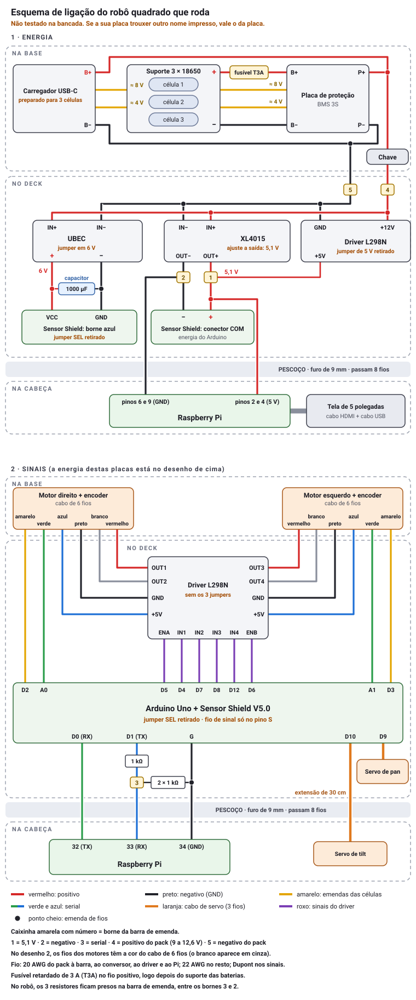

# Ligação elétrica do robô quadrado que roda

<!-- GERADO:idiomas -->
[🇧🇷 Português](LIGACAO.md) · [🇺🇸 English](LIGACAO.en.md) · [🇪🇸 Español](LIGACAO.es.md)
<!-- /GERADO -->

**Não testado na bancada.** Este esquema saiu das fichas dos componentes; nenhum fio foi ligado ainda num robô montado.
Confira cada ligação com o multímetro antes de ligar a chave. Se a sua placa trouxer um nome impresso diferente do
que está aqui, vale o nome da placa.

Página do robô: https://inematds.github.io/robos-impressos/guia/cubo-rodas/

Toda a solda do robô é feita na bancada, nos preparos 1, 2 e 3. Na montagem só há bornes e encaixes.

## Segurança com bateria de lítio

- **Polaridade:** vermelho no positivo, preto no negativo. Meça com o multímetro antes de cada ligação nova. Fio invertido queima a placa na hora.
- **Ajuste antes de ligar a carga:** XL4015 em 5,1 V e UBEC em 6 V, medidos com o multímetro, sem o Raspberry Pi, sem o Arduino e sem os servos ligados.
- **Curto pega fogo:** solde com as células FORA do suporte e isole cada emenda com termo-retrátil. Nenhum metal pode ficar à mostra. Um pack de 3 células em curto solta muito mais energia que uma pilha comum.
- **Fusível:** 3 A, retardado (marcado T3A), no fio positivo, a poucos centímetros do suporte das baterias.
- **Células iguais:** as três 18650 da mesma marca, do mesmo modelo e novas. Célula amassada, inchada ou quente vai para a coleta de pilhas, não para o robô.
- **Primeira carga:** fique por perto, com o robô sobre uma superfície que não queima.

## O que alimenta o quê

- **Pack 3S:** três células 18650 em série, de 9 V (vazio) a 12,6 V (cheio). Passa pelo fusível e pela placa de proteção (BMS).
- **Carregador USB-C:** fica ligado na saída da placa de proteção, antes da chave. O robô carrega desligado, por uma fonte USB-C de 15 W ou mais. Ele precisa ser preparado para 3 células (preparo 1).
- **Chave:** corta o positivo que vai para os dois conversores e para o driver.
- **XL4015, ajustado em 5,1 V:** a saída vai à barra de emenda, no deck. Dela saem o par que alimenta o Raspberry Pi (pelos pinos 2, 4, 6 e 9), o par que alimenta o Arduino (pelos pinos + e − do conector COM do Sensor Shield) e o fio dos 5 V do driver e dos encoders.
- **UBEC em 6 V:** alimenta só os 2 servos, pelo borne azul do Sensor Shield, com o jumper SEL retirado.
- **Driver L298N:** recebe a tensão do pack e a entrega aos 2 motores. Ele tira cerca de 2 V no caminho.
- **Negativo (GND):** é um só para o robô inteiro.

Por que o Arduino recebe os 5,1 V do conversor, e não a tensão da bateria: a entrada VIN do Arduino Uno pede de 7 a 12 V
([ficha do Arduino Uno R3](https://docs.arduino.cc/resources/datasheets/A000066-datasheet.pdf)) e o pack cheio passa
de 12 V.

Por que o Raspberry Pi recebe a energia pelos pinos, e não pela entrada USB-C: a entrada USB-C fica na borda de baixo
da placa, onde sobram cerca de 22 mm até o fundo da cabeça (medida do modelo, não confirmada), e um plugue reto não
cabe ali. Os pinos 2 e 4 aceitam a entrada de 5 V
([documentação da Raspberry Pi](https://github.com/raspberrypi/documentation/blob/master/documentation/asciidoc/computers/raspberry-pi/gpio-on-raspberry-pi.adoc)).
Por eles a energia não passa pela proteção da entrada USB-C: meça os 5,1 V antes de encaixar. Se preferir a entrada
USB-C, use um adaptador USB-C com bornes em ângulo e confira o espaço.

## A barra de emenda

É uma barra de bornes de parafuso (tipo sindal) que fica solta no deck. Você usa 5 bornes dela, numerados de 1 a 5:

- **Borne 1, os 5,1 V:** de um lado, o fio vermelho que vem do XL4015. Do outro, o fio vermelho que sobe ao Raspberry Pi, o jumper que vai ao pino + do conector COM do shield e o fio que vai ao borne +5V do driver.
- **Borne 2, o negativo:** de um lado, o fio preto do XL4015 e uma ponta do par de resistores. Do outro, o fio preto que sobe ao Raspberry Pi e o jumper que vai ao pino − do conector COM.
- **Borne 3, a serial:** de um lado, os resistores do divisor. Do outro, o fio azul que desce do Raspberry Pi.
- **Borne 4, o positivo do pack:** de um lado, o fio vermelho que sobe da chave. Do outro, a entrada do XL4015, a entrada do UBEC e o borne +12V do driver.
- **Borne 5, o negativo do pack:** de um lado, o fio preto que sobe da placa de proteção. Do outro, o negativo do XL4015, do UBEC e do driver.

Os bornes 4 e 5 existem para o deck poder ser separado da base sem dessoldar nada: os 2 fios que sobem da base passam
por um rasgo do deck e são apertados na barra.

## Tabela de ligações, fio a fio

<!-- GERADO:ligacoes -->
### Bateria, proteção e carga

| De | Para | Cor | Fio | Atenção |
|---|---|---|---|---|
| Suporte das baterias: fio vermelho (positivo do pack) | Porta-fusível de 3 A e, depois dele, ilha do positivo das células na placa de proteção (B+ ou 12,6V) | vermelho | 22 AWG | O fusível fica a poucos centímetros do suporte. |
| Suporte das baterias: fio preto (negativo do pack) | Ilha do negativo das células na placa de proteção (B− ou 0V) | preto | 22 AWG |  |
| Suporte das baterias: lâmina da emenda de cima (a do lado do fio vermelho) | Ilha da emenda de cima na placa de proteção (em geral 8,4V) | amarelo, marcado com fita | 22 AWG | Do fio preto do suporte até este fio o multímetro marca cerca de 8 V. Solde na lâmina com as células FORA do suporte. |
| Suporte das baterias: lâmina da emenda de baixo (a do lado do fio preto) | Ilha da emenda de baixo na placa de proteção (em geral 4,2V) | amarelo | 22 AWG | Do fio preto do suporte até este fio o multímetro marca cerca de 4 V. |
| Lâmina da emenda de cima (um segundo fio na mesma lâmina) | Carregador USB-C: a ilha do meio que fica mais perto da B+ | amarelo, marcado com fita | 22 AWG | Sem os 2 fios das emendas o carregador não equilibra as três células. |
| Lâmina da emenda de baixo (um segundo fio na mesma lâmina) | Carregador USB-C: a ilha do meio que fica mais perto da B− | amarelo | 22 AWG | A ordem das 2 ilhas do meio vem da figura da loja; os nomes impressos não dão para ler na foto. |
| Ilha B+ do carregador USB-C | Saída positiva da placa de proteção (P+) | vermelho | 22 AWG | O carregador fica antes da chave: o robô carrega desligado. |
| Ilha B− do carregador USB-C | Saída negativa da placa de proteção (P−) | preto | 22 AWG | Não ligue na ilha do negativo das células: a carga tem de passar pela proteção. |

### Chave e distribuição do pack

| De | Para | Cor | Fio | Atenção |
|---|---|---|---|---|
| Saída positiva da placa de proteção (P+) | Chave liga/desliga e, depois dela, borne 4 da barra de emenda | vermelho | 20 AWG | A chave corta só o positivo. Este fio sobe da base ao deck pelo rasgo de trás. |
| Saída negativa da placa de proteção (P−) | Borne 5 da barra de emenda | preto | 20 AWG | Este é o negativo comum (GND) de todo o robô. |
| Barra de emenda, borne 4 (positivo do pack, de 9 a 12,6 V) | Entrada IN+ do XL4015, fio vermelho de entrada do UBEC e borne +12V do driver L298N | vermelho | 20 AWG | São 3 fios no mesmo borne. |
| Barra de emenda, borne 5 (negativo do pack) | Entrada IN− do XL4015, fio preto de entrada do UBEC e borne GND do driver L298N | preto | 20 AWG |  |

### 5,1 V: Raspberry Pi, Arduino, driver e encoders

| De | Para | Cor | Fio | Atenção |
|---|---|---|---|---|
| Saída OUT+ do XL4015 (5,1 V) | Barra de emenda, borne 1 | vermelho | 20 AWG, curto | Ajuste os 5,1 V ANTES de ligar qualquer coisa do outro lado da barra. |
| Saída OUT− do XL4015 | Barra de emenda, borne 2 | preto | 20 AWG, curto |  |
| Barra de emenda, borne 1 (5,1 V) | Pelo pescoço, até os pinos 2 e 4 do Raspberry Pi | vermelho | 20 AWG, com 2 metades de jumper soldadas na ponta | Os pinos 2 e 4 são a entrada de 5 V do Pi. Por eles a energia não passa pela proteção da entrada USB-C: meça os 5,1 V e a polaridade na barra antes de encaixar. |
| Barra de emenda, borne 2 (negativo) | Pelo pescoço, até os pinos 6 e 9 do Raspberry Pi | preto | 20 AWG, com 2 metades de jumper soldadas na ponta |  |
| Barra de emenda, borne 1 (5,1 V) | Pino + do conector COM do Sensor Shield | vermelho | jumper Dupont com uma ponta cortada e descascada | É por aqui que o Arduino recebe energia. Antes, com o Uno só na USB e o jumper SEL retirado, confirme com o multímetro que esse pino marca cerca de 5 V e que o pino V do D9 marca 0 V. Um pino errado aqui põe os 6 V dos servos no Raspberry Pi. |
| Barra de emenda, borne 2 (negativo) | Pino − do conector COM do Sensor Shield | preto | jumper Dupont com uma ponta cortada e descascada |  |
| Barra de emenda, borne 1 (5,1 V) | Borne +5V do driver L298N | vermelho | 22 AWG | Só com o jumper do regulador de 5 V do driver RETIRADO. Com ele posto, o regulador do driver e o XL4015 ficam ligados um contra o outro. |
| Fio azul do cabo de cada motor (energia do encoder) | Borne +5V do driver L298N, junto com o fio que vem do borne 1 | azul | cabo de 6 fios do motor | O encoder aceita de 3,3 a 5 V. Nunca ligue este fio na tensão do motor nem no pino V do shield, que tem 6 V. |
| Fio preto do cabo de cada motor (negativo do encoder) | Borne GND do driver L298N | preto | cabo de 6 fios do motor |  |

### 6 V: servos

| De | Para | Cor | Fio | Atenção |
|---|---|---|---|---|
| Fio vermelho de saída do UBEC (6 V) | Borne azul VCC do Sensor Shield | vermelho | fio do UBEC, com o plugue de 3 pinos cortado | Jumper SEL do shield RETIRADO e jumper do UBEC em 6 V. A saída do UBEC vem com um plugue de servo: corte o plugue e descasque os fios. O vermelho é o positivo. |
| Fio preto ou marrom de saída do UBEC | Borne azul GND do Sensor Shield | preto | fio do UBEC, com o plugue de 3 pinos cortado | Se o plugue tiver um terceiro fio, branco ou laranja, isole a ponta dele com termo-retrátil: ele não é ligado. |
| Capacitor de 1000 µF: perna comprida (+) | Borne azul VCC; a perna da listra (−) vai no borne azul GND | sem fio | pernas do capacitor | Capacitor invertido estoura. |
| Servo de pan (no deck) | Conector D9 do Sensor Shield | cabo do servo | cabo de 3 fios do servo | G = marrom ou preto, V = vermelho, S = laranja ou amarelo. |
| Servo de tilt (na cabeça) | Pelo pescoço, com a extensão de 30 cm, até o conector D10 do Sensor Shield | cabo do servo | cabo de 3 fios do servo | Mesma ordem de cores do D9. |

### Motores e encoders

| De | Para | Cor | Fio | Atenção |
|---|---|---|---|---|
| Motor direito: fios vermelho e branco | Bornes OUT1 e OUT2 do driver L298N | vermelho e branco | cabo de 6 fios do motor | Se a roda girar ao contrário quando o programa da fase 2 mandar andar para a frente, troque estes 2 fios de lugar. |
| Motor esquerdo: fios vermelho e branco | Bornes OUT3 e OUT4 do driver L298N | vermelho e branco | cabo de 6 fios do motor |  |
| Driver L298N: pino ENA | Pino S do D5 do Sensor Shield | qualquer, marcado ENA | jumper Dupont de 40 cm, inteiro | Com o jumper ENA retirado. O fio vai no pino da entrada, não no pino de 5 V que fica ao lado dele (preparo 3). O D5 e o D6 controlam a velocidade. |
| Driver L298N: pinos IN1 e IN2 | Pino S do D4 (IN1) e pino S do D7 (IN2) | qualquer, marcados | jumper Dupont de 40 cm, inteiro | Sentido do motor direito. |
| Driver L298N: pinos IN3 e IN4 | Pino S do D8 (IN3) e pino S do D12 (IN4) | qualquer, marcados | jumper Dupont de 40 cm, inteiro | Sentido do motor esquerdo. |
| Driver L298N: pino ENB | Pino S do D6 do Sensor Shield | qualquer, marcado ENB | jumper Dupont de 40 cm, inteiro | Com o jumper ENB retirado; vale o mesmo cuidado do ENA. |
| Encoder direito: fio amarelo | Pino S do D2 do Sensor Shield | amarelo | metade de jumper soldada no fio do cabo | A ficha do motor não diz qual dos 2 fios, amarelo ou verde, é o canal A. Se a contagem sair ao contrário, isso se acerta no programa. |
| Encoder direito: fio verde | Pino S do conector A0 do Sensor Shield | verde | metade de jumper soldada no fio do cabo | Os conectores A0 e A1 ficam na fileira ANALOG IN do shield; confira que a sua placa tem os pinos em pé ali. |
| Encoder esquerdo: fio amarelo | Pino S do D3 do Sensor Shield | amarelo | metade de jumper soldada no fio do cabo |  |
| Encoder esquerdo: fio verde | Pino S do conector A1 do Sensor Shield | verde | metade de jumper soldada no fio do cabo |  |

### Serial entre o Raspberry Pi e o Arduino

| De | Para | Cor | Fio | Atenção |
|---|---|---|---|---|
| Raspberry Pi: pino 32 (GPIO12, TX) | Pelo pescoço, até o pino S do D0 (RX) do Sensor Shield | verde | jumper Dupont de 40 cm, inteiro | Direto: os 3,3 V do Pi já valem como nível alto para o Arduino. |
| Raspberry Pi: pino 34 (GND) | Pelo pescoço, até o pino G do D0 do Sensor Shield | preto | jumper Dupont de 40 cm, inteiro |  |
| Raspberry Pi: pino 33 (GPIO13, RX) | Pelo pescoço, até o borne 3 da barra de emenda | azul | jumper de 40 cm com uma ponta cortada e descascada | Este fio nunca vai direto no D1: são 5 V num pino de 3,3 V. |
| Barra de emenda, borne 3 | Resistor de 1 kΩ e, depois dele, pino S do D1 (TX) do Sensor Shield | azul | metade de um jumper, soldada na perna do resistor, com o conector fêmea no shield | Montado na bancada, no preparo 3. |
| Barra de emenda, borne 3 | 2 resistores de 1 kΩ em série e, depois deles, borne 2 da barra (negativo) | sem fio | pernas dos resistores | Os 3 resistores formam o divisor: 5 V viram 3,3 V. |
| Tela de 5 polegadas | Raspberry Pi: saída micro-HDMI (a mais perto da entrada USB-C) e uma porta USB | sem fio | cabo HDMI flat curto e cabo USB curto | A tela não usa os pinos do Pi. Os 2 cabos ficam dentro da cabeça e não estão no modelo 3D. |
<!-- /GERADO -->

## Preparo 1: solde a energia e ajuste as duas tensões

Faça na bancada, com a base e o deck impressos lado a lado. A chave é a primeira peça a entrar na base, e entra antes
de ser soldada no resto. Os nomes das ilhas mudam de placa para placa, e os das placas deste robô não foram lidos:
a página da loja da placa de proteção de 3 células não mostra os nomes, e na foto do carregador as 2 ilhas do meio não
dão para ler. Por isso este guia chama as ligações pelo que elas são (positivo, negativo, emenda de cima, emenda de
baixo) e manda conferir cada uma com o multímetro.

O carregador vem pronto para 2 células. A página da loja mostra, numa figura, o que muda para 3 células: um resistor
retirado e um jumper fechado com solda, ao lado da marca ROV
([página do carregador](https://www.usinainfo.com.br/fonte-de-alimentacao/carregador-de-baterias-18650-litio-2s3s-com-balanceamento-usb-c-lx-usc-v2-8996.html)).
É uma solda muito pequena. Plano B, sem mexer no carregador: tirar as 3 células pelo alçapão e carregá-las num
carregador de 18650 comum.

<!-- GERADO:prep1 -->
1. Com as 3 células fora do suporte, solde 2 fios amarelos de 20 cm em cada uma das 2 lâminas de metal que unem as células: são as 2 emendas do pack, e de cada uma sai um fio para a placa de proteção e outro para o carregador. Marque com fita os 2 fios da emenda que fica do lado do fio vermelho do suporte: é a emenda de cima.
2. Prepare o carregador para 3 células, seguindo a figura da página da loja: retire o resistor minúsculo indicado e feche com um pingo de solda o jumper ao lado da marca ROV. Sem isso ele carrega só até 8,4 V. Se você não tem prática com solda tão pequena, não use este carregador: tire as 3 células pelo alçapão e carregue-as num carregador de 18650 comum.
3. Solde 2 fios vermelhos de 20 AWG, com 15 cm, nos 2 terminais da chave. Passe as pontas livres pelo recorte de trás da base, de fora para dentro, e encaixe a chave no recorte. Faça isso ANTES de soldar a chave no resto: ligada ao chicote, ela não passa pelo recorte de 13,5 × 9 mm.
4. Com a base ao lado servindo de gabarito do comprimento dos fios, ligue o suporte, o fusível, a placa de proteção e o carregador, conforme a tabela de ligações. Deixe uns 15 cm de folga nos 4 fios do suporte: ele desce junto com o alçapão na hora de trocar as células.
5. Solde uma ponta da chave na saída positiva da placa de proteção (P+). Descasque 6 mm da outra ponta: ela vai ao borne 4. Solde um fio preto de 20 AWG, com 20 cm, na saída negativa (P−) e descasque a ponta livre: ela vai ao borne 5.
6. Agora o deck, ainda fora do robô. Corte da barra de emenda um pedaço com 5 bornes e numere de 1 a 5. Solde 2 fios curtos de 20 AWG na entrada do XL4015 e aperte as outras pontas na barra: o do IN+ no borne 4, o do IN− no borne 5. O fio vermelho de entrada do UBEC vai junto no borne 4 e o preto no borne 5.
7. Retire do driver L298N os 3 jumpers (as capinhas de plástico): os 2 marcados ENA e ENB e o do regulador de 5 V, ao lado do borne de energia. Depois, do mesmo lado da barra, aperte um fio vermelho de 20 AWG do borne 4 ao borne +12V do driver e um preto do borne 5 ao borne GND do driver.
8. Na saída do XL4015, solde 2 fios curtos de 20 AWG e aperte as outras pontas na barra: o do OUT+ no borne 1, o do OUT− no borne 2. Não ligue mais nada nas saídas.
9. Ponha a base e o deck lado a lado. Do outro lado da barra, aperte no borne 4 o fio vermelho que vem da chave e, no borne 5, o fio preto que vem da placa de proteção.
10. Ponha as 3 células no suporte, conferindo o lado do positivo. Com o multímetro, meça do fio preto do suporte até cada fio amarelo: cerca de 4 V na emenda de baixo e cerca de 8 V na de cima (a marcada com fita). Ligue a chave.
11. Meça entre os bornes 4 e 5: tem de dar de 9 a 12,6 V, com o vermelho no positivo.
12. Com o multímetro nos bornes 1 e 2, gire o parafuso de ajuste do XL4015 com a chave de fenda até marcar 5,1 V. São várias voltas.
13. Meça a saída do UBEC: tem de marcar 6 V. Se marcar 5 V, mude o jumper dele para 6 V.
14. Desligue a chave.
<!-- /GERADO -->

## Preparo 2: grave o programa e ponha os 2 servos em 90°

O programa é o sketch [centrar_servos.ino](firmware/centrar_servos/centrar_servos.ino). Ele leva os dois servos para
o centro, mantém os dois lá e deixa os motores das rodas desligados.

<!-- GERADO:prep2 -->
1. Abra o sketch `centrar_servos.ino` na Arduino IDE. Ligue o Arduino Uno ao computador pelo cabo USB, sem o shield e sem bateria.
2. No menu Ferramentas, escolha a placa Arduino Uno e a porta em que ela apareceu. Clique em Carregar.
3. Tire o cabo USB, encaixe o Sensor Shield no Uno e retire o jumper SEL do shield: é a capinha de plástico sobre 2 pinos, ao lado do borne azul.
4. Ligue o cabo USB de novo, só para medir com o multímetro. O conector COM do shield tem 4 pinos em pé, marcados TX, RX, − e +. Entre o + e o − tem de dar cerca de 5 V. No conector D9, entre o pino V e o pino G, tem de dar 0 V.
5. Se o V do D9 marcar 5 V, o jumper SEL ainda está posto. Se o + do COM não marcar 5 V, o seu shield é diferente do da foto da loja: procure outro pino marcado + ou 5V que marque 5 V com o SEL retirado. Um pino errado aqui põe os 6 V dos servos no Raspberry Pi.
6. Tire o cabo USB.
7. A saída do UBEC vem com um plugue de servo de 3 pinos: corte o plugue e descasque os fios. O vermelho é o positivo e o preto (ou marrom) é o negativo. Se houver um terceiro fio, branco ou laranja, isole a ponta dele com termo-retrátil. Aperte o vermelho no VCC e o preto no GND do borne azul. No mesmo borne vai o capacitor de 1000 µF, com a perna comprida no VCC.
8. Pegue 2 jumpers de 40 cm, corte o conector de uma ponta de cada um e descasque. Aperte um no borne 1 da barra de emenda, do lado oposto ao do conversor, e encaixe o conector dele no pino + do conector COM. O outro vai do borne 2 ao pino − do mesmo conector. Os pinos TX e RX, ao lado, ficam vazios: 5 V num deles chegam ao Raspberry Pi pelo fio da serial.
9. Ligue o servo de pan no D9 e o servo de tilt no D10: fio marrom ou preto no G, vermelho no V, laranja ou amarelo no S.
10. Ligue a chave: os dois servos vão para o centro (90°) e o LED do Uno pisca uma vez por segundo. O driver dos motores ainda não está ligado ao Arduino: as rodas não se mexem.
11. Desligue a chave. Daqui em diante não gire os eixos dos servos com a mão.
12. Desfaça as ligações de teste para a montagem: tire os 2 servos do D9 e do D10, solte do borne azul os fios do UBEC e o capacitor e tire os 2 jumpers do conector COM. Solte dos bornes 4 e 5 os 2 fios que vêm da base: eles voltam na montagem, depois de passar pelo rasgo do deck. Se o shield cobrir os furos de fixação do Uno, desencaixe-o também. Tire as 3 células do suporte: elas só voltam na montagem, no passo da bateria.
<!-- /GERADO -->

Três avisos:

- Não alimente o servo MG996R pelos 5 V da USB. A porta USB dá 0,5 A e o servo pede mais do que isso ao partir.
- Nunca ligue o cabo USB do computador com a bateria ligada: as duas fontes ficariam em paralelo.
- Grave o sketch antes de fechar o robô. Depois, para chegar ao USB do Arduino, é preciso soltar os 4 parafusos de baixo e levantar o tronco.

O sketch compila para o Arduino Uno (arduino-cli, core arduino:avr 1.8.8, biblioteca Servo 1.3.0). Ele ainda não foi
rodado num robô montado.

## Preparo 3: faça os cabos da serial, do Raspberry Pi, do driver e dos encoders

O Raspberry Pi fica na cabeça e o Arduino no deck. Os dois conversam por 3 fios que descem pelo pescoço: verde, azul
e preto. Pelo mesmo pescoço sobe o par de fios que alimenta o Pi. No deck, o Arduino manda no driver por 6 fios e lê
os 2 encoders por 4. São 16 jumpers de 40 cm no robô inteiro; um kit de 40 sobra. Faça este preparo com as células
fora do suporte.

<!-- GERADO:prep3 -->
1. Serial. Separe 3 jumpers de 40 cm: um verde, um azul e um preto (ou marque 3 de outra cor com fita). O verde e o preto ficam inteiros, com os 2 conectores fêmea. No azul, corte o conector de UMA ponta e descasque 6 mm: essa ponta vai num borne.
2. Ache os pinos no Raspberry Pi: o pino 1 é o do canto, do lado do cartão microSD, na fileira de dentro; o pino 40 fica no canto oposto, na fileira da borda. Os ímpares ficam na fileira de dentro e os pares na fileira da borda. Os pinos 2, 4 e 6 são os 3 primeiros da fileira da borda; o pino 9 é o 5º da fileira de dentro. Os pinos 32 e 34 são o 16º e o 17º da fileira da borda; o pino 33 é o 17º da fileira de dentro.
3. Marque com fita a ponta de cada jumper da serial que vai no Pi: verde = pino 32, azul = pino 33, preto = pino 34.
4. Divisor. Solde 2 resistores de 1 kΩ um no outro, perna com perna, e cubra a emenda com termo-retrátil. Esse par vale 2 kΩ.
5. Corte um jumper ao meio. Solde a ponta cortada de uma das metades numa perna do 3º resistor e cubra com termo-retrátil. O conector fêmea dessa metade é o que vai no D1.
6. Na barra de emenda, do lado do conversor, aperte no borne 3 a perna livre do 3º resistor junto com uma ponta do par de 2 kΩ. Aperte a outra ponta do par no borne 2, junto com o fio preto que já está lá. Dobre a ponta de cada perna antes de apertar, para o parafuso morder.
7. Confira com o multímetro, em ohms: entre o conector fêmea do jumper do D1 e o borne 3, cerca de 1 kΩ; entre o borne 3 e o borne 2, cerca de 2 kΩ.
8. Energia do Raspberry Pi. Corte 2 jumpers ao meio: são 4 metades com conector fêmea. Corte 45 cm de fio vermelho e 45 cm de fio preto de 20 AWG. Solde 2 metades na ponta do vermelho e 2 na ponta do preto e cubra cada emenda com termo-retrátil. Marque as 2 do vermelho com fita: vão nos pinos 2 e 4 (5 V). As 2 do preto vão nos pinos 6 e 9 (GND). Descasque 6 mm da outra ponta de cada fio: elas vão aos bornes 1 e 2.
9. Driver. Os 3 jumpers dele já saíram no preparo 1. Onde ficavam os jumpers ENA e ENB há 2 pinos em cada lugar: um é a entrada (ENA ou ENB) e o outro é ligado aos 5 V da placa. Com o multímetro em continuidade e a chave desligada, ache em cada par o pino que apita com o borne +5V do driver: esse fica vazio. Marque o outro com caneta: é nele que vai o fio do Arduino. Um fio do Arduino no pino de 5 V pode queimar a saída do Arduino.
10. Guarde 6 jumpers inteiros para os sinais do driver e marque cada um com fita: ENA, IN1, IN2, IN3, IN4 e ENB.
11. Aperte um fio vermelho de 22 AWG, com 15 cm, no borne 1 da barra, do lado oposto ao do conversor. A outra ponta vai ao borne +5V do driver, na montagem, junto com os fios azuis dos encoders.
12. Encoders. Cada motor vem com um cabo de 6 fios. Encaixe o cabo no motor e corte o conector da outra ponta. Descasque 6 mm do vermelho, do branco, do azul e do preto: eles vão em bornes. No amarelo e no verde, solde em cada um uma metade de jumper com conector fêmea (são mais 2 jumpers cortados ao meio) e cubra com termo-retrátil. Marque os cabos: direito e esquerdo.
13. Guarde os cabos. Na montagem tudo entra por borne ou encaixe, sem solda. Atenção: nos conectores de 3 pinos do shield, só o pino S (sinal) recebe fio de sinal. O pino do meio (V) fica sempre vazio: com o jumper SEL retirado ele tem os 6 V dos servos, e 6 V num fio de sinal queimam o Raspberry Pi ou o encoder.
<!-- /GERADO -->

Por que aqui o conector Dupont comum serve: a tela deste robô não espeta nos pinos do Raspberry Pi. Entre o Pi e a
tela sobram cerca de 20 mm (medida do modelo, não confirmada), e o conector Dupont tem 14 mm. Se na sua tela não
couber, dobre os fios logo acima do conector ou solde os fios num pedaço de barra de pinos fêmea, com os fios saindo
de lado.

Onde fica o pino 1 e por que o número do pino não é o número do GPIO:
[documentação da Raspberry Pi](https://github.com/raspberrypi/documentation/blob/master/documentation/asciidoc/computers/raspberry-pi/gpio-on-raspberry-pi.adoc).
No Pi já ligado, o comando `pinout` desenha o mapa dos pinos.

O cabo de cada motor tem cerca de 14 cm
([tabela do motor numa loja](https://rcdrone.top/products/jgb37-520-dc-gear-motor-with-encoder)). Se algum fio não
chegar ao driver ou ao shield, emende um pedaço de fio 22 AWG, com solda e termo-retrátil, ainda neste preparo.

## Preparo 4: grave o cartão microSD, teste a tela e ligue a serial

O cartão é gravado no seu computador, com um leitor de cartão microSD. Depois você fala com o Raspberry Pi pela rede,
por SSH: digita os comandos no seu computador e eles rodam no Pi.

<!-- GERADO:prep4 -->
1. Instale no computador o Raspberry Pi Imager, o programa gratuito da Raspberry Pi, e ponha o cartão no leitor.
2. No Imager, escolha o modelo do seu Pi, o sistema Raspberry Pi OS (64-bit) e o cartão.
3. Antes de gravar, abra as configurações do Imager: dê um nome ao Pi (por exemplo `robo`), crie um usuário e uma senha, ponha o nome e a senha do seu Wi-Fi e ative o SSH. Grave.
4. Ponha o cartão no Pi. Só para este teste, ligue a tela nele com o cabo HDMI e o cabo USB, e ligue o Pi por uma fonte USB-C de 5 V e 3 A. Espere uns 2 minutos: a tela tem de mostrar o sistema. O fabricante diz que ela funciona no Raspberry Pi OS sem instalar driver.
5. No computador, abra o terminal: no Windows é o programa PowerShell; no Mac e no Linux, o Terminal.
6. Digite `ssh usuario@robo.local`, trocando `usuario` e `robo` pelos nomes que você criou. Responda `yes` na primeira vez e digite a senha.
7. Se `robo.local` não responder, abra a página do seu roteador, ache o Pi na lista de aparelhos ligados e use o número dele (o endereço IP), por exemplo `ssh usuario@192.168.0.50`.
8. Quando o terminal mostrar o nome do Pi, você está dentro dele. Ligue a serial: digite `sudo nano /boot/firmware/config.txt`, vá até o fim do arquivo e acrescente uma linha: `dtoverlay=uart5` no Raspberry Pi 4, ou `dtoverlay=uart4-pi5` no Raspberry Pi 5. Salve com Ctrl+O e Enter, saia com Ctrl+X.
9. Digite `sudo poweroff`, espere o LED verde do Pi parar de piscar, tire a fonte e solte os 2 cabos da tela: ela volta na montagem.
<!-- /GERADO -->

A tela é a Waveshare 5inch HDMI LCD (B): 5 polegadas, 800 × 480, ligada por HDMI, com um cabo USB para a energia. O
fabricante diz que ela funciona no Raspberry Pi OS sem driver
([página do fabricante](https://www.waveshare.com/5inch-hdmi-lcd-b.htm)). Se a imagem não preencher a tela, veja a
[wiki do fabricante](https://www.waveshare.com/wiki/5inch_HDMI_LCD_%28B%29). Não testado na bancada. Documentação da
Raspberry Pi, no GitHub: [SSH](https://github.com/raspberrypi/documentation/blob/master/documentation/asciidoc/computers/remote-access/ssh.adoc) e [como achar o endereço do Pi](https://github.com/raspberrypi/documentation/blob/master/documentation/asciidoc/computers/remote-access/find-your-ip-address.adoc).

A linha da serial vem da [lista de overlays do firmware do Raspberry Pi](https://github.com/raspberrypi/firmware/blob/master/boot/overlays/README).
Depois de reiniciar, o nome da porta aparece com `ls /dev/ttyAMA*`. O programa que usa essa serial é da fase 2.

## Os cabos da tela

A tela liga no Raspberry Pi por 2 cabos, que ficam dentro da cabeça: um HDMI e um USB. Eles não estão no modelo 3D.

- O Raspberry Pi 4 tem saída micro-HDMI, na borda de baixo da placa. Pelo modelo sobram cerca de 22 mm dali até o fundo da cabeça.
- As portas USB do Pi ficam viradas para a direita. Pelo modelo sobram cerca de 30 mm até a parede da cabeça.
- Os cabos que vêm com a tela são retos e compridos e não cabem nesses espaços. Por isso a lista pede um cabo HDMI flat curto, com o plugue micro-HDMI em ângulo, e um cabo USB curto, com o plugue USB-A em ângulo.
- Confira os 2 cabos com as peças na mão, antes de fechar a cabeça. É o principal risco de encaixe deste robô.

## Como o Raspberry Pi conversa com o Arduino

O furo de cabos do pescoço tem 9 mm e um plugue USB não passa por ele. Por isso os dois conversam por uma serial
(UART) de 3 fios soltos.

- **No Arduino:** pinos D0 (RX) e D1 (TX), que são a serial de verdade da placa. Ela não atrapalha o sinal dos servos.
- **No Raspberry Pi:** pino 32 (GPIO12, TX), pino 33 (GPIO13, RX) e pino 34 (GND).
- **Número do pino e número do GPIO:** "pino 32" é a posição na fileira de 40 pinos, contada a partir do canto do cartão microSD. "GPIO12" é o nome do sinal que sai por esse pino. Os dois números não são iguais.
- **Tensão:** o Arduino trabalha em 5 V e o Pi em 3,3 V. O fio que vai do Arduino para o Pi passa por um divisor de 3 resistores de 1 kΩ, que baixa 5 V para 3,3 V. O fio que vai do Pi para o Arduino é direto.
- **Por que resistores e não um módulo conversor de nível:** o divisor resolve com 3 resistores presos na barra de emenda, sem mais uma placa solta no deck.

## Como o Arduino manda nos motores

O driver L298N tem 6 pinos de comando. O Arduino usa 6 conectores do Sensor Shield, sempre só o pino S.

- **Velocidade:** ENA no D5 (motor direito) e ENB no D6 (motor esquerdo). Esses dois pinos do Arduino sabem variar a força do motor, e a biblioteca dos servos não mexe neles. Os jumpers ENA e ENB do driver saem: com eles postos, o motor fica sempre na força máxima.
- **Sentido:** IN1 no D4 e IN2 no D7 (motor direito); IN3 no D8 e IN4 no D12 (motor esquerdo).
- **Os 5 V do driver:** o jumper do regulador de 5 V do driver sai, e o borne +5V dele recebe os 5,1 V da barra de emenda. Assim a parte de comando do driver não depende da tensão do pack.
- **Encoders:** cada motor tem um sensor que dá 2 sinais. O fio amarelo vai no D2 (direito) e no D3 (esquerdo), os dois pinos do Arduino que avisam o programa a cada pulso. O fio verde vai no A0 (direito) e no A1 (esquerdo). O encoder dá 11 pulsos por volta do motor, antes da redução de 1:56 (tabela da loja citada acima).
- **Energia dos encoders:** de 3,3 a 5 V, pelos fios azul (positivo) e preto (negativo). Eles vão nos bornes +5V e GND do driver. Nunca no pino V do shield, que tem os 6 V dos servos.

Enquanto o sketch `centrar_servos.ino` estiver gravado, os 6 pinos do driver ficam em nível baixo e as rodas não giram.
O programa que faz o robô andar é da fase 2.

## Os 8 fios que passam pelo pescoço

São 8 fios: 2 de energia (5,1 V do Raspberry Pi, 20 AWG), 3 da serial e os 3 do cabo do servo de tilt. Eles têm de ser
ligados dentro da cabeça ANTES do copo, porque depois o Raspberry Pi fica fechado. E não podem ficar pendurados por
baixo do garfo nessa hora, porque o fundo do copo passa por baixo dele. A ordem é esta:

1. Na montagem do Raspberry Pi, antes do painel com a tela, encaixe os 3 jumpers da serial nos pinos 32, 33 e 34 e os 4 conectores do cabo de energia nos pinos 2, 4, 6 e 9.
2. Com a cabeça ainda aberta (quadro, tela, servo de tilt e garfo no lugar), confira esses 7 conectores e os 2 cabos da tela.
3. Ligue a extensão de 30 cm no cabo do servo de tilt.
4. Desça os 8 fios pelo furo de 9 mm do garfo, de cima para baixo. Primeiro o conector da extensão, que tem 7,6 mm de largura e passa justo.
5. Pare quando as pontas ficarem rentes à face de baixo do garfo. Deixe uns 5 cm de fio sobrando dentro da cabeça: ela inclina em volta do garfo.
6. Feche a cabeça com o copo. Com a pinça, puxe as pontas dos 8 fios para fora pelo rasgo do fundo do copo.
7. Enfie os fios pelo tubo do pescoço e assente a cabeça sobre ele.
8. No deck, com a chave desligada e sem solda: os 2 fios de 5,1 V nos bornes 1 e 2 da barra de emenda; o fio azul no borne 3; o conector do verde no pino S do D0 e o do preto no pino G do D0; o jumper do divisor no pino S do D1; a extensão do servo no D10.

Deixe cerca de 10 cm de folga dentro do tronco: o pescoço gira quase uma volta e torce os fios. Esta passagem nunca foi
ensaiada com as peças impressas.

## Corrente, fio e fusível

Os valores abaixo são calculados a partir das fichas, não medidos.

- Uso normal: cerca de 2 A saindo do pack. O Raspberry Pi com a tela puxa cerca de 1,5 A em 5,1 V, os servos menos de 1 A em 6 V e cada motor cerca de 0,2 A andando.
- Pior caso: cerca de 6,5 A, com as 2 rodas travadas (1,2 A cada, pela tabela do motor), o UBEC nos 3 A de limite, o XL4015 em 3 A e o pack em 9 V.
- Chave KCD11-101: 3 A em 250 V~ e 6 A em 125 V~ ([ficha de loja](https://eletronicamaker.com.br/produto/mini-chave-gangorra-kcd11-101-liga-desliga-3a-250v-vm-c)). A ficha não traz valor para corrente contínua.
- Fusível de 3 A: é o menor valor da chave. O uso normal fica abaixo dele, e uma sobrecarga que dura abre o fusível antes de a chave esquentar.
- **A chave é o ponto mais fraco deste robô.** Se ele forçar contra um obstáculo com os servos em esforço, a corrente passa de 3 A e o fusível pode abrir. Trocar por uma chave maior exige mudar o recorte de 13,5 × 9 mm na base: fica como pendência do projeto.
- Fusível retardado (marcado T3A ou T3,15A): a partida dos motores e dos servos e a carga do capacitor de 1000 µF dão picos de uma fração de segundo. Um fusível rápido pode abrir nesses picos sem haver defeito; o retardado aguenta o pico curto e abre na sobrecarga que dura (comportamento usual desse tipo de fusível, medida não confirmada).
- Se o fusível abrir com o robô em uso normal, não ponha um maior: meça a corrente e procure o que está forçando.
- Driver L298N: 2 A por canal (valor do anúncio da loja). O motor travado puxa 1,2 A, dentro desse limite.
- Fio 20 AWG (0,5 mm²) do pack até a barra de emenda, da barra ao conversor e ao driver, e no par de 5,1 V que sobe até o Raspberry Pi: com 1,5 A, a queda calculada nesse par é de cerca de 0,05 V. Os contatos dos conectores Dupont somam uma queda que não foi medida. Fio 22 AWG (0,33 mm²) no resto da energia.
- Se o Raspberry Pi acusar subtensão, encurte o par de 5,1 V e confira o ajuste. Para ver, digite `vcgencmd get_throttled` no Pi: a resposta boa é `throttled=0x0`.
- O programa da fase 2 tem de acelerar e frear em rampa e não pode deixar os motores e os servos forçando ao mesmo tempo.

## Calor dentro da cabeça

O Raspberry Pi 4 fica fechado na cabeça, que é de PLA e não tem abertura de ventilação. É um risco não medido.

- O PLA amolece perto de 60 °C (valor usual, medida não confirmada).
- O Pi reduz a velocidade quando o processador fica entre 80 e 85 °C ([documentação da Raspberry Pi](https://github.com/raspberrypi/documentation/blob/master/documentation/asciidoc/computers/raspberry-pi/frequency-management.adoc)).
- Cole os dissipadores adesivos nos chips do Pi antes de montá-lo.
- Com o robô ligado há meia hora, digite `vcgencmd measure_temp` no Pi. Se passar de 70 °C, imprima o copo da cabeça em PETG ou abra furos de ventilação na parede de trás.

## Primeira vez que você liga o robô montado

1. Chave desligada. Com o multímetro em continuidade, confira que o positivo e o negativo do pack não estão em curto.
2. Ponha o robô sobre um calço, com as 2 rodas no ar.
3. Antes de apertar na barra os 2 fios que descem do Raspberry Pi, ligue a chave e meça na barra de emenda: 5,1 V entre os bornes 1 e 2, com o vermelho no positivo, e de 9 a 12,6 V entre os bornes 4 e 5. Meça 6 V no borne azul. Desligue.
4. Aperte os fios do Pi na barra, vermelho no borne 1 e preto no borne 2, e ligue a chave de novo.
5. O LED do Arduino pisca, os dois servos seguram o centro, as rodas ficam paradas, o LED de energia do Raspberry Pi acende e, em cerca de 1 minuto, a tela mostra o sistema.
6. Se nada acender, desligue e confira o fusível.

## O que ainda não foi testado

<!-- GERADO:riscos -->
- Nada foi impresso nem montado ainda. A parte elétrica desta página não foi testada na bancada: ela saiu das fichas dos componentes.
- Os arquivos 3MF das mesas nunca foram abertos no Bambu Studio. Se algum não abrir, use os STL.
- A chave de 3 A é o ponto mais fraco da parte elétrica. Pela conta das fichas, o robô puxa cerca de 2 A em uso normal e cerca de 6,5 A no pior caso (as 2 rodas travadas, os 2 servos forçando e o Raspberry Pi no máximo). O fusível de 3 A protege a chave, mas pode abrir se o robô forçar contra um obstáculo. Trocar por uma chave maior exige mudar o recorte de 13,5 × 9 mm na base.
- Os 2 cabos da tela, HDMI e USB, não estão no modelo 3D. Pelo modelo sobram cerca de 22 mm abaixo do Raspberry Pi e cerca de 30 mm ao lado das portas USB dele: os cabos retos que vêm com a tela não cabem. É o principal risco de encaixe deste robô. Confira com as peças na mão antes de fechar a cabeça.
- O carregador vem pronto para 2 células. Passá-lo para 3 exige tirar um resistor minúsculo e fechar um jumper de solda. Se não der certo, as 3 células saem pelo alçapão e carregam num carregador de 18650 comum.
- Os nomes impressos nas ilhas da placa de proteção de 3 células e nas 2 ilhas do meio do carregador não foram lidos. Confira cada emenda com o multímetro (cerca de 4 V e cerca de 8 V) antes de soldar.
- A posição dos 6 furos do motor em volta do eixo é uma medida não confirmada. Se não bater, a peça a reimprimir é a flange, um disco pequeno. Confira com o motor na mão antes de imprimir a base.
- O Raspberry Pi recebe os 5,1 V pelos pinos 2 e 4, sem passar pela proteção da entrada USB-C. Tensão errada ou fio invertido ali queima o Pi. Meça na barra de emenda antes de encaixar.
- O cupom de teste não confere a janela do servo MG996R nem a rosca do parafuso M5. A janela do servo você confere no quadro da cabeça (mesa 01). A rosca do M5 fica no braço do garfo (mesa 04). As duas saem antes das impressões longas.
- Para regravar o Arduino depois do robô montado é preciso soltar os 4 parafusos de baixo e levantar o tronco com o pescoço e a cabeça.
- O porta-fusível, a barra de emenda e os 3 resistores da serial não têm lugar modelado: ficam soltos, isolados com termo-retrátil. O cabo de cada motor tem cerca de 14 cm e pode não chegar ao driver: se faltar, emende.
- Os conectores A0 e A1 do Sensor Shield, usados pelo segundo fio de cada encoder, não aparecem com clareza na foto da loja. Se a sua placa não tiver esses pinos, deixe os 2 fios verdes isolados: o programa da fase 2 pode contar as voltas só com o fio amarelo.
- As medidas marcadas como NC vêm de anúncios de loja. Meça a sua peça antes de imprimir a parte que encosta nela.
- A passagem dos 8 fios pelo furo do garfo e pelo rasgo do fundo da cabeça nunca foi ensaiada com as peças impressas.
- Equilíbrio: o verificador mostra que o robô não tomba parado, com a cabeça em qualquer posição. Andando, a conta é uma estimativa: ele aguenta frear até cerca de 3 m/s² sem tombar para a frente, e o programa da fase 2 deve usar no máximo a metade disso. O degrau mais alto que ele passa tem cerca de 8 mm.
- Calor: o Raspberry Pi 4 fica fechado na cabeça, que é de PLA e não tem abertura de ventilação. O PLA amolece perto de 60 °C e o Pi reduz a velocidade a partir de 80 °C. Cole os dissipadores e meça com o comando `vcgencmd measure_temp`. Se passar de 70 °C, imprima o copo da cabeça em PETG ou abra furos de ventilação atrás.
<!-- /GERADO -->

## Glossário

<!-- GERADO:glossario -->
- **GPIO:** A fileira de 40 pinos do Raspberry Pi, onde se ligam os fios de energia e de sinal. Neste guia, "pino 32" é a posição do pino na fileira; "GPIO12" é o nome do sinal que sai por ele.
- **UBEC:** Conversor pequeno, usado em aeromodelos, que baixa a tensão da bateria para um valor fixo. Aqui, 6 V para os servos.
- **BMS:** Placa de proteção da bateria de lítio. Desliga a bateria antes de ela descarregar demais, carregar demais ou entrar em curto.
- **3S:** Três células de lítio ligadas em série, uma depois da outra. As tensões somam: de 9 V (vazio) a 12,6 V (cheio).
- **Emenda (do pack):** O ponto em que uma célula se liga à seguinte. Num pack de 3 células são 2 emendas. A placa de proteção e o carregador medem cada célula por elas.
- **Horn:** A peça de plástico que encaixa no eixo do servo e gira com ele. Este robô usa o horn redondo, em forma de disco.
- **Inserto a quente:** Bucha de latão com rosca por dentro. Entra no furo do plástico empurrada com o ferro de solda e vira uma rosca de metal.
- **NC:** Não confirmado: uma medida que veio de anúncio de loja e ainda não foi conferida com a peça na mão.
- **Fatiador:** O programa que transforma o arquivo 3D nas camadas que a impressora imprime. O da Bambu Lab se chama Bambu Studio.
- **SSH:** Jeito de usar o Raspberry Pi pela rede: você digita os comandos no terminal do seu computador e eles rodam no Pi, sem ligar teclado nem monitor nele.
- **UART (serial):** Ligação de dados simples: um fio para falar (TX) e um para ouvir (RX). É por ela que o Raspberry Pi manda ordens ao Arduino.
- **Driver (ponte H):** Placa que liga os motores na bateria e inverte o sentido deles quando o Arduino manda. Aqui é o L298N.
- **Encoder:** Sensor preso atrás do motor que conta as voltas. Com ele o programa sabe quanto cada roda andou.
- **Jumper SEL:** Capinha de plástico sobre 2 pinos do Sensor Shield, ao lado do borne azul, com a marca SEL. Posta, ela liga os 5 V do Arduino aos conectores dos servos. Retirada, os servos recebem só o que entra pelo borne azul.
- **Borne:** Conector de parafuso: o fio entra no furo e o parafuso aperta. No Sensor Shield é o bloco azul marcado GND e VCC.
- **Sketch:** O nome que a Arduino dá a um programa. Você abre o arquivo na Arduino IDE e grava na placa pelo cabo USB.
- **Shield:** Placa que encaixa por cima do Arduino, nos pinos dele, e acrescenta conectores. Aqui, o Sensor Shield dá os conectores dos servos, do driver e dos encoders.
- **AWG:** Medida da grossura do fio. Quanto menor o número, mais grosso: o 20 AWG é mais grosso que o 22 AWG.
- **GND:** O negativo do circuito, também chamado de terra. Todos os negativos do robô são ligados entre si.
- **Dupont:** Fio fino que já vem com um conector de encaixe em cada ponta, do tamanho dos pinos das placas. Também é chamado de jumper.
- **Step-down:** Conversor que baixa a tensão. Aqui, o XL4015 baixa a tensão da bateria para 5,1 V.
- **Termo-retrátil:** Tubinho de plástico que encolhe com calor. Você veste sobre a emenda de solda e aquece: ele aperta e isola.
- **Alçapão:** A tampa por baixo da base. Ela leva o suporte das baterias e sai com 4 parafusos, sem abrir o resto do robô.
- **Flange:** O disco que prende cada motor na parede da base. Fica escondido atrás da roda.
- **Deck:** A bandeja que fica entre a base e o tronco. Nela vão o Arduino, o driver, os conversores e o servo que gira o pescoço.
<!-- /GERADO -->

O que comprar: [LISTA-DE-COMPRAS.md](LISTA-DE-COMPRAS.md). Como imprimir: [IMPRIMIR.md](IMPRIMIR.md).
