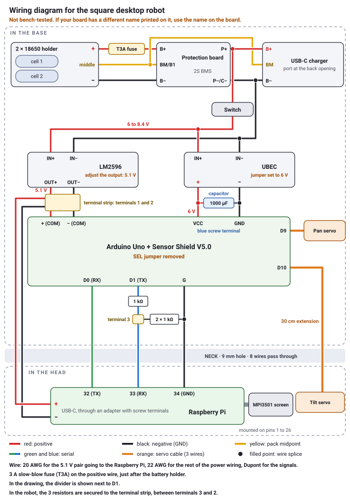

# Electrical wiring for the square desktop robot

<!-- GERADO:idiomas -->
[🇧🇷 Português](LIGACAO.md) · [🇺🇸 English](LIGACAO.en.md) · [🇪🇸 Español](LIGACAO.es.md)
<!-- /GERADO -->

**Not bench-tested.** This diagram is based on the component datasheets; no wires have been connected to an assembled robot yet.
Check every connection with a multimeter before turning on the switch. If your board has a different name printed on it than
the one shown here, use the name printed on the board.



Page with the same diagram: https://inematds.github.io/robos-impressos/guia/en/cubo/#energia

## Lithium Battery Safety

- **Polarity:** red to positive, black to negative. Measure with a multimeter before each new connection. Reversed wires will burn out the board immediately.
- **Adjust before connecting the load:** set the LM2596 to 5.1 V and the UBEC to 6 V, measured with a multimeter, with the Raspberry Pi, Arduino, and servos disconnected.
- **A short circuit can start a fire:** solder with the cells OUT of the holder and insulate each joint with heat-shrink tubing. No metal should be exposed.
- **Fuse:** 5 A, on the positive wire, a few centimeters from the battery holder.
- **Matching cells:** use two 18650 cells that are the same brand and model, and are new. Take dented, swollen, or hot cells to a battery recycling collection point; do not use them in the robot.
- **First charge:** stay nearby, with the robot on a nonflammable surface.

## What Powers What

- **2S pack:** two 18650 cells in series, from 6 V (empty) to 8.4 V (full). It passes through the fuse and the protection board (BMS).
- **USB-C charger:** connected to the protection board output, before the switch. Charge the robot while it is off, using a USB-C power supply of 15 W or more.
- **Switch:** cuts the positive wire going to both converters.
- **LM2596, set to 5.1 V:** powers the Raspberry Pi (through the USB-C adapter with screw terminals) and the Arduino (through the Sensor Shield 5 V pin).
- **UBEC at 6 V:** powers only the 2 servos, through the Sensor Shield blue screw terminal, with the SEL jumper removed.
- **Negative (GND):** shared by the entire robot.

Why the Arduino gets 5.1 V from the LM2596 instead of the battery voltage: the Arduino Uno VIN input requires 7 to 12 V
([Arduino Uno R3 datasheet](https://docs.arduino.cc/resources/datasheets/A000066-datasheet.pdf)), and the pack stays below 7 V for a good
part of its discharge.

## Wiring Table, Wire by Wire

<!-- GERADO:ligacoes -->
### Battery, protection, and charging

| From | To | Color | Wire | Attention |
|---|---|---|---|---|
| Battery holder: red wire (pack positive) | 5 A fuse holder and, after it, B+ solder pad on the protection board | red | 22 AWG | The fuse goes a few centimeters from the holder. |
| Battery holder: black wire (pack negative) | B− solder pad on the protection board | black | 22 AWG |  |
| Battery holder: metal strip that joins the 2 cells (middle point) | BM solder pad on the protection board | yellow | 22 AWG | This is the 3rd wire. Solder it to the strip with the cells OUT of the holder. |
| BM solder pad on the protection board | USB-C charger: middle screw terminal (pack middle point) | yellow | 22 AWG | Without this wire, the charger cannot balance the two cells. |
| USB-C charger: positive output | P+ solder pad on the protection board | red | 22 AWG | The charger goes before the switch: the robot charges while switched off. |
| USB-C charger: negative output | P− solder pad on the protection board | black | 22 AWG |  |

### Switch and converters

| From | To | Color | Wire | Attention |
|---|---|---|---|---|
| P+ solder pad on the protection board | On/off switch and, after it, LM2596 IN+ input and UBEC red input wire | red | 22 AWG | The switch cuts only the positive. |
| P− solder pad on the protection board | LM2596 IN− input and UBEC black input wire | black | 22 AWG | This is the common negative (GND) for the entire robot. |

### 5 V: Raspberry Pi and Arduino

| From | To | Color | Wire | Attention |
|---|---|---|---|---|
| LM2596 OUT+ output (5.1 V) | Through the neck, to the + screw terminal on the USB-C adapter, which plugs into the Raspberry Pi USB-C port | red | 22 AWG | Set the 5.1 V BEFORE connecting this wire. |
| LM2596 OUT− output | Through the neck, to the − screw terminal on the USB-C adapter | black | 22 AWG |  |
| LM2596 OUT+ output (5.1 V) | 5 V pin on the Sensor Shield (the + on the COM or IIC connector) | red | Dupont | This is how the Arduino receives power. First, with the Uno powered only by USB and the SEL jumper removed, use a multimeter to confirm that this pin reads about 5 V and the D9 V pin reads 0 V. The wrong pin here sends the servos’ 6 V to the Raspberry Pi. |
| LM2596 OUT− output | − (GND) pin on the same Sensor Shield connector | black | Dupont |  |

### 6 V: servos

| From | To | Color | Wire | Attention |
|---|---|---|---|---|
| UBEC red output wire (6 V) | Sensor Shield blue VCC screw terminal | red | UBEC wire | Shield SEL jumper REMOVED and UBEC jumper set to 6 V. |
| UBEC black output wire | Sensor Shield blue GND screw terminal | black | UBEC wire |  |
| 1000 µF capacitor: long leg (+) | Blue VCC screw terminal; the striped leg (−) goes to the blue GND screw terminal | no wire | capacitor leads | The capacitor will explode if connected backwards. |
| Pan servo (at the base) | Sensor Shield D9 connector | servo cable | 3-wire servo cable | G = brown or black, V = red, S = orange or yellow. |
| Tilt servo (in the head) | Through the neck, using the 30 cm extension, to the Sensor Shield D10 connector | servo cable | 3-wire servo cable | Same color order as D9. |

### Serial connection between the Raspberry Pi and Arduino

| From | To | Color | Wire | Attention |
|---|---|---|---|---|
| Raspberry Pi: pin 32 (GPIO12, TX) | Through the neck to the S pin of D0 (RX) on the Sensor Shield | green | Dupont | Direct: the Pi's 3.3 V already counts as a high level for Arduino. |
| S pin of D1 (TX) on the Sensor Shield | 1 kΩ resistor, then through the neck to pin 33 (GPIO13, RX) on the Raspberry Pi | blue | Dupont | Never connect D1 directly to the Pi: that's 5 V on a 3.3 V pin. |
| Point between the 1 kΩ resistor and the blue wire | 2 1 kΩ resistors in series, then a G (GND) pin on the Sensor Shield | black | resistor leads | The 3 resistors form the voltage divider: 5 V becomes 3.3 V. |
| Raspberry Pi: pin 34 (GND) | Through the neck to a G (GND) pin on the Sensor Shield | black | Dupont |  |
| MPI3501 screen | Fitted onto Raspberry Pi pins 1 to 26 | no wire | the screen's own connector | Uses SPI and the 5 V from pins 2 and 4. |
<!-- /GERADO -->

## Prep Step 1: Solder the Power Circuit and Set Both Voltages

Do this at the workbench, before assembling the robot, with the printed base beside you as a guide for wire lengths.

1. Solder the 3rd wire (yellow) to the metal strip that connects the two cells, with the cells out of the holder.
2. Connect the holder, fuse, protection board, and charger according to the table.
3. Fit the switch into the cutout on the base from the outside, with the wires passing through the cutout, and solder it to the positive wire.
4. Connect the LM2596 and UBEC inputs. Leave their outputs loose and unconnected.
5. Put the cells in the holder, checking the positive side, and turn on the switch.
6. With the multimeter on the LM2596 output, turn the adjustment screw with a screwdriver until it reads 5.1 V. It takes several turns.
7. Measure the UBEC output: it should read 6 V. If it reads 5 V, move its jumper to 6 V.
8. Turn off the switch.

## Prep Step 2: Upload the Program and Set Both Servos to 90°

The program is the sketch [centrar_servos.ino](firmware/centrar_servos/centrar_servos.ino). It moves both servos to
the center and holds them there.

1. Open the sketch in the Arduino IDE. Connect the Arduino Uno to your computer with the USB cable, without the shield or battery.
2. In Tools, select the Arduino Uno board and the port it appeared on. Click Upload.
3. Unplug the USB cable, fit the Sensor Shield onto the Uno, and remove the shield’s SEL jumper.
4. Plug the USB cable back in, just to measure with the multimeter: the 5 V pin you’ll use on the shield (the + on the COM or IIC connector) should read about 5 V, and the V pin on D9 should read 0 V.
5. If the V pin on D9 reads 5 V, the SEL jumper is still in place. If the 5 V pin reads 0 V, choose another + pin and measure again. A wrong pin here sends the servos’ 6 V to the Raspberry Pi.
6. Unplug the USB cable.
7. Connect the UBEC’s 6 V to the blue screw terminal (VCC and GND), and connect the 1000 µF capacitor to the same terminal.
8. Connect the LM2596’s 5.1 V to the shield’s 5 V pin and the negative wire to a G pin.
9. Connect the pan servo to D9 and the tilt servo to D10.
10. Turn on the switch: both servos move to the center (90°), and the Uno’s LED flashes once per second.
11. Turn it off. From now on, don’t turn the servo shafts by hand.

Three notes:

- Do not power the MG996R servo from USB 5 V. The USB port supplies 0.5 A, and the servo needs more than that when it starts.
- Never connect the computer's USB cable while the battery is on: the two power sources would be in parallel.
- Upload the sketch before screwing the Uno onto the base. Once it is in place, only about 10 mm remains between the USB connector and the wall, so the cable will not fit.

The sketch compiles for the Arduino Uno (arduino-cli, core arduino:avr 1.8.8, Servo library 1.3.0). It has not yet been
run on an assembled robot.

## Prep Step 3: Flash the microSD Card and Install the Screen Driver

1. Flash the card with Raspberry Pi Imager, the free Raspberry Pi program. Choose your Pi model, the Raspberry Pi OS (64-bit) system, and the card.
2. Before flashing, open Imager settings: set the username, password, and Wi-Fi, and enable SSH. This lets you access the Pi over the network, without a keyboard.
3. The screen is the MPI3501: 3.5 inches, 480 × 320, ILI9486 controller, connected over SPI on pins 1 to 26. It only lights up after you install the driver.
4. The manufacturer recommends the LCD-show package. On the Pi, over the network, run the three commands below.

```
git clone https://github.com/goodtft/LCD-show.git
cd LCD-show
sudo ./LCD35-show
```

Source for the model, pins, and driver: [MPI3501 page on lcdwiki](http://www.lcdwiki.com/3.5inch_RPi_Display).
The script replaces the Pi's configuration file and restarts it. Not bench-tested: the manufacturer lists tests through the
Raspberry Pi 3B+; adjustments may be needed on the Pi 4 and Pi 5.

## How the Raspberry Pi Communicates with the Arduino

The Raspberry Pi is in the head and the Arduino is in the base. The neck cable hole is 9 mm wide, and a USB plug will not fit
through it. So they communicate over a 3-wire serial connection (UART), with loose wires that pass through the hole.

- **On the Arduino:** pins D0 (RX) and D1 (TX), which are the board's actual serial pins. They do not interfere with the servo signal.
- **On the Raspberry Pi:** pin 32 (GPIO12, TX), pin 33 (GPIO13, RX), and pin 34 (GND). The screen uses pins 1 to 26; these three are free.
- **Voltage:** the Arduino runs at 5 V and the Pi at 3.3 V. The wire from the Arduino to the Pi passes through a 3-resistor 1 kΩ divider, which lowers 5 V to 3.3 V. The wire from the Pi to the Arduino connects directly.
- **Why use resistors instead of a logic level converter module:** the module needs a 3.3 V reference, and the Pi's 3.3 V pins are underneath the screen.

How to assemble the divider: solder a 1 kΩ resistor to the wire from D1. On its other leg, solder the blue wire that goes up
to Pi pin 33 and two more 1 kΩ resistors in series, ending at a G pin on the shield. Cover everything with
heat-shrink tubing.

How to connect to the Pi: pins 31 to 34 are underneath the screen board, where about 17.5 mm of clearance is available (measurement not
confirmed). A standard 14 mm Dupont connector will not fit upright. Cut a 2 × 2 piece from the female pin header strip,
solder the 3 wires sideways to its terminals, and fit it onto pins 31 to 34 before installing the screen.

To enable serial on the Pi system, add a line at the end of the `/boot/firmware/config.txt` file, AFTER
installing the screen driver, because the driver script rewrites this file:

- Raspberry Pi 4: `dtoverlay=uart5`
- Raspberry Pi 5: `dtoverlay=uart4-pi5`

Source: [Raspberry Pi firmware overlay list](https://github.com/raspberrypi/firmware/blob/master/boot/overlays/README).
After restarting, check the port name with `ls /dev/ttyAMA*`. Not bench-tested. The program that uses this
serial connection is part of phase 2.

## The 8 Wires That Pass Through the Neck

Pass the wires through the 9 mm hole before closing the head over the tube, in this order:

1. The tilt servo extension: the 3-pin connector is 7.6 mm wide and fits snugly.
2. The Raspberry Pi's 2 power wires, 5.1 V (red and black). The USB-C adapter is screwed onto them later.
3. The 3 serial wires (green, blue, and black).

Leave about 10 cm of slack inside the base: the neck turns almost one full rotation and twists the wires.

## Current, Wire, and Fuse

The values below are calculated from the specifications, not measured.

- Normal use: about 2 A from the pack (Raspberry Pi with about 1 A at 5 V and servos with less than 1 A at 6 V).
- Worst case: about 6 A, with the LM2596 and UBEC at their 3 A limit and the pack at 6.5 V.
- 22 AWG wire (0.33 mm²) throughout the power section. In the neck section, at 2 A, the calculated drop is 0.1 V: that’s why the setting is 5.1 V, not 5.0 V.
- 5 A fuse: above normal use and below the protection board’s 10 A rating.
- KCD11 switch: usually rated for 3 A (rating not confirmed; read the value printed on your switch).
- The phase 2 program must not let both servos push at the same time at the end of their travel.

## First time you turn on the assembled robot

1. Switch off. Use a multimeter to check that there is no continuity between the pack’s positive and negative terminals.
2. Turn on the switch. Measure 5.1 V at the USB-C adapter, still disconnected from the Pi, and 6 V at the blue screw terminal.
3. Turn off, plug the USB-C adapter into the Raspberry Pi, and turn it on again.
4. The Arduino LED blinks, both servos hold the center position, and the Raspberry Pi power LED lights up.

## What has not been tested yet

<!-- GERADO:riscos -->
- Nothing has been printed or assembled yet. The electrical section of this page has not been bench-tested: it was based on the component datasheets.
- The table 3MF files have never been opened in Bambu Studio. If one won't open, use the STL files.
- The USB-C plug that powers the Raspberry Pi is not in the 3D model. There may not be room for it next to the Pi inside the head.
- Raspberry Pi pins 31 to 34 are under the screen board. The clearance there (17.5 mm in the model) is unconfirmed: if the low-profile connector doesn't fit, the 3 serial wires will have to be soldered.
- The test coupon doesn't check the MG996R servo window or the M5 pin hole. Check both on table 01 before the long prints.
- With the Arduino screwed to the base, the USB cable won't fit: there is about 10 mm of clearance to the wall. To reprogram it, you need to remove its 4 screws.
- The fuse holder and the 3 serial resistors have no modeled mounting place: they hang loose on the wires, insulated with heat-shrink tubing.
- Measurements marked NC come from store listings. Measure your part before printing the section that touches it.
<!-- /GERADO -->

## Glossary

<!-- GERADO:glossario -->
- **GPIO:** The Raspberry Pi's 40-pin header, where the screen and signal wires connect.
- **UBEC:** A small converter used in model aircraft that lowers the battery voltage to a fixed value. Here, 6 V for the servos.
- **BMS:** Lithium battery protection board. It disconnects the battery before it discharges too much, overcharges, or shorts out.
- **2S:** Two lithium cells connected in series, one after the other. Their voltages add up: from 6 V (empty) to 8.4 V (full).
- **Horn:** The plastic part that fits onto the servo shaft and turns with it. This robot uses the round, disk-shaped horn.
- **Heat-set threaded insert:** A brass bushing with an internal thread. It goes into the hole in the plastic when pushed in with a soldering iron, creating a metal thread.
- **NC:** Unconfirmed: a measurement from a store listing that has not yet been checked against the part in hand.
- **Slicer:** The software that turns the 3D file into the layers the printer prints. Bambu Lab's slicer is called Bambu Studio.
<!-- /GERADO -->

What to buy: [LISTA-DE-COMPRAS.en.md](LISTA-DE-COMPRAS.en.md). How to print: [IMPRIMIR.en.md](IMPRIMIR.en.md).
