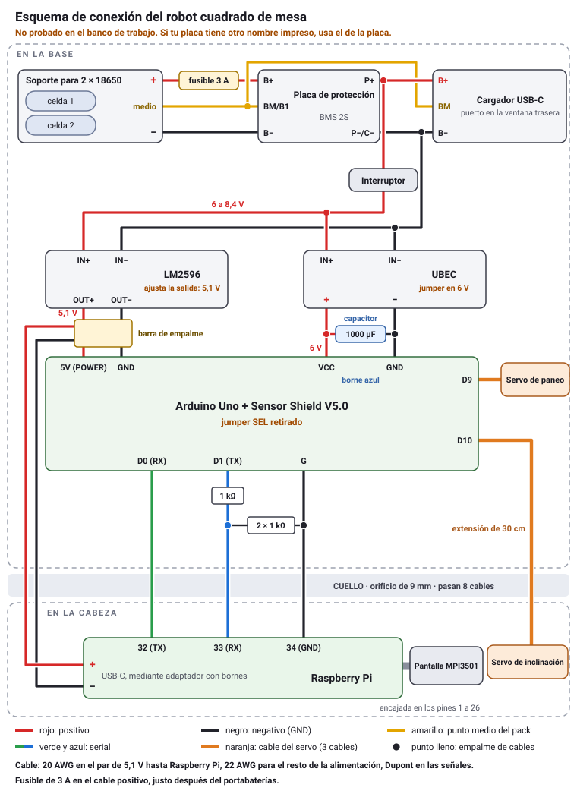

# Conexión eléctrica del robot cuadrado de mesa

<!-- GERADO:idiomas -->
[🇧🇷 Português](LIGACAO.md) · [🇺🇸 English](LIGACAO.en.md) · [🇪🇸 Español](LIGACAO.es.md)
<!-- /GERADO -->

**No probado en el banco de trabajo.** Este esquema se elaboró a partir de las fichas de los componentes; todavía no se conectó ningún cable en un robot montado.
Verifica cada conexión con el multímetro antes de encender el interruptor. Si tu placa tiene un nombre impreso diferente del
que aparece aquí, usa el nombre de la placa.



Página con el mismo esquema: https://inematds.github.io/robos-impressos/guia/es/cubo/#energia

## Seguridad con baterías de litio

- **Polaridad:** rojo en el positivo, negro en el negativo. Mide con el multímetro antes de cada conexión nueva. Un cable invertido quema la placa de inmediato.
- **Ajuste antes de conectar la carga:** LM2596 a 5,1 V y UBEC a 6 V, medidos con el multímetro, sin Raspberry Pi, sin Arduino y sin los servos conectados.
- **Un cortocircuito puede provocar un incendio:** suelda con las celdas FUERA del soporte y aísla cada empalme con tubo termorretráctil. No debe quedar ningún metal expuesto.
- **Fusible:** 3 A, en el cable positivo, a pocos centímetros del soporte de baterías.
- **Celdas iguales:** las dos 18650 deben ser de la misma marca y modelo, y nuevas. Si una celda está abollada, hinchada o caliente, llévala a un punto de recolección de pilas; no la pongas en el robot.
- **Primera carga:** quédate cerca, con el robot sobre una superficie que no se queme.

## Qué alimenta cada componente

- **Pack 2S:** dos celdas 18650 en serie, de 6 V (descargado) a 8,4 V (cargado). Pasa por el fusible y la placa de protección (BMS).
- **Cargador USB-C:** queda conectado a la salida de la placa de protección, antes del interruptor. El robot se carga apagado, con una fuente USB-C de 15 W o más.
- **Interruptor:** corta el positivo que va a los dos convertidores.
- **LM2596, ajustado a 5,1 V:** alimenta Raspberry Pi (mediante el adaptador USB-C con bornes) y Arduino (por el pin 5V del conector POWER de Sensor Shield).
- **UBEC a 6 V:** alimenta solo los 2 servos, por el borne azul de Sensor Shield, con el jumper SEL retirado.
- **Negativo (GND):** es uno solo para todo el robot.

Por qué el Arduino recibe los 5,1 V del LM2596 y no el voltaje de la batería: la entrada VIN del Arduino Uno requiere de 7 a 12 V
([ficha del Arduino Uno R3](https://docs.arduino.cc/resources/datasheets/A000066-datasheet.pdf)) y el pack pasa buena
parte de la descarga por debajo de 7 V.

## Tabla de conexiones, cable por cable

<!-- GERADO:ligacoes -->
### Batería, protección y carga

| De | Para | Color | Cable | Atención |
|---|---|---|---|---|
| Soporte de las baterías: cable rojo (positivo del pack) | Portafusible de 3 A y, después de este, pad B+ de la placa de protección | rojo | 22 AWG | El fusible queda a pocos centímetros del soporte. |
| Soporte de las baterías: cable negro (negativo del pack) | Pad B− de la placa de protección | negro | 22 AWG |  |
| Soporte de las baterías: lámina de metal que une las 2 celdas (punto medio) | Pad del punto medio de la placa de protección (BM o B1) | amarillo | 22 AWG | Es el 3.er cable. Suéldalo a la lámina con las celdas FUERA del soporte. |
| Pad del punto medio de la placa de protección (BM o B1) | Pad BM del cargador USB-C | amarillo | 22 AWG | Sin este cable, el cargador no equilibra las dos celdas. |
| Pad B+ del cargador USB-C | Salida positiva de la placa de protección (P+; si la placa no tiene P+, es el mismo pad B+) | rojo | 22 AWG | El cargador queda antes del interruptor: el robot se carga apagado. |
| Pad B− del cargador USB-C | Salida negativa de la placa de protección (P− o C−) | negro | 22 AWG | No conectes al pad B− de la placa de protección: la carga debe pasar por la protección. |

### Interruptor y convertidores

| De | Para | Color | Cable | Atención |
|---|---|---|---|---|
| Salida positiva de la placa de protección (P+ o B+) | Interruptor de encendido/apagado y, después, entrada IN+ del LM2596 y cable rojo de entrada del UBEC | rojo | 22 AWG | El interruptor corta solo el positivo. |
| Salida negativa de la placa de protección (P− o C−) | Entrada IN− del LM2596 y cable negro de entrada del UBEC | negro | 22 AWG | Este es el negativo común (GND) de todo el robot. |

### 5 V: Raspberry Pi y Arduino

| De | Para | Color | Cable | Atención |
|---|---|---|---|---|
| Salida OUT+ del LM2596 (5,1 V) | Regleta de conexión en la base y, desde allí, por el cuello, hasta el borne + del adaptador USB-C, que se conecta al puerto USB-C del Raspberry Pi | rojo | 20 AWG | Ajusta los 5,1 V ANTES de conectar este cable. Cable corto y grueso: uno delgado hace que el Pi indique subtensión. |
| Salida OUT− del LM2596 | Regleta de conexión en la base y, desde allí, por el cuello, hasta el borne − del adaptador USB-C | negro | 20 AWG |  |
| Salida OUT+ del LM2596 (5,1 V) | Pin 5V del conector POWER del Sensor Shield | rojo | Dupont | Por aquí recibe energía el Arduino. Antes, con el Uno conectado solo por USB y el jumper SEL retirado, confirma con el multímetro que este pin marca cerca de 5 V y que el pin V del D9 marca 0 V. Un pin incorrecto aquí envía los 6 V de los servos al Raspberry Pi. |
| Salida OUT− del LM2596 | Pin GND del conector POWER del Sensor Shield | negro | Dupont |  |

### 6 V: servos

| De | Para | Color | Cable | Atención |
|---|---|---|---|---|
| Cable rojo de salida del UBEC (6 V) | Borne azul VCC del Sensor Shield | rojo | cable del UBEC | Jumper SEL del shield RETIRADO y jumper del UBEC en 6 V. |
| Cable negro de salida del UBEC | Borne azul GND del Sensor Shield | negro | cable del UBEC |  |
| Capacitor de 1000 µF: pata larga (+) | Borne azul VCC; la pata con la franja (−) va en el borne azul GND | sin cable | patas del capacitor | El capacitor invertido explota. |
| Servo de pan (en la base) | Conector D9 del Sensor Shield | cable del servo | cable de 3 hilos del servo | G = marrón o negro, V = rojo, S = naranja o amarillo. |
| Servo de tilt (en la cabeza) | Por el cuello, con la extensión de 30 cm, hasta el conector D10 del Sensor Shield | cable del servo | cable de 3 hilos del servo | Mismo orden de colores que en D9. |

### Conexión serial entre Raspberry Pi y Arduino

| De | Para | Color | Cable | Atención |
|---|---|---|---|---|
| Raspberry Pi: pin 32 (GPIO12, TX) | Por el cuello, hasta el pin S de D0 (RX) del Sensor Shield | verde | Dupont | Directo: los 3,3 V del Pi ya sirven como nivel alto para Arduino. |
| Pin S de D1 (TX) del Sensor Shield | Resistor de 1 kΩ y, después de él, por el cuello hasta el pin 33 (GPIO13, RX) de Raspberry Pi | azul | Dupont | Nunca conectes D1 directamente al Pi: son 5 V en un pin de 3,3 V. |
| Punto entre el resistor de 1 kΩ y el cable azul | 2 resistores de 1 kΩ en serie y, después de ellos, un pin G (GND) del Sensor Shield | negro | patas de los resistores | Los 3 resistores forman el divisor: 5 V se convierten en 3,3 V. |
| Raspberry Pi: pin 34 (GND) | Por el cuello, hasta un pin G (GND) del Sensor Shield | negro | Dupont |  |
| Pantalla MPI3501 | Conectada a los pines 1 a 26 de Raspberry Pi | sin cable | conector de la propia pantalla | Usa SPI y los 5 V de los pines 2 y 4. |
<!-- /GERADO -->

## Preparativo 1: suelda la alimentación y ajusta los dos voltajes

Hazlo en la mesa de trabajo, antes de montar el robot, con la base impresa al lado como plantilla para medir la longitud de los cables.

1. Suelda el 3.er cable (amarillo) a la lámina de metal que une las dos celdas, con las celdas fuera del soporte.
2. Conecta el soporte, el fusible, la placa de protección y el cargador, según la tabla. Los nombres de los pads de soldadura cambian de una placa a otra: en la placa de protección de la tienda consultada son B+, B1 (medio), B− y C− (salida negativa); en el cargador son B+, BM y B−.
3. Encaja el interruptor en el recorte de la base, desde afuera, pasando los cables por el recorte, y suelda el positivo.
4. Conecta las entradas del LM2596 y del UBEC. En la salida del LM2596, suelda 2 cables cortos (20 AWG) que terminan en la barra de empalme. No conectes nada más a las salidas.
5. Pon las celdas en el soporte, comprobando el lado positivo, y enciende el interruptor.
6. Con el multímetro en la salida del LM2596, gira el tornillo de ajuste con el destornillador hasta que marque 5,1 V. Hay que darle varias vueltas.
7. Mide la salida del UBEC: debe marcar 6 V. Si marca 5 V, cambia su jumper a 6 V.
8. Apaga el interruptor.

## Preparativo 2: carga el programa y coloca los 2 servos a 90°

El programa es el sketch [centrar_servos.ino](firmware/centrar_servos/centrar_servos.ino). Lleva los dos servos
al centro y los mantiene allí.

1. Abre el sketch en Arduino IDE. Conecta Arduino Uno a la computadora con el cable USB, sin el shield y sin batería.
2. En Herramientas, elige la placa Arduino Uno y el puerto en el que apareció. Haz clic en Cargar.
3. Desconecta el cable USB, encaja Sensor Shield en el Uno y retira el jumper SEL del shield: es la cubierta de plástico sobre 2 pines, junto al borne azul.
4. Vuelve a conectar el cable USB, solo para medir con el multímetro: el pin 5V del conector POWER del shield debe marcar cerca de 5 V, y el pin V de D9 debe marcar 0 V.
5. Si V de D9 marca 5 V, el jumper SEL sigue puesto. Si tu shield no tiene el conector POWER, usa el pin + del conector COM y mide de la misma manera. Un pin equivocado aquí envía los 6 V de los servos a Raspberry Pi.
6. Desconecta el cable USB.
7. Conecta los 6 V del UBEC al borne azul (VCC y GND) y el capacitor de 1000 µF al mismo borne.
8. Conecta los 5,1 V del LM2596 al pin 5V del conector POWER del shield y el negativo al pin GND del mismo conector.
9. Conecta el servo de pan a D9 y el servo de tilt a D10.
10. Enciende el interruptor: los dos servos se centran (90°) y el LED del Uno parpadea una vez por segundo.
11. Apaga. A partir de aquí, no gires los ejes de los servos con la mano.

Tres avisos:

- No alimentes el servo MG996R con los 5 V del USB. El puerto USB suministra 0,5 A y el servo necesita más al arrancar.
- Nunca conectes el cable USB de la computadora con la batería encendida: ambas fuentes quedarían en paralelo.
- Carga el sketch antes de atornillar el Uno a la base. Una vez colocado, quedan unos 10 mm entre el conector USB y la pared, y el cable no entra.

El sketch compila para Arduino Uno (arduino-cli, core arduino:avr 1.8.8, biblioteca Servo 1.3.0). Todavía no se ha
probado en un robot montado.

## Preparativo 3: graba la tarjeta microSD e instala el controlador de la pantalla

La tarjeta se graba en tu computadora con un lector de tarjetas microSD. Después te conectas a Raspberry Pi por la red,
mediante SSH: escribes los comandos en tu computadora y se ejecutan en el Pi.

1. Instala en la computadora Raspberry Pi Imager, el programa gratuito de Raspberry Pi, y pon la tarjeta en el lector.
2. En Imager, elige el modelo de tu Pi, el sistema Raspberry Pi OS (64-bit) y la tarjeta.
3. Antes de grabar, abre la configuración de Imager: ponle un nombre al Pi (por ejemplo, `robo`), crea un usuario y una contraseña, ingresa el nombre y la contraseña de tu Wi-Fi y activa SSH. Graba.
4. Pon la tarjeta en el Pi, encaja la pantalla en los pines 1 a 26 solo para esta prueba y enciende el Pi con una fuente USB-C de 5 V y 3 A. Espera unos 2 minutos.
5. En la computadora, abre la terminal: en Windows es el programa PowerShell; en Mac y Linux, Terminal.
6. Escribe `ssh usuario@robo.local`, cambiando `usuario` y `robo` por los nombres que creaste. Responde `yes` la primera vez e ingresa la contraseña.
7. Si `robo.local` no responde, abre la página de tu router, busca el Pi en la lista de dispositivos conectados y usa su número (la dirección IP), por ejemplo `ssh usuario@192.168.0.50`.
8. Cuando la terminal muestre el nombre del Pi, ya estás dentro. Escribe los tres comandos de abajo, uno por línea, presionando Enter después de cada uno. El Pi debe tener acceso a internet.

```
git clone https://github.com/goodtft/LCD-show.git
cd LCD-show
sudo ./LCD35-show
```

El Pi se reinicia solo y la pantalla se enciende. Después, apaga el Pi con `sudo poweroff`, espera a que el LED verde deje de parpadear y retira la pantalla para el montaje.

La pantalla es la MPI3501: 3,5 pulgadas, 480 × 320, controlador ILI9486, conectada por SPI en los pines 1 a 26. Fuentes:
[página de la MPI3501 en lcdwiki](http://www.lcdwiki.com/3.5inch_RPi_Display) (modelo, pines y controlador) y
[documentación de Raspberry Pi](https://www.raspberrypi.com/documentation/computers/remote-access.html) (SSH).
No probado en el banco de trabajo: el fabricante menciona pruebas hasta Raspberry Pi 3B+, y el script reemplaza el archivo de configuración del Pi.

Plan B, tampoco probado, si la pantalla queda blanca o apagada:

- En lugar del script, agrega la línea `dtoverlay=piscreen,drm` al final del archivo `/boot/firmware/config.txt` y reinicia. Es el overlay oficial para una pantalla de 3,5 pulgadas con el mismo controlador ILI9486 ([lista de overlays](https://github.com/raspberrypi/firmware/blob/master/boot/overlays/README)); la fuente no garantiza que funcione con MPI3501.
- Si aun así no se enciende, vuelve a grabar la tarjeta con Raspberry Pi OS (Legacy) y repite el script del fabricante.

## Cómo se comunica la Raspberry Pi con el Arduino

La Raspberry Pi va en la cabeza y el Arduino en la base. El orificio para los cables del cuello tiene 9 mm y un conector USB no pasa por
él. Por eso, ambos se comunican mediante una conexión serial (UART) de 3 cables sueltos que pasan por el orificio.

- **En el Arduino:** pines D0 (RX) y D1 (TX), que son la conexión serial real de la placa. No interfieren con la señal de los servos.
- **En la Raspberry Pi:** pin 32 (GPIO12, TX), pin 33 (GPIO13, RX) y pin 34 (GND). La pantalla ocupa los pines 1 a 26; estos tres quedan libres.
- **Voltaje:** el Arduino trabaja a 5 V y el Pi a 3,3 V. El cable que va del Arduino al Pi pasa por un divisor de 3 resistencias de 1 kΩ, que reduce los 5 V a 3,3 V. El cable que va del Pi al Arduino va directo.
- **Por qué usar resistencias y no un módulo conversor de nivel:** el módulo necesita una referencia de 3,3 V, y los pines de 3,3 V del Pi quedan debajo de la pantalla.

Cómo montar el divisor: suelda una resistencia de 1 kΩ al cable que sale de D1. En el otro extremo, suelda el cable azul que sube
al pin 33 del Pi y otras dos resistencias de 1 kΩ en serie, que terminan en un pin G del shield. Cubre todo con
tubo termorretráctil.

Cómo conectar al Pi: los pines 31 a 34 quedan debajo de la placa de la pantalla, donde sobran unos 17,5 mm (medida no
confirmada). El conector Dupont común, de 14 mm, no cabe en posición vertical. Corta un trozo de 2 × 2 de la barra de pines hembra,
suelda los 3 cables de lado a sus terminales y encájalo en los pines 31 a 34 antes de colocar la pantalla.

Para activar la conexión serial en el sistema del Pi, agrega una línea al final del archivo `/boot/firmware/config.txt`, DESPUÉS de
instalar el controlador de la pantalla, porque el script del controlador vuelve a escribir ese archivo:

- Raspberry Pi 4: `dtoverlay=uart5`
- Raspberry Pi 5: `dtoverlay=uart4-pi5`

Fuente: [lista de overlays del firmware de Raspberry Pi](https://github.com/raspberrypi/firmware/blob/master/boot/overlays/README).
Después de reiniciar, consulta el nombre del puerto con `ls /dev/ttyAMA*`. No probado en el banco de trabajo. El programa que usa esta
conexión serial corresponde a la fase 2.

## Los 8 cables que pasan por el cuello

Son 8 cables: 2 de alimentación (5,1 V de Raspberry Pi, 20 AWG), 3 de la conexión serial y los 3 del cable del servo de tilt. Deben
conectarse dentro de la cabeza ANTES del copo, porque después Raspberry Pi queda encerrado. Tampoco pueden quedar colgando por
debajo de la horquilla en ese momento, porque la parte inferior del copo pasa por debajo de ella. Este es el orden:

1. Con la cabeza aún abierta (marco, pantalla, servo de tilt y horquilla en su lugar), atornilla los 2 cables de 5,1 V al adaptador USB-C y conéctalo a Raspberry Pi.
2. Comprueba el conector bajo de la conexión serial en los pines 31 a 34. Se conecta antes de la pantalla, con los 3 cables ya soldados.
3. Conecta la extensión de 30 cm al cable del servo de tilt.
4. Pasa los 8 cables por el agujero de 9 mm de la horquilla, de arriba hacia abajo. Primero pasa el conector de la extensión, que tiene 7,6 mm de ancho y entra justo.
5. Detente cuando las puntas queden al ras de la cara inferior de la horquilla. Deja unos 5 cm de cable sobrante dentro de la cabeza: esta se inclina alrededor de la horquilla.
6. Cierra la cabeza con la carcasa de la cabeza. Con las pinzas, saca las puntas de los 8 cables por la ranura de la parte inferior de la carcasa.
7. Pasa los cables por el tubo del cuello y asienta la cabeza encima.
8. En la base, con el interruptor apagado: conecta los 2 cables de 5,1 V a la barra de empalme, la extensión a D10 y los 3 de la conexión serial según la tabla.

Deja unos 10 cm de holgura dentro de la base: el cuello gira casi una vuelta y tuerce los cables. Este paso nunca se ha
ensayado con las piezas impresas.

## Corriente, cable y fusible

Los valores de abajo se calculan a partir de las fichas técnicas; no se midieron.

- Uso normal: unos 2 A desde el pack. Raspberry Pi consume unos 1 A a 5,1 V y los servos menos de 1 A a 6 V.
- Pico: unos 5 A, con el LM2596 a 2 A, el UBEC en su límite de 3 A y el pack a 6,5 V.
- Interruptor KCD11-101: 3 A a 250 V~ y 6 A a 125 V~ ([ficha de la tienda](https://eletronicamaker.com.br/produto/mini-chave-gangorra-kcd11-101-liga-desliga-3a-250v-vm-c)). La ficha no indica un valor para corriente continua.
- Fusible de 3 A: es el valor más bajo del interruptor. El uso normal queda por debajo. Un pico de unos segundos no lo abre; una sobrecarga prolongada abre el fusible antes de que se caliente el interruptor (comportamiento habitual de un fusible de vidrio, medición no confirmada).
- Si el fusible se abre durante el uso normal del robot, no pongas uno de mayor valor: mide la corriente e investiga qué está haciendo trabajar de más al sistema.
- Cable 22 AWG (0,33 mm²) para la alimentación de la base. Cable 20 AWG (0,5 mm²) para el par de 5,1 V que sube a Raspberry Pi: con 2 A, la caída calculada en ese tramo es de 0,06 V.
- LM2596 soporta unos 2 A continuos sin disipador (valor habitual, medición no confirmada). Usa Raspberry Pi 4, o Pi 5 sin accesorios USB.
- Si Raspberry Pi indica subtensión, acorta el par de 5,1 V y comprueba el ajuste. Para revisarlo, escribe `vcgencmd get_throttled` en el Pi: la respuesta correcta es `throttled=0x0`.
- El programa de la fase 2 no debe dejar que los dos servos hagan fuerza al mismo tiempo al final del recorrido.

## La primera vez que enciendes el robot montado

1. Interruptor apagado. Con el multímetro en continuidad, comprueba que el positivo y el negativo del pack no estén en cortocircuito.
2. Antes de empalmar los 2 cables que bajan de Raspberry Pi, enciende el interruptor y mide en la barra de empalme, del lado del convertidor: 5,1 V, con el cable rojo en el positivo. Mide 6 V en el borne azul. Apaga.
3. Empalma los cables del Pi en la barra, rojo con rojo y negro con negro, y vuelve a encender el interruptor.
4. El LED de Arduino parpadea, los dos servos mantienen el centro, el LED de alimentación de Raspberry Pi se enciende y, en cerca de 1 minuto, la pantalla muestra el sistema.
5. Si no se enciende nada, apaga y revisa el fusible.

## Lo que todavía no se probó

<!-- GERADO:riscos -->
- Todavía no se imprimió ni se montó nada. La parte eléctrica de esta página no se probó en el banco de trabajo: se preparó a partir de las fichas de los componentes.
- Los archivos 3MF de las camas nunca se abrieron en Bambu Studio. Si alguno no abre, usa los STL.
- El enchufe USB-C que alimenta la Raspberry Pi no está en el modelo 3D. Puede que no haya espacio para él junto a la Pi, dentro de la cabeza.
- Los pines 31 a 34 de la Raspberry Pi quedan debajo de la placa de la pantalla. El espacio libre allí (17,5 mm en el modelo) es una medida sin confirmar: si el conector bajo no cabe, habrá que soldar los 3 cables de la serial.
- El cupón de prueba no verifica la ventana del servo MG996R ni la rosca del tornillo M5. Comprueba la ventana del servo en el marco de la cabeza (mesa 01). La rosca para el M5 está en el brazo de la horquilla (mesa 03). Ambas se revisan antes de las impresiones largas.
- Con el Arduino atornillado a la base, el cable USB no entra: quedan unos 10 mm hasta la pared. Para volver a grabar el programa, hay que quitarle los 4 tornillos.
- El portafusible, la barra de empalme y las 3 resistencias de la serie no tienen un lugar modelado: quedan sueltos en los cables, aislados con tubo termorretráctil.
- Las medidas marcadas como NC provienen de anuncios de tiendas. Mide tu pieza antes de imprimir la parte que hace contacto con ella.
- Nunca se probó el paso de los 8 cables por el agujero de la horquilla y la ranura de la parte inferior de la cabeza con las piezas impresas.
<!-- /GERADO -->

## Glosario

<!-- GERADO:glossario -->
- **GPIO:** La fila de 40 pines de Raspberry Pi, donde se conectan la pantalla y los cables de señal.
- **UBEC:** Convertidor pequeño, usado en aeromodelos, que reduce el voltaje de la batería a un valor fijo. Aquí, 6 V para los servos.
- **BMS:** Placa de protección de la batería de litio. Desconecta la batería antes de que se descargue demasiado, se sobrecargue o entre en cortocircuito.
- **2S:** Dos celdas de litio conectadas en serie, una después de la otra. Los voltajes se suman: de 6 V (vacía) a 8,4 V (cargada).
- **Horn:** La pieza de plástico que encaja en el eje del servo y gira con él. Este robot usa el horn redondo, en forma de disco.
- **Inserto en caliente:** Buje de latón con rosca interna. Se introduce en el orificio del plástico con el cautín y se convierte en una rosca metálica.
- **NC:** No confirmado: una medida tomada de un anuncio de una tienda que aún no se ha verificado con la pieza en mano.
- **Laminador:** El programa que convierte el archivo 3D en las capas que imprime la impresora. El de Bambu Lab se llama Bambu Studio.
- **SSH:** Forma de usar el Raspberry Pi por la red: escribes los comandos en la terminal de tu computadora y se ejecutan en el Pi, sin conectarle teclado ni monitor.
- **SPI:** Conexión de datos con pocos cables y un reloj que marca el ritmo. Por ella, el Raspberry Pi envía la imagen a la pantalla.
- **UART (serial):** Conexión de datos sencilla: un cable para hablar (TX) y otro para escuchar (RX). Por ella, el Raspberry Pi envía órdenes al Arduino.
- **Jumper SEL:** Cubierta de plástico sobre 2 pines del Sensor Shield, junto al borne azul, con la marca SEL. Colocada, conecta los 5 V del Arduino a los conectores de los servos. Retirada, los servos reciben solo lo que entra por el borne azul.
- **Borne:** Conector de tornillo: el cable entra por el orificio y se aprieta con el tornillo. En el Sensor Shield es el bloque azul marcado GND y VCC.
<!-- /GERADO -->

Qué comprar: [LISTA-DE-COMPRAS.es.md](LISTA-DE-COMPRAS.es.md). Cómo imprimir: [IMPRIMIR.es.md](IMPRIMIR.es.md).
