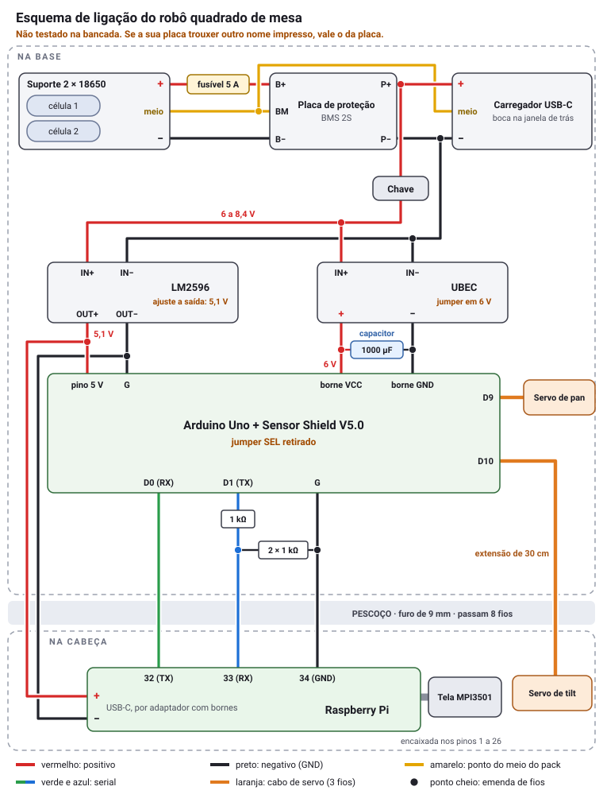

# Ligação elétrica do robô quadrado de mesa

<!-- GERADO:idiomas -->
[🇧🇷 Português](LIGACAO.md) · [🇺🇸 English](LIGACAO.en.md) · [🇪🇸 Español](LIGACAO.es.md)
<!-- /GERADO -->

**Não testado na bancada.** Este esquema saiu das fichas dos componentes; nenhum fio foi ligado ainda num robô montado.
Confira cada ligação com o multímetro antes de ligar a chave. Se a sua placa trouxer um nome impresso diferente do
que está aqui, vale o nome da placa.

Página com o mesmo esquema: https://inematds.github.io/robos-impressos/guia/cubo/#energia

Toda a solda do robô é feita na bancada, nos preparos 1, 2 e 3. Na montagem só há bornes e encaixes. Os passos
numerados dos 4 preparos são os mesmos da página.

## Segurança com bateria de lítio

- **Polaridade:** vermelho no positivo, preto no negativo. Meça com o multímetro antes de cada ligação nova. Fio invertido queima a placa na hora.
- **Ajuste antes de ligar a carga:** LM2596 em 5,1 V e UBEC em 6 V, medidos com o multímetro, sem o Raspberry Pi, sem o Arduino e sem os servos ligados.
- **Curto pega fogo:** solde com as células FORA do suporte e isole cada emenda com termo-retrátil. Nenhum metal pode ficar à mostra.
- **Fusível:** 3 A, retardado (marcado T3A), no fio positivo, a poucos centímetros do suporte das baterias.
- **Células iguais:** as duas 18650 da mesma marca, do mesmo modelo e novas. Célula amassada, inchada ou quente vai para a coleta de pilhas, não para o robô.
- **Primeira carga:** fique por perto, com o robô sobre uma superfície que não queima.

## O que alimenta o quê

- **Pack 2S:** duas células 18650 em série, de 6 V (vazio) a 8,4 V (cheio). Passa pelo fusível e pela placa de proteção (BMS).
- **Carregador USB-C:** fica ligado na saída da placa de proteção, antes da chave. O robô carrega desligado, por uma fonte USB-C de 15 W ou mais.
- **Chave:** corta o positivo que vai para os dois conversores.
- **LM2596, ajustado em 5,1 V:** a saída vai a uma barra de emenda na base. Dela saem o par que alimenta o Raspberry Pi (pelo adaptador USB-C com bornes) e o par que alimenta o Arduino (pelos pinos + e − do conector COM do Sensor Shield).
- **UBEC em 6 V:** alimenta só os 2 servos, pelo borne azul do Sensor Shield, com o jumper SEL retirado.
- **Negativo (GND):** é um só para o robô inteiro.

Por que o Arduino recebe os 5,1 V do LM2596, e não a tensão da bateria: a entrada VIN do Arduino Uno pede de 7 a 12 V
([ficha do Arduino Uno R3](https://docs.arduino.cc/resources/datasheets/A000066-datasheet.pdf)) e o pack passa boa
parte da descarga abaixo de 7 V.

## A barra de emenda

É uma barra de bornes de parafuso (tipo sindal) que fica solta na base. Você usa 3 bornes dela:

- **Borne 1, os 5,1 V:** de um lado, o fio vermelho que vem do LM2596. Do outro, o fio vermelho que sobe ao Raspberry Pi e o jumper que vai ao pino + do conector COM do shield.
- **Borne 2, o negativo:** de um lado, o fio preto do LM2596 e uma ponta do par de resistores. Do outro, o fio preto que sobe ao Raspberry Pi e o jumper que vai ao pino − do conector COM.
- **Borne 3, a serial:** de um lado, os resistores do divisor. Do outro, o fio azul que desce do Raspberry Pi.

## Tabela de ligações, fio a fio

<!-- GERADO:ligacoes -->
### Bateria, proteção e carga

| De | Para | Cor | Fio | Atenção |
|---|---|---|---|---|
| Suporte das baterias: fio vermelho (positivo do pack) | Porta-fusível de 3 A e, depois dele, ilha B+ da placa de proteção | vermelho | 22 AWG | O fusível fica a poucos centímetros do suporte. |
| Suporte das baterias: fio preto (negativo do pack) | Ilha B− da placa de proteção | preto | 22 AWG |  |
| Suporte das baterias: lâmina de metal que une as 2 células (ponto do meio) | Ilha do meio da placa de proteção (BM ou B1) | amarelo | 22 AWG | É o 3º fio. Solde-o na lâmina com as células FORA do suporte. |
| Ilha do meio da placa de proteção (BM ou B1) | Ilha BM do carregador USB-C | amarelo | 22 AWG | Sem este fio o carregador não equilibra as duas células. |
| Ilha B+ do carregador USB-C | Saída positiva da placa de proteção (P+; se a placa não tiver P+, é a própria ilha B+) | vermelho | 22 AWG | O carregador fica antes da chave: o robô carrega desligado. |
| Ilha B− do carregador USB-C | Saída negativa da placa de proteção (P−; na placa da loja consultada, a ilha C−) | preto | 22 AWG | Não ligue na ilha B− da placa de proteção: a carga tem de passar pela proteção. |

### Chave e conversores

| De | Para | Cor | Fio | Atenção |
|---|---|---|---|---|
| Saída positiva da placa de proteção (P+ ou B+) | Chave liga/desliga e, depois dela, entrada IN+ do LM2596 e fio vermelho de entrada do UBEC | vermelho | 22 AWG | A chave corta só o positivo. |
| Saída negativa da placa de proteção (P−; na placa da loja consultada, a ilha C−) | Entrada IN− do LM2596 e fio preto de entrada do UBEC | preto | 22 AWG | Este é o negativo comum (GND) de todo o robô. |

### 5 V: Raspberry Pi e Arduino

| De | Para | Cor | Fio | Atenção |
|---|---|---|---|---|
| Saída OUT+ do LM2596 (5,1 V) | Barra de emenda, borne 1 | vermelho | 20 AWG, curto | Ajuste os 5,1 V ANTES de ligar qualquer coisa do outro lado da barra. |
| Saída OUT− do LM2596 | Barra de emenda, borne 2 | preto | 20 AWG, curto |  |
| Barra de emenda, borne 1 (5,1 V) | Pelo pescoço, até o borne + do adaptador USB-C, que entra na porta USB-C do Raspberry Pi | vermelho | 20 AWG | Fio grosso e o mais curto que der: fio fino faz o Pi acusar subtensão. |
| Barra de emenda, borne 2 (negativo) | Pelo pescoço, até o borne − do adaptador USB-C | preto | 20 AWG |  |
| Barra de emenda, borne 1 (5,1 V) | Pino + do conector COM do Sensor Shield | vermelho | jumper Dupont com uma ponta cortada e descascada | É por aqui que o Arduino recebe energia. Antes, com o Uno só na USB e o jumper SEL retirado, confirme com o multímetro que esse pino marca cerca de 5 V e que o pino V do D9 marca 0 V. Um pino errado aqui põe os 6 V dos servos no Raspberry Pi. |
| Barra de emenda, borne 2 (negativo) | Pino − do conector COM do Sensor Shield | preto | jumper Dupont com uma ponta cortada e descascada |  |

### 6 V: servos

| De | Para | Cor | Fio | Atenção |
|---|---|---|---|---|
| Fio vermelho de saída do UBEC (6 V) | Borne azul VCC do Sensor Shield | vermelho | fio do UBEC | Jumper SEL do shield RETIRADO e jumper do UBEC em 6 V. |
| Fio preto de saída do UBEC | Borne azul GND do Sensor Shield | preto | fio do UBEC |  |
| Capacitor de 1000 µF: perna comprida (+) | Borne azul VCC; a perna da listra (−) vai no borne azul GND | sem fio | pernas do capacitor | Capacitor invertido estoura. |
| Servo de pan (na base) | Conector D9 do Sensor Shield | cabo do servo | cabo de 3 fios do servo | G = marrom ou preto, V = vermelho, S = laranja ou amarelo. |
| Servo de tilt (na cabeça) | Pelo pescoço, com a extensão de 30 cm, até o conector D10 do Sensor Shield | cabo do servo | cabo de 3 fios do servo | Mesma ordem de cores do D9. |

### Serial entre o Raspberry Pi e o Arduino

| De | Para | Cor | Fio | Atenção |
|---|---|---|---|---|
| Raspberry Pi: pino 32 (GPIO12, TX), no conector baixo 2 × 2 | Pelo pescoço, até o pino S do D0 (RX) do Sensor Shield | verde | jumper de 40 cm: uma ponta soldada no conector 2 × 2, a outra com o conector fêmea | Direto: os 3,3 V do Pi já valem como nível alto para o Arduino. |
| Raspberry Pi: pino 34 (GND), no conector baixo 2 × 2 | Pelo pescoço, até o pino G do D0 do Sensor Shield | preto | jumper de 40 cm: uma ponta soldada no conector 2 × 2, a outra com o conector fêmea |  |
| Raspberry Pi: pino 33 (GPIO13, RX), no conector baixo 2 × 2 | Pelo pescoço, até o borne 3 da barra de emenda | azul | jumper de 40 cm: uma ponta soldada no conector 2 × 2, a outra cortada e descascada | Este fio nunca vai direto no D1: são 5 V num pino de 3,3 V. |
| Barra de emenda, borne 3 | Resistor de 1 kΩ e, depois dele, pino S do D1 (TX) do Sensor Shield | azul | metade de um jumper, soldada na perna do resistor, com o conector fêmea no shield | Montado na bancada, no preparo 3. |
| Barra de emenda, borne 3 | 2 resistores de 1 kΩ em série e, depois deles, borne 2 da barra (negativo) | sem fio | pernas dos resistores | Os 3 resistores formam o divisor: 5 V viram 3,3 V. |
| Tela MPI3501 | Encaixada nos pinos 1 a 26 do Raspberry Pi | sem fio | conector da própria tela | Usa SPI e os 5 V dos pinos 2 e 4. |
<!-- /GERADO -->

## Preparo 1: solde a energia e ajuste as duas tensões

Faça na bancada, com a base impressa ao lado. A chave é a primeira peça a entrar na base, e entra antes de ser soldada
no resto. Os nomes das ilhas mudam de placa para placa. No carregador são B+, BM e B−. Na placa de proteção da loja
consultada só o verso tem nomes: B+, B1 (meio), B− e C−. Pela foto, a C− é a saída negativa e a saída positiva é a
própria B+; é leitura de foto, não confirmada: confira com o multímetro. No Sensor Shield da mesma loja, a foto mostra
o conector COM com 4 pinos em pé (TX, RX, − e +) e o jumper SEL ao lado do borne azul.

<!-- GERADO:prep1 -->
1. Solde o 3º fio (amarelo) na lâmina de metal que une as duas células, com as células fora do suporte.
2. Solde 2 fios vermelhos de 10 cm nos 2 terminais da chave. Passe as pontas livres pelo recorte da base, de fora para dentro, e encaixe a chave no recorte. Faça isso ANTES de soldar a chave no resto: ligada ao chicote, ela não passa pelo recorte de 13,5 × 9 mm.
3. Com a base ao lado servindo de gabarito do comprimento dos fios, ligue o suporte, o fusível, a placa de proteção e o carregador, conforme a tabela de ligações.
4. Solde uma ponta da chave na saída positiva da placa de proteção. Solde a outra na entrada IN+ do LM2596 e no fio vermelho de entrada do UBEC. Os negativos das duas entradas vão na saída negativa da placa de proteção.
5. Na saída do LM2596, solde 2 fios curtos de 20 AWG e aperte as outras pontas na barra de emenda: o vermelho no borne 1, o preto no borne 2. Não ligue mais nada nas saídas.
6. Ponha as células no suporte, conferindo o lado do positivo, e ligue a chave.
7. Com o multímetro na barra de emenda, gire o parafuso de ajuste do LM2596 com a chave de fenda até marcar 5,1 V. São várias voltas.
8. Meça a saída do UBEC: tem de marcar 6 V. Se marcar 5 V, mude o jumper dele para 6 V.
9. Desligue a chave.
<!-- /GERADO -->

## Preparo 2: grave o programa e ponha os 2 servos em 90°

O programa é o sketch [centrar_servos.ino](firmware/centrar_servos/centrar_servos.ino). Ele leva os dois servos para
o centro e os mantém lá.

<!-- GERADO:prep2 -->
1. Abra o sketch `centrar_servos.ino` na Arduino IDE. Ligue o Arduino Uno ao computador pelo cabo USB, sem o shield e sem bateria.
2. No menu Ferramentas, escolha a placa Arduino Uno e a porta em que ela apareceu. Clique em Carregar.
3. Tire o cabo USB, encaixe o Sensor Shield no Uno e retire o jumper SEL do shield: é a capinha de plástico sobre 2 pinos, ao lado do borne azul.
4. Ligue o cabo USB de novo, só para medir com o multímetro. O conector COM do shield tem 4 pinos em pé, marcados TX, RX, − e +. Entre o + e o − tem de dar cerca de 5 V. No conector D9, entre o pino V e o pino G, tem de dar 0 V.
5. Se o V do D9 marcar 5 V, o jumper SEL ainda está posto. Se o + do COM não marcar 5 V, o seu shield é diferente do da foto da loja: procure outro pino marcado + ou 5V que marque 5 V com o SEL retirado. Um pino errado aqui põe os 6 V dos servos no Raspberry Pi.
6. Tire o cabo USB.
7. Ligue os 6 V do UBEC no borne azul (VCC e GND) e o capacitor de 1000 µF no mesmo borne, com a perna comprida no VCC.
8. Pegue 2 jumpers de 40 cm, corte o conector de uma ponta de cada um e descasque. Aperte um no borne 1 da barra de emenda, do lado oposto ao do conversor, e encaixe o conector dele no pino + do conector COM. O outro vai do borne 2 ao pino − do mesmo conector.
9. Ligue o servo de pan no D9 e o servo de tilt no D10: fio marrom ou preto no G, vermelho no V, laranja ou amarelo no S.
10. Ligue a chave: os dois servos vão para o centro (90°) e o LED do Uno pisca uma vez por segundo.
11. Desligue a chave. Daqui em diante não gire os eixos dos servos com a mão.
12. Desfaça as ligações de teste, porque o Uno é parafusado na base sem o shield: tire os 2 servos do D9 e do D10, solte do borne azul os fios do UBEC e o capacitor, tire os 2 jumpers do conector COM e desencaixe o shield. Tudo volta ao lugar na montagem.
<!-- /GERADO -->

Três avisos:

- Não alimente o servo MG996R pelos 5 V da USB. A porta USB dá 0,5 A e o servo pede mais do que isso ao partir.
- Nunca ligue o cabo USB do computador com a bateria ligada: as duas fontes ficariam em paralelo.
- Grave o sketch antes de parafusar o Uno na base. Com ele no lugar sobram cerca de 10 mm entre o conector USB e a parede, e o cabo não entra.

O sketch compila para o Arduino Uno (arduino-cli, core arduino:avr 1.8.8, biblioteca Servo 1.3.0). Ele ainda não foi
rodado num robô montado.

## Preparo 3: faça o cabo da serial e o divisor de resistores

O Raspberry Pi fica na cabeça e o Arduino na base. Os dois conversam por 3 fios que descem pelo pescoço: verde, azul
e preto. Neste preparo você solda esses 3 fios num conector baixo, que entra nos pinos do Pi, e monta o divisor de 3
resistores na barra de emenda. São 6 jumpers de 40 cm no robô inteiro: 3 neste cabo, 1 cortado ao meio para o
divisor e 2 que levam energia ao Arduino (preparo 2). Um kit de 40 sobra.

<!-- GERADO:prep3 -->
1. Com o alicate de corte, corte da barra de pinos fêmea um pedaço de 2 × 2: 2 fileiras com 2 furos cada. É o conector baixo que vai nos pinos 31 a 34 do Raspberry Pi.
2. Separe 3 jumpers de 40 cm: um verde, um azul e um preto (ou marque 3 de outra cor com fita). Corte o conector de UMA ponta de cada um e descasque 3 mm.
3. Ache os pinos no Raspberry Pi: o pino 1 é o do canto, do lado do cartão microSD, na fileira de dentro; o pino 40 fica no canto oposto, na fileira da borda. Os ímpares ficam na fileira de dentro e os pares na fileira da borda. Os pinos 31 e 32 são o 16º par; os pinos 33 e 34, o 17º.
4. Solde as 3 pontas nos terminais do conector 2 × 2, com os fios saindo deitados, para o lado: o verde no furo que vai entrar no pino 32, o azul no do pino 33, o preto no do pino 34. O terminal do pino 31 fica vazio. Vista um pedaço de termo-retrátil fino em cada solda.
5. Marque com caneta o canto do conector onde ficou o terminal vazio, o do pino 31. Na hora de encaixar, a marca fica na fileira de dentro, virada para o lado do cartão microSD. Para conferir: entre o conector e a tela sobram 2 pares de pinos vazios (27 a 30) e, do outro lado, 3 pares (35 a 40). Virado ao contrário, o conector troca os fios de lugar.
6. No fio azul, corte também o conector da outra ponta e descasque 6 mm: essa ponta vai num borne. O verde e o preto ficam com o conector fêmea, que encaixa no shield.
7. Agora o divisor. Solde 2 resistores de 1 kΩ um no outro, perna com perna, e cubra a emenda com termo-retrátil. Esse par vale 2 kΩ.
8. Corte um jumper ao meio. Solde a ponta cortada de uma das metades numa perna do 3º resistor e cubra com termo-retrátil. O conector fêmea dessa metade é o que vai no D1.
9. Na barra de emenda, do lado do conversor, aperte no borne 3 a perna livre do 3º resistor junto com uma ponta do par de 2 kΩ. Aperte a outra ponta do par no borne 2, junto com o fio preto que já está lá. Dobre a ponta de cada perna antes de apertar, para o parafuso morder.
10. Confira com o multímetro, em ohms: entre o conector fêmea do jumper do D1 e o borne 3, cerca de 1 kΩ; entre o borne 3 e o borne 2, cerca de 2 kΩ.
11. Guarde o cabo: o conector 2 × 2 entra no Raspberry Pi na montagem, antes da tela. Na base, o azul vai no borne 3 da barra, o verde no pino S do D0 e o preto no pino G do D0, tudo por borne ou encaixe, sem solda. Atenção: nos conectores de 3 pinos do D0 e do D1, o pino do meio (V) fica sempre vazio. Com o jumper SEL retirado ele tem os 6 V dos servos, e 6 V num fio da serial queimam o Raspberry Pi.
<!-- /GERADO -->

Por que um conector baixo: os pinos 31 a 34 ficam embaixo da placa da tela, onde sobram cerca de 17,5 mm (medida não
confirmada). O conector Dupont comum, de 14 mm, não cabe em pé.

Onde fica o pino 1 e por que o número do pino não é o número do GPIO:
[documentação da Raspberry Pi](https://github.com/raspberrypi/documentation/blob/master/documentation/asciidoc/computers/raspberry-pi/gpio-on-raspberry-pi.adoc).
No Pi já ligado, o comando `pinout` desenha o mapa dos pinos.

## Preparo 4: grave o cartão microSD, instale o driver da tela e ligue a serial

O cartão é gravado no seu computador, com um leitor de cartão microSD. Depois você fala com o Raspberry Pi pela rede,
por SSH: digita os comandos no seu computador e eles rodam no Pi.

<!-- GERADO:prep4 -->
1. Instale no computador o Raspberry Pi Imager, o programa gratuito da Raspberry Pi, e ponha o cartão no leitor.
2. No Imager, escolha o modelo do seu Pi, o sistema Raspberry Pi OS (64-bit) e o cartão.
3. Antes de gravar, abra as configurações do Imager: dê um nome ao Pi (por exemplo `robo`), crie um usuário e uma senha, ponha o nome e a senha do seu Wi-Fi e ative o SSH. Grave.
4. Ponha o cartão no Pi, encaixe a tela nos pinos 1 a 26 só para este teste e ligue o Pi por uma fonte USB-C de 5 V e 3 A. Espere uns 2 minutos.
5. No computador, abra o terminal: no Windows é o programa PowerShell; no Mac e no Linux, o Terminal.
6. Digite `ssh usuario@robo.local`, trocando `usuario` e `robo` pelos nomes que você criou. Responda `yes` na primeira vez e digite a senha.
7. Se `robo.local` não responder, abra a página do seu roteador, ache o Pi na lista de aparelhos ligados e use o número dele (o endereço IP), por exemplo `ssh usuario@192.168.0.50`.
8. Quando o terminal mostrar o nome do Pi, você está dentro dele. Digite os três comandos do driver, um por linha, com Enter depois de cada um: `git clone https://github.com/goodtft/LCD-show.git`, depois `cd LCD-show`, depois `sudo ./LCD35-show`. O Pi precisa estar na internet. Ele reinicia sozinho e a tela acende.
9. Entre de novo por SSH e ligue a serial, DEPOIS do script da tela, porque ele reescreve o arquivo de configuração. Digite `sudo nano /boot/firmware/config.txt`, vá até o fim do arquivo e acrescente uma linha: `dtoverlay=uart5` no Raspberry Pi 4, ou `dtoverlay=uart4-pi5` no Raspberry Pi 5. Salve com Ctrl+O e Enter, saia com Ctrl+X.
10. Digite `sudo poweroff`, espere o LED verde do Pi parar de piscar, tire a fonte e desencaixe a tela: ela volta na montagem.
<!-- /GERADO -->

A tela é a MPI3501: 3,5 polegadas, 480 × 320, controlador ILI9486, ligada por SPI nos pinos 1 a 26. Fontes:
[página da MPI3501 na lcdwiki](http://www.lcdwiki.com/3.5inch_RPi_Display) (modelo, pinos e driver) e
documentação da Raspberry Pi, no GitHub: [SSH](https://github.com/raspberrypi/documentation/blob/master/documentation/asciidoc/computers/remote-access/ssh.adoc) e [como achar o endereço do Pi](https://github.com/raspberrypi/documentation/blob/master/documentation/asciidoc/computers/remote-access/find-your-ip-address.adoc).
Não testado na bancada: o fabricante lista testes até o Raspberry Pi 3B+, e o script troca o arquivo de configuração do Pi.

A linha da serial vem da [lista de overlays do firmware do Raspberry Pi](https://github.com/raspberrypi/firmware/blob/master/boot/overlays/README).
Depois de reiniciar, o nome da porta aparece com `ls /dev/ttyAMA*`. O programa que usa essa serial é da fase 2.

Plano B, também não testado, se a tela ficar branca ou apagada:

- Em vez do script, acrescente a linha `dtoverlay=piscreen,drm` ao fim do arquivo `/boot/firmware/config.txt` e reinicie. É o overlay oficial para uma tela de 3,5 polegadas com o mesmo controlador ILI9486 ([lista de overlays](https://github.com/raspberrypi/firmware/blob/master/boot/overlays/README)); a fonte não garante que sirva na MPI3501.
- Se ainda assim não acender, grave o cartão de novo com o Raspberry Pi OS (Legacy) e repita o script do fabricante.

## Como o Raspberry Pi conversa com o Arduino

O furo de cabos do pescoço tem 9 mm e um plugue USB não passa por ele. Por isso os dois conversam por uma serial
(UART) de 3 fios soltos.

- **No Arduino:** pinos D0 (RX) e D1 (TX), que são a serial de verdade da placa. Ela não atrapalha o sinal dos servos.
- **No Raspberry Pi:** pino 32 (GPIO12, TX), pino 33 (GPIO13, RX) e pino 34 (GND). A tela ocupa os pinos 1 a 26; estes três ficam livres.
- **Número do pino e número do GPIO:** "pino 32" é a posição na fileira de 40 pinos, contada a partir do canto do cartão microSD. "GPIO12" é o nome do sinal que sai por esse pino. Os dois números não são iguais.
- **Tensão:** o Arduino trabalha em 5 V e o Pi em 3,3 V. O fio que vai do Arduino para o Pi passa por um divisor de 3 resistores de 1 kΩ, que baixa 5 V para 3,3 V. O fio que vai do Pi para o Arduino é direto.
- **Por que resistores e não um módulo conversor de nível:** o divisor resolve com 3 resistores presos na barra de emenda, sem mais uma placa solta na base. O módulo também serviria, mas pede um pino de 3,3 V: na foto do shield aparece a marca 3V3, sem dar para confirmar se há pino em pé ali.

## Os 8 fios que passam pelo pescoço

São 8 fios: 2 de energia (5,1 V do Raspberry Pi, 20 AWG), 3 da serial e os 3 do cabo do servo de tilt. Eles têm de ser
ligados dentro da cabeça ANTES do copo, porque depois o Raspberry Pi fica fechado. E não podem ficar pendurados por
baixo do garfo nessa hora, porque o fundo do copo passa por baixo dele. A ordem é esta:

1. Na montagem do Raspberry Pi, antes da tela, encaixe o conector baixo do cabo da serial nos pinos 31 a 34.
2. Com a cabeça ainda aberta (quadro, tela, servo de tilt e garfo no lugar), parafuse os 2 fios de 5,1 V no adaptador USB-C e encaixe-o no Raspberry Pi.
3. Ligue a extensão de 30 cm no cabo do servo de tilt.
4. Desça os 8 fios pelo furo de 9 mm do garfo, de cima para baixo. Primeiro o conector da extensão, que tem 7,6 mm de largura e passa justo.
5. Pare quando as pontas ficarem rentes à face de baixo do garfo. Deixe uns 5 cm de fio sobrando dentro da cabeça: ela inclina em volta do garfo.
6. Feche a cabeça com o copo. Com a pinça, puxe as pontas dos 8 fios para fora pelo rasgo do fundo do copo.
7. Enfie os fios pelo tubo do pescoço e assente a cabeça sobre ele.
8. Na base, com a chave desligada e sem solda: os 2 fios de 5,1 V nos bornes 1 e 2 da barra de emenda; o fio azul no borne 3; o conector do verde no pino S do D0 e o do preto no pino G do D0; o jumper do divisor no pino S do D1; a extensão do servo no D10.

Deixe cerca de 10 cm de folga dentro da base: o pescoço gira quase uma volta e torce os fios. Esta passagem nunca foi
ensaiada com as peças impressas.

## Corrente, fio e fusível

Os valores abaixo são calculados a partir das fichas, não medidos.

- Uso normal: cerca de 2 A saindo do pack. O Raspberry Pi puxa cerca de 1 A em 5,1 V e os servos menos de 1 A em 6 V.
- Pico: cerca de 5 A, com o LM2596 em 2 A, o UBEC nos 3 A de limite e o pack em 6,5 V.
- Chave KCD11-101: 3 A em 250 V~ e 6 A em 125 V~ ([ficha de loja](https://eletronicamaker.com.br/produto/mini-chave-gangorra-kcd11-101-liga-desliga-3a-250v-vm-c)). A ficha não traz valor para corrente contínua.
- Fusível de 3 A: é o menor valor da chave. O uso normal fica abaixo dele, e uma sobrecarga que dura abre o fusível antes de a chave esquentar.
- Fusível retardado (marcado T3A ou T3,15A): a partida dos servos e a carga do capacitor de 1000 µF dão picos de uma fração de segundo. Um fusível rápido pode abrir nesses picos sem haver defeito; o retardado aguenta o pico curto e abre na sobrecarga que dura (comportamento usual desse tipo de fusível, medida não confirmada).
- Se o fusível abrir com o robô em uso normal, não ponha um maior: meça a corrente e procure o que está forçando.
- Fio 22 AWG (0,33 mm²) na energia da base. Fio 20 AWG (0,5 mm²) no par de 5,1 V que sobe até o Raspberry Pi: com 2 A, a queda calculada nesse trecho é de 0,06 V.
- O LM2596 aguenta cerca de 2 A contínuos sem dissipador (valor usual, medida não confirmada). Use o Raspberry Pi 4, ou o Pi 5 sem acessórios USB.
- Se o Raspberry Pi acusar subtensão, encurte o par de 5,1 V e confira o ajuste. Para ver, digite `vcgencmd get_throttled` no Pi: a resposta boa é `throttled=0x0`.
- O programa da fase 2 não pode deixar os dois servos forçando ao mesmo tempo no fim do curso.

## Calor dentro da cabeça

O Raspberry Pi 4 fica fechado na cabeça, que é de PLA e não tem abertura de ventilação. É um risco não medido.

- O PLA amolece perto de 60 °C (valor usual, medida não confirmada).
- O Pi reduz a velocidade quando o processador fica entre 80 e 85 °C ([documentação da Raspberry Pi](https://github.com/raspberrypi/documentation/blob/master/documentation/asciidoc/computers/raspberry-pi/frequency-management.adoc)).
- Cole os dissipadores adesivos nos chips do Pi antes de montá-lo.
- Com o robô ligado há meia hora, digite `vcgencmd measure_temp` no Pi. Se passar de 70 °C, imprima o copo da cabeça em PETG ou abra furos de ventilação na parede de trás.

## Primeira vez que você liga o robô montado

1. Chave desligada. Com o multímetro em continuidade, confira que o positivo e o negativo do pack não estão em curto.
2. Antes de apertar na barra os 2 fios que descem do Raspberry Pi, ligue a chave e meça na barra de emenda, do lado do conversor: 5,1 V entre os bornes 1 e 2, com o vermelho no positivo. Meça 6 V no borne azul. Desligue.
3. Aperte os fios do Pi na barra, vermelho no borne 1 e preto no borne 2, e ligue a chave de novo.
4. O LED do Arduino pisca, os dois servos seguram o centro, o LED de energia do Raspberry Pi acende e, em cerca de 1 minuto, a tela mostra o sistema.
5. Se nada acender, desligue e confira o fusível.

## O que ainda não foi testado

<!-- GERADO:riscos -->
- Nada foi impresso nem montado ainda. A parte elétrica desta página não foi testada na bancada: ela saiu das fichas dos componentes.
- Os arquivos 3MF das mesas nunca foram abertos no Bambu Studio. Se algum não abrir, use os STL.
- O plugue USB-C que alimenta o Raspberry Pi não está no modelo 3D. Pode não haver espaço para ele ao lado do Pi, dentro da cabeça.
- Os pinos 31 a 34 do Raspberry Pi ficam embaixo da placa da tela. A folga ali (17,5 mm no modelo) é uma medida não confirmada: se o conector baixo não couber, os 3 fios da serial terão de ser soldados.
- O cupom de teste não confere a janela do servo MG996R nem a rosca do parafuso M5. A janela do servo você confere no quadro da cabeça (mesa 01). A rosca do M5 fica no braço do garfo (mesa 03). As duas saem antes das impressões longas.
- Com o Arduino parafusado na base, o cabo USB não entra: sobram cerca de 10 mm até a parede. Para regravar o programa é preciso soltar os 4 parafusos dele.
- O porta-fusível, a barra de emenda e os 3 resistores da serial não têm lugar modelado: ficam soltos nos fios, isolados com termo-retrátil.
- As medidas marcadas como NC vêm de anúncios de loja. Meça a sua peça antes de imprimir a parte que encosta nela.
- A passagem dos 8 fios pelo furo do garfo e pelo rasgo do fundo da cabeça nunca foi ensaiada com as peças impressas.
- Calor: o Raspberry Pi 4 fica fechado na cabeça, que é de PLA e não tem abertura de ventilação. O PLA amolece perto de 60 °C e o Pi reduz a velocidade a partir de 80 °C. Cole os dissipadores e meça com o comando `vcgencmd measure_temp`. Se passar de 70 °C, imprima o copo da cabeça em PETG ou abra furos de ventilação atrás.
<!-- /GERADO -->

## Glossário

<!-- GERADO:glossario -->
- **GPIO:** A fileira de 40 pinos do Raspberry Pi, onde se ligam a tela e os fios de sinal. Neste guia, "pino 32" é a posição do pino na fileira; "GPIO12" é o nome do sinal que sai por ele.
- **UBEC:** Conversor pequeno, usado em aeromodelos, que baixa a tensão da bateria para um valor fixo. Aqui, 6 V para os servos.
- **BMS:** Placa de proteção da bateria de lítio. Desliga a bateria antes de ela descarregar demais, carregar demais ou entrar em curto.
- **2S:** Duas células de lítio ligadas em série, uma depois da outra. As tensões somam: de 6 V (vazio) a 8,4 V (cheio).
- **Horn:** A peça de plástico que encaixa no eixo do servo e gira com ele. Este robô usa o horn redondo, em forma de disco.
- **Inserto a quente:** Bucha de latão com rosca por dentro. Entra no furo do plástico empurrada com o ferro de solda e vira uma rosca de metal.
- **NC:** Não confirmado: uma medida que veio de anúncio de loja e ainda não foi conferida com a peça na mão.
- **Fatiador:** O programa que transforma o arquivo 3D nas camadas que a impressora imprime. O da Bambu Lab se chama Bambu Studio.
- **SSH:** Jeito de usar o Raspberry Pi pela rede: você digita os comandos no terminal do seu computador e eles rodam no Pi, sem ligar teclado nem monitor nele.
- **SPI:** Ligação de dados por poucos fios, com um relógio que marca o passo. É por ela que o Raspberry Pi manda a imagem para a tela.
- **UART (serial):** Ligação de dados simples: um fio para falar (TX) e um para ouvir (RX). É por ela que o Raspberry Pi manda ordens ao Arduino.
- **Jumper SEL:** Capinha de plástico sobre 2 pinos do Sensor Shield, ao lado do borne azul, com a marca SEL. Posta, ela liga os 5 V do Arduino aos conectores dos servos. Retirada, os servos recebem só o que entra pelo borne azul.
- **Borne:** Conector de parafuso: o fio entra no furo e o parafuso aperta. No Sensor Shield é o bloco azul marcado GND e VCC.
- **Sketch:** O nome que a Arduino dá a um programa. Você abre o arquivo na Arduino IDE e grava na placa pelo cabo USB.
- **Shield:** Placa que encaixa por cima do Arduino, nos pinos dele, e acrescenta conectores. Aqui, o Sensor Shield dá os conectores dos servos.
- **AWG:** Medida da grossura do fio. Quanto menor o número, mais grosso: o 20 AWG é mais grosso que o 22 AWG.
- **GND:** O negativo do circuito, também chamado de terra. Todos os negativos do robô são ligados entre si.
- **Dupont:** Fio fino que já vem com um conector de encaixe em cada ponta, do tamanho dos pinos das placas. Também é chamado de jumper.
- **Step-down:** Conversor que baixa a tensão. Aqui, o LM2596 baixa a tensão da bateria para 5,1 V.
- **Termo-retrátil:** Tubinho de plástico que encolhe com calor. Você veste sobre a emenda de solda e aquece: ele aperta e isola.
<!-- /GERADO -->

O que comprar: [LISTA-DE-COMPRAS.md](LISTA-DE-COMPRAS.md). Como imprimir: [IMPRIMIR.md](IMPRIMIR.md).
