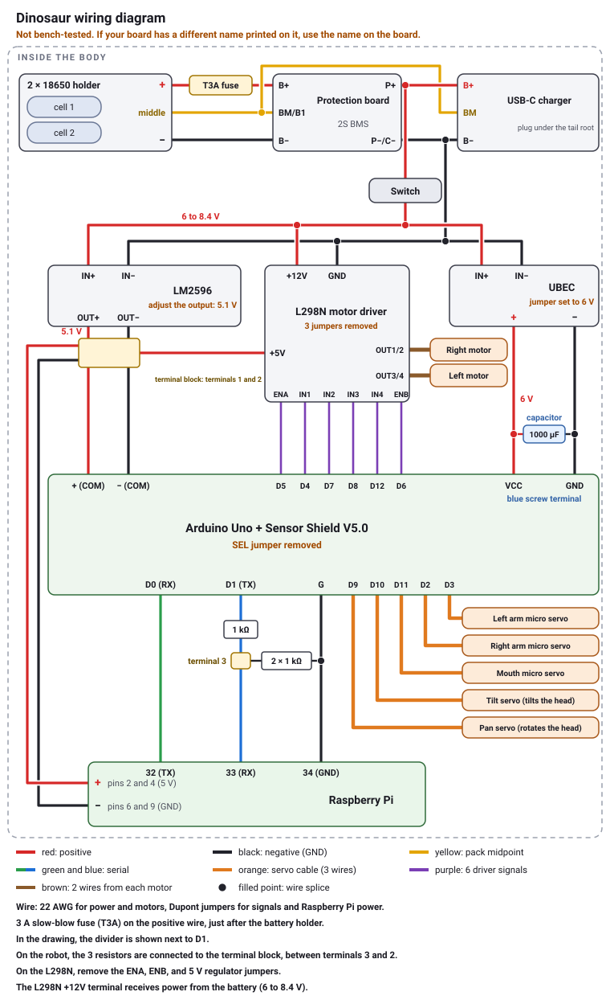

# Dinosaur wiring

<!-- GERADO:idiomas -->
[🇧🇷 Português](LIGACAO.md) · [🇺🇸 English](LIGACAO.en.md) · [🇪🇸 Español](LIGACAO.es.md)
<!-- /GERADO -->

**Not bench-tested.** This diagram is based on the component datasheets; no wires have been connected to an assembled robot yet.
Check every connection with a multimeter before turning on the switch. If your board has a different name printed on it than
the one shown here, use the name printed on the board.

Page with the same diagram: https://inematds.github.io/robos-impressos/guia/en/dino/#energia

All soldering for the robot is done on the workbench, in prep steps 1, 2, and 3. During assembly, you only use screw terminals and plug-in connections. The numbered steps in the 4 prep steps are the same as on the page.

## Lithium Battery Safety

- **Polarity:** red to positive, black to negative. Measure with the multimeter before each new connection. Reversed wiring burns the board immediately.
- **Adjust before connecting the load:** LM2596 to 5.1 V and UBEC to 6 V, measured with the multimeter, with the Raspberry Pi, Arduino, driver and servos disconnected.
- **Short circuits can start fires:** solder with the cells OUT of the holder and insulate each splice with heat-shrink tubing. No metal can be exposed.
- **Fuse:** 3 A, slow-blow (marked T3A), on the positive wire, a few centimeters from the battery holder.
- **Matching cells:** both 18650 cells must be the same brand and model, and new. A dented, swollen or hot cell goes to battery recycling, not into the robot.
- **First charge:** stay nearby, with the robot on a nonflammable surface.

## What Powers What

- **2S pack:** two 18650 cells in series, from 6 V (empty) to 8.4 V (full). It passes through the fuse and the protection board (BMS).
- **USB-C charger:** connected to the protection board output, before the switch. Charge the robot while it is off, using a 15 W or higher USB-C power supply. It sits on a small chassis tray at the rear, with the plug entering through a slot under the tail root.
- **Switch:** cuts the positive wire going to both converters and the motor driver. It sits under the floor, between the legs.
- **LM2596, set to 5.1 V:** the output goes to a terminal block inside the body. The Raspberry Pi wires branch off from it (pins 2 and 4, 6 and 9), along with the Arduino pair (pins + and − on the Sensor Shield COM connector) and the driver's logic wire (L298N +5V terminal).
- **UBEC at 6 V:** powers only the servos (2 MG996R servos (pan and tilt) and 3 micro servos (mouth and 2 fork arms)), through the blue terminal on the Sensor Shield, with the SEL jumper removed.
- **L298N driver:** receives battery voltage (6 to 8.4 V) and connects to the 2 wheel motors. The driver drops about 2 V: the motors, rated for 3 to 6 V, receive 4 to 6.4 V.
- **Negative (GND):** there is only one for the entire robot.

Why the Arduino gets 5.1 V from the LM2596 instead of the battery voltage: the Arduino Uno VIN input requires 7 to 12 V
([Arduino Uno R3 datasheet](https://docs.arduino.cc/resources/datasheets/A000066-datasheet.pdf)), and the pack stays below 7 V for a good
part of its discharge.

Why the Raspberry Pi gets power through the pins instead of the USB-C port: in the tray, its USB-C port is about
1 mm from the rack wall and the plug will not fit. This is a common connection, but it has not been tested on this robot. There are 2 wires
for positive and 2 for negative to share the current between the contacts.

## The terminal block

It is a screw terminal block (the sindal type) that sits loose inside the body. You use 3 of its terminals:

- **Terminal 1, 5.1 V:** on one side, the red wire from the LM2596. On the other, the Raspberry Pi's 2 red jumpers, the jumper going to the + pin on the shield's COM connector and the wire going to the driver's +5V terminal.
- **Terminal 2, negative:** on one side, the black wire from the LM2596 and one end of the resistor pair. On the other, the Raspberry Pi's 2 black jumpers and the jumper going to the − pin on the COM connector.
- **Terminal 3, serial:** on one side, the voltage divider resistors. On the other, the blue wire from the Raspberry Pi.

There are 4 wires in terminal 1: twist the ends together before tightening, or use 2 neighboring terminals joined by a short wire.

## Wiring Table, Wire by Wire

<!-- GERADO:ligacoes -->
### Battery, protection, and charging

| From | To | Color | Wire | Attention |
|---|---|---|---|---|
| Battery holder: red wire (pack positive) | 3 A fuse holder and, after it, the protection board B+ solder pad | red | 22 AWG | The fuse goes a few centimeters from the holder. |
| Battery holder: black wire (pack negative) | B− solder pad on the protection board | black | 22 AWG |  |
| Battery holder: metal strip that joins the 2 cells (middle point) | Middle solder pad on the protection board (BM or B1) | yellow | 22 AWG | This is the 3rd wire. Solder it to the strip with the cells OUT of the holder. |
| Middle solder pad on the protection board (BM or B1) | BM solder pad on the USB-C charger | yellow | 22 AWG | Without this wire, the charger cannot balance the two cells. |
| B+ solder pad on the USB-C charger | Positive output of the protection board (P+; if the board has no P+, use the B+ solder pad itself) | red | 22 AWG | The charger goes before the switch: the robot charges while switched off. |
| B− solder pad on the USB-C charger | Negative output of the protection board (P−; on the board from the store checked, the C− solder pad) | black | 22 AWG | Do not connect to the B− solder pad on the protection board: charging must pass through the protection circuit. |

### Switch, converters, and motor power

| From | To | Color | Wire | Attention |
|---|---|---|---|---|
| Positive output of the protection board (P+ or B+) | On/off switch and, after it, 3 wires: LM2596 IN+ input, UBEC red input wire, and L298N motor power terminal (marked +12V or VS) | red | 22 AWG | The switch cuts only the positive wire. The driver terminal gets the battery voltage (6 to 8.4 V), despite the +12V label. |
| Negative output of the protection board (P−; on the board from the store checked, the C− solder pad) | LM2596 IN− input, UBEC black input wire, and L298N GND terminal | black | 22 AWG | This is the common negative (GND) for the entire robot. |

### 5 V: Raspberry Pi, Arduino, and driver logic

| From | To | Color | Wire | Attention |
|---|---|---|---|---|
| LM2596 OUT+ output (5.1 V) | Terminal block, screw terminal 1 | red | 22 AWG, short | Adjust the 5.1 V BEFORE connecting anything on the other side of the terminal block. |
| LM2596 OUT− output | Terminal block, screw terminal 2 | black | 22 AWG, short |  |
| Terminal block, screw terminal 1 (5.1 V) | Raspberry Pi: pins 2 and 4 (5 V), one wire on each pin | red | 2 Dupont jumpers: one end cut and stripped at the terminal, the other with the female connector on the pin | These are 2 wires to share the current. Measure 5.1 V and check the polarity at the terminal block before connecting: the wrong voltage or a swapped wire on these pins will burn out the Raspberry Pi. |
| Terminal block, screw terminal 2 (negative) | Raspberry Pi: pins 6 and 9 (GND), one wire on each pin | black | 2 Dupont jumpers: one end cut and stripped at the terminal, the other with the female connector on the pin |  |
| Terminal block, screw terminal 1 (5.1 V) | Sensor Shield COM connector + pin | red | Dupont jumper with one end cut and stripped | This is how the Arduino receives power. First, with the Uno powered only by USB and the SEL jumper removed, use a multimeter to confirm that this pin reads about 5 V and the D9 V pin reads 0 V. The wrong pin here sends the servos’ 6 V to the Raspberry Pi. |
| Terminal block, screw terminal 2 (negative) | Sensor Shield COM connector − pin | black | Dupont jumper with one end cut and stripped |  |
| Terminal block, screw terminal 1 (5.1 V) | L298N +5V terminal | red | 22 AWG, about 15 cm | Only with the L298N 5 V regulator jumper REMOVED (the jumper next to the power terminals). If it is in place, the driver regulator and the LM2596 will work against each other. |

### 6 V: servos

| From | To | Color | Wire | Attention |
|---|---|---|---|---|
| UBEC red output wire (6 V) | Sensor Shield blue VCC screw terminal | red | UBEC wire, with the 3-pin plug cut off | Sensor Shield SEL jumper REMOVED and UBEC jumper set to 6 V. The UBEC output has a servo plug: cut it off and strip the wires. Red is positive. |
| Black or brown UBEC output wire | Sensor Shield blue GND screw terminal | black | UBEC wire, with the 3-pin plug cut off | If the plug has a third wire, white or orange, insulate its end with heat-shrink tubing: it isn’t connected. |
| 1000 µF capacitor: long leg (+) | Blue VCC screw terminal; the striped leg (−) goes to the blue GND screw terminal | no wire | capacitor leads | The capacitor will explode if connected backwards. |
| Pan servo (on the chassis deck) | Sensor Shield D9 connector | servo cable | 3-wire servo cable | G = brown or black, V = red, S = orange or yellow. |
| Tilt servo (in the cradle, inside the neck) | Along the column’s flat face and through the fork slot, to the Sensor Shield’s D10 connector | servo cable | 3-wire servo cable, with a 30 cm extension if it doesn’t reach | Same color order as D9. Leave enough slack for the head to turn 60° in either direction. |
| Mouth micro servo (on the head plate) | With the 30 cm extension, along the column’s flat face, to the Sensor Shield’s D11 connector | servo cable | 3-wire servo cable + 30 cm extension | Same color order as D9. |
| Right arm micro servo (on the chassis ear) | Sensor Shield’s D2 connector | servo cable | 3-wire servo cable | Same color order as D9. |
| Left arm micro servo (on the chassis ear) | Sensor Shield’s D3 connector | servo cable | 3-wire servo cable | Same color order as D9. |

### Wheel motors and L298N motor driver

| From | To | Color | Wire | Attention |
|---|---|---|---|---|
| Right motor: the 2 terminals | L298N terminals OUT1 and OUT2 | red and black | 22 AWG, about 20 cm, soldered to the motor | If the wheel spins in the opposite direction than expected, swap the motor’s 2 wires at the terminal. |
| Left motor: the 2 terminals | L298N terminals OUT3 and OUT4 | red and black | 22 AWG, about 20 cm, soldered to the motor |  |
| L298N: ENA pin (with the jumper removed) | Sensor Shield’s D5 S pin | any | female-to-female Dupont jumper | Right motor speed. S pin only: the shield’s V pin carries the servos’ 6 V. |
| L298N: IN1 and IN2 pins | D4 S pin (IN1) and D7 S pin (IN2) | any | 2 female-to-female Dupont jumpers | Right motor direction. |
| L298N: IN3 and IN4 pins | D8 S pin (IN3) and D12 S pin (IN4) | any | 2 female-to-female Dupont jumpers | Left motor direction. |
| L298N: ENB pin (with the jumper removed) | Sensor Shield’s D6 S pin | any | female-to-female Dupont jumper | Left motor speed. |

### Serial connection between the Raspberry Pi and Arduino

| From | To | Color | Wire | Attention |
|---|---|---|---|---|
| Raspberry Pi: pin 32 (GPIO12, TX) | Sensor Shield’s D0 (RX) S pin | green | whole female-to-female Dupont jumper | Direct: the Pi's 3.3 V already counts as a high level for Arduino. |
| Raspberry Pi: pin 34 (GND) | Sensor Shield D0 G pin | black | whole female-to-female Dupont jumper |  |
| Raspberry Pi: pin 33 (GPIO13, RX) | Terminal 3 of the terminal block | blue | Dupont jumper: female connector on the pin, the other end cut and stripped | This wire never goes straight to D1: that’s 5 V on a 3.3 V pin. |
| Terminal block, terminal 3 | 1 kΩ resistor and, after it, the S pin on D1 (TX) of the Sensor Shield | blue | Half a jumper, soldered to the resistor lead, with the female connector on the shield | Assembled on the workbench, in prep step 3. |
| Terminal block, terminal 3 | 2 1 kΩ resistors in series and, after them, terminal 2 on the block (negative) | no wire | resistor leads | The 3 resistors form the voltage divider: 5 V becomes 3.3 V. |
<!-- /GERADO -->

## Prep Step 1: Solder the Power Circuit and Set Both Voltages

Do this on the workbench, with the printed chassis beside you. The switch is the first part to go into the chassis, and it goes in before
being soldered to the rest. Solder pad names vary from board to board. On the charger they are B+, BM and B−. On the protection board
from the store we checked, only the back has labels: B+, B1 (middle), B− and C−. From the photo, C− appears to be the negative output and the positive output is
B+ itself; this is based on the photo and is unconfirmed: check with a multimeter. On the Sensor Shield from the same store, the photo shows
the COM connector with 4 upright pins (TX, RX, − and +) and the SEL jumper beside the blue terminal.

<!-- GERADO:prep1 -->
1. Solder the 3rd wire (yellow) to the metal strip joining the two cells, with the cells out of the holder.
2. Solder 2 15 cm red wires to the switch's 2 terminals. Pass the free ends through the chassis floor cutout, from bottom to top, and fit the switch into the cutout from underneath. Do this BEFORE soldering the switch to the rest: once connected to the wiring harness, it won't fit through the 13.5 × 9 mm cutout.
3. If the motors came without wires, solder 2 20 cm wires (one red and one black, 22 AWG) to the 2 terminals on each motor.
4. With the chassis beside you as a guide for wire lengths, connect the battery holder, fuse, protection board, and charger as shown in the wiring table. The charger sits on the chassis's rear tray, with the USB-C port facing backward. Leave about 8 cm of slack in the battery holder wires so it can be pulled out from the rear when you replace the cells.
5. Solder one switch terminal to the protection board's positive output. At the other terminal, join 3 red wires: the LM2596 IN+ input, the UBEC red input wire, and a 15 cm wire that goes to the driver's motor power terminal. At the protection board's negative output, join 3 black wires: the LM2596 IN− input, the UBEC black input wire, and a 15 cm wire for the driver's GND terminal. Insulate each splice with heat-shrink tubing.
6. At the LM2596 output, solder 2 short wires and tighten their other ends in the terminal block: red in terminal 1, black in terminal 2. Don't connect anything else to the outputs.
7. Put the cells in the holder, checking which side is positive, and turn on the switch.
8. With the multimeter connected to the terminal block, turn the LM2596 adjustment screw with the screwdriver until it reads 5.1 V. It takes several turns.
9. Measure the UBEC output: it should read 6 V. If it reads 5 V, move its jumper to 6 V.
10. Turn off the switch.
<!-- /GERADO -->

## Prep step 2: upload the program and set the 5 servos to 90°

The program is the sketch [centrar_servos.ino](firmware/centrar_servos/centrar_servos.ino). It moves the 5 servos to
the middle and holds them there, with the wheel motors off.

<!-- GERADO:prep2 -->
1. Open the `centrar_servos.ino` sketch in Arduino IDE. Connect the Arduino Uno to the computer with the USB cable, without the shield or battery.
2. From the Tools menu, select the Arduino Uno board and the port it appeared on. Click Upload.
3. Unplug the USB cable, fit the Sensor Shield onto the Uno, and remove the shield’s SEL jumper: it is the small plastic cap over 2 pins, next to the blue screw terminal.
4. Reconnect the USB cable just to take a measurement with the multimeter. The shield's COM connector has 4 upright pins labeled TX, RX, −, and +. You should get about 5 V between + and −. On the D9 connector, you should get 0 V between the V pin and the G pin.
5. If the D9 V pin reads 5 V, the SEL jumper is still in place. If the COM + pin does not read 5 V, your shield differs from the store photo: look for another pin labeled + or 5V that reads 5 V with SEL removed. A wrong pin here sends the servos' 6 V to the Raspberry Pi.
6. Unplug the USB cable.
7. The UBEC output has a 3-pin servo plug: cut it off and strip the wires. Red is positive and black (or brown) is negative. If there’s a third wire, white or orange, insulate its end with heat-shrink tubing. Clamp the red wire into VCC and the black wire into GND on the blue screw terminal. The 1000 µF capacitor goes into the same terminal, with its longer lead in VCC.
8. Take 2 jumper wires, cut off the connector at one end of each, and strip the wires. Tighten one in terminal 1 of the terminal block, on the side opposite the converter, and plug its connector into the + pin of the COM connector. Connect the other from terminal 2 to the − pin of the same connector. Leave the TX and RX pins next to it empty: 5 V on either one reaches the Raspberry Pi through the serial wire.
9. Connect the pan servo to D9, the tilt servo to D10, the mouth servo to D11, the right arm servo to D2, and the left arm servo to D3: brown or black wire to G, red to V, orange or yellow to S.
10. Turn on the switch: the 5 servos move to the centre (90°) and the Uno LED flashes once per second.
11. Turn off the switch. From now on, do not turn the servo shafts by hand.
12. Undo the test connections for assembly: remove the servos from the shield, disconnect the UBEC wires and capacitor from the blue terminal, and remove the 2 jumpers from the COM connector. Label each servo cable with tape and the pin name. Remove the 2 cells from the battery holder: they go back in during assembly, at the battery step.
<!-- /GERADO -->

Three notes:

- Do not power the servos from the USB 5 V. The USB port supplies 0.5 A and an MG996R servo needs more than that when starting.
- Never connect the computer's USB cable while the battery is on: the two power sources would be in parallel.
- 90° is the midpoint of the servo's travel. The closed mouth is its servo's midpoint: the spline has steps of about 17° (typical value, unconfirmed), so choose the nearest tooth; fine adjustment comes in the phase 2 program.

The sketch compiles for the Arduino Uno (arduino-cli, core arduino:avr, Servo library). It has not yet been
run on an assembled robot.

## Prep step 3: prepare the Raspberry Pi cables, the divider and the driver wires

The Raspberry Pi and Arduino sit in trays, one above the other, inside the body. They communicate over 3 wires: green, blue,
and black. The Pi gets power through 4 more wires. In this prep step, you prepare and label those 7 wires, assemble the 3-resistor divider on the terminal block, and set aside the driver's 6 signal wires. There are 16 jumpers in the whole robot: 4 for Pi power, 3 for serial, 1 cut in half for the divider, 2 for Arduino power (prep step 2), and 6 for the driver. A 40-piece kit leaves some over. Do this prep step with the cells out of the holder.

<!-- GERADO:prep3 -->
1. Set aside 3 female-to-female jumper wires for the serial connection: one green, one blue, and one black (or mark 3 wires of another color with tape). Leave the green and black wires intact. On the blue wire, cut off the connector at one end and strip 6 mm: this end goes into a terminal.
2. Now make the divider. Solder 2 1 kΩ resistors together, leg to leg, and cover the joint with heat-shrink tubing. This pair adds up to 2 kΩ.
3. Cut a jumper in half. Solder the cut end of one half to a leg of the 3rd resistor and cover it with heat-shrink tubing. The female connector on this half goes to D1.
4. On the terminal block, on the converter side, tighten the free leg of the 3rd resistor together with one end of the 2 kΩ pair in terminal 3. Tighten the other end of the pair in terminal 2, together with the black wire already there. Bend the end of each leg before tightening, so the screw grips it.
5. Check with the multimeter in ohms: between the D1 jumper’s female connector and terminal 3, about 1 kΩ; between terminal 3 and terminal 2, about 2 kΩ.
6. Set aside 4 more jumper wires for Raspberry Pi power, 2 red and 2 black (or mark them with tape). Cut off the connector at one end of each and strip 6 mm. Tighten the 2 red wires together in terminal 1 of the terminal block, on the side opposite the converter, and the 2 black wires together in terminal 2.
7. Cut a 15 cm red wire (22 AWG) and tighten one end in terminal 1 of the terminal block, together with the 2 red jumper wires: the other end goes to the driver's +5V terminal during assembly.
8. Find the pins on the Raspberry Pi: pin 1 is in the corner next to the microSD card, on the inner row; pin 40 is in the opposite corner, on the outer row. Odd-numbered pins are on the inner row and even-numbered pins are on the outer row. Pins 2, 4, and 6 are the first 3 on the outer row; pin 9 is the 5th on the inner row; pins 32 and 34 are the 16th and 17th on the outer row; pin 33 is the 17th on the inner row.
9. Label each connector with tape and the pin number: 2 and 4 on the red wires, 6 and 9 on the black power wires, 32 on the green wire, 33 on the blue wire, and 34 on the black serial wire. A red wire on the wrong pin sends 5 V to a signal pin and burns out the Raspberry Pi.
10. Set aside 6 intact female-to-female jumper wires for the driver signals and label the ends: ENA-D5, IN1-D4, IN2-D7, IN3-D8, IN4-D12, and ENB-D6.
11. Put the cables aside: during assembly, they connect to the Raspberry Pi, shield, and driver using terminals or connectors, with no soldering. Attention: on the shield's 3-pin connectors, the serial and driver wires use only the S pin (and the G pin for the black serial wire). The middle pin (V) must always stay empty: with the SEL jumper removed, it carries the servos' 6 V, and 6 V on one of these wires will burn out the Raspberry Pi or driver.
<!-- /GERADO -->

There is about 17 mm of clearance above the Raspberry Pi to the upper tray (measured from the model, not confirmed). A standard Dupont connector is about 16.5 mm tall: bend the wires just above it. If it does not fit, solder the wires to a low-profile female pin header, with the wires coming out to the side.

Where pin 1 is and why the pin number is not the GPIO number:
[Raspberry Pi documentation](https://github.com/raspberrypi/documentation/blob/master/documentation/asciidoc/computers/raspberry-pi/gpio-on-raspberry-pi.adoc).
On a powered-on Pi, the `pinout` command draws the pin map.

## Prep step 4: flash the microSD card and connect the serial

You write the card on your computer using a microSD card reader. Then you connect to the Raspberry Pi over the network,
using SSH: you type commands on your computer, and they run on the Pi.

<!-- GERADO:prep4 -->
1. Install Raspberry Pi Imager, the free Raspberry Pi program, on your computer, and put the card in the reader.
2. In Imager, choose your Pi model, the Raspberry Pi OS (64-bit) operating system, and the card.
3. Before flashing, open Imager’s settings: give the Pi a name (for example, `robo`), create a username and password, enter your Wi-Fi name and password, and enable SSH. Flash the card.
4. Put the card in the Raspberry Pi and power it on at the workbench, outside the robot, using a 5 V, 3 A USB-C power supply. Wait about 2 minutes.
5. On your computer, open the terminal: on Windows, use the PowerShell program; on Mac and Linux, use Terminal.
6. Type `ssh usuario@robo.local`, replacing `usuario` and `robo` with the names you created. Answer `yes` the first time and enter the password.
7. If `robo.local` doesn’t respond, open your router’s page, find the Pi in the list of connected devices, and use its number (the IP address), for example `ssh usuario@192.168.0.50`.
8. When the terminal shows the Pi’s name, you’re in. Enable the serial port: type `sudo nano /boot/firmware/config.txt`, go to the end of the file, and add a line: `dtoverlay=uart5` on the Raspberry Pi 4, or `dtoverlay=uart4-pi5` on the Raspberry Pi 5. Save with Ctrl+O and Enter, then exit with Ctrl+X.
9. Type `sudo poweroff`, wait for the Pi’s green LED to stop blinking, and unplug the power supply. Inside the robot, the Raspberry Pi no longer uses the USB-C port: it gets 5.1 V through the pins.
<!-- /GERADO -->

Sources: Raspberry Pi documentation on GitHub: [SSH](https://github.com/raspberrypi/documentation/blob/master/documentation/asciidoc/computers/remote-access/ssh.adoc) and [how to find the Pi's address](https://github.com/raspberrypi/documentation/blob/master/documentation/asciidoc/computers/remote-access/find-your-ip-address.adoc).
The serial line comes from the [Raspberry Pi firmware overlay list](https://github.com/raspberrypi/firmware/blob/master/boot/overlays/README).
After restarting, the port name appears with `ls /dev/ttyAMA*`. The program that uses this serial connection is in phase 2.

## How the Raspberry Pi Communicates with the Arduino

The two communicate over a 3-wire serial connection (UART). A USB cable between them will not fit in the rack.

- **On the Arduino:** pins D0 (RX) and D1 (TX), the board's actual serial connection. It does not interfere with the servo signal.
- **On the Raspberry Pi:** pin 32 (GPIO12, TX), pin 33 (GPIO13, RX), and pin 34 (GND).
- **Pin number and GPIO number:** “pin 32” is the position in the 40-pin row, counted from the microSD card corner. “GPIO12” is the name of the signal that comes out through that pin. The two numbers are not the same.
- **Voltage:** the Arduino runs at 5 V and the Pi at 3.3 V. The wire from the Arduino to the Pi passes through a 3-resistor 1 kΩ divider, which lowers 5 V to 3.3 V. The wire from the Pi to the Arduino is direct.
- **To upload to the Arduino over USB:** first remove the 2 serial wires from D0 and D1. They use the same pins as USB.

## The motor driver

The L298N turns the 2 wheel motors on and off and reverses their direction.

- **Module jumpers:** remove all 3. Remove the two on pins ENA and ENB because the Arduino controls the speed. Remove the 5 V regulator jumper because below about 7 V of battery power, this regulator cannot maintain 5 V: the driver's logic gets 5.1 V from the terminal block, through the +5V terminal.
- **Speed:** ENA to D5 (right motor) and ENB to D6 (left motor). The servo library takes the speed output (PWM) away from pins 9 and 10 on the Arduino Uno; pins 5 and 6 still have it.
- **Direction:** IN1 to D4 and IN2 to D7 (right motor); IN3 to D8 and IN4 to D12 (left motor).
- **S pin only:** on each 3-pin connector on the shield, the driver's wire goes to pin S. Pin V carries the servos' 6 V.
- **Motor running backward:** if a wheel spins backward when it should go forward, swap the motor's 2 wires at the terminal.

The program that makes the robot move is in phase 2. This phase's sketch only keeps the motors off.

## The cables that run up to the head

In phase 1, 2 servo cables run up (tilt and mouth). They go down the flat side of the cradle column, through the slot in the fork base and the deck slot, to the Arduino. In phase 2, the camera ribbon cable and the head sensor wires follow the same path.

1. Connect the 30 cm extension to the mouth micro servo cable before putting the head on the neck.
2. Secure the cables to the flat side of the column with a loose zip tie or tape.
3. Leave about 5 cm of slack inside the collar: the head rotates 60° to each side and tilts.
4. Before closing it up, slowly turn the head by hand to both extremes with the switch off: no cable should stretch or catch on the fork.

The lengths were estimated from the model. This cable routing has never been tested with printed parts.

## Current, Wire, and Fuse

The values below are calculated from the specifications, not measured.

- Normal use: between 2.5 and 3 A coming from the pack. The Raspberry Pi draws about 1 A at 5.1 V, the servos draw less than 1.5 A at 6 V, and the 2 motors draw about 0.3 A each while moving (typical value, not confirmed).
- Peak: close to 8 A, with the LM2596 at 2 A, the UBEC at its 3 A limit, both motors stalled (about 1.5 A each, typical value, not confirmed), and the pack at 6.5 V.
- KCD11-101 switch: 3 A at 250 V~ and 6 A at 125 V~ ([store listing](https://eletronicamaker.com.br/produto/mini-chave-gangorra-kcd11-101-liga-desliga-3a-250v-vm-c)). The listing gives no continuous current rating.
- 3 A slow-blow fuse (marked T3A or T3.15A): this is the switch's lowest rating. It handles the short startup peaks from the servos and motors and blows under a sustained overload (typical behavior for this type of fuse, not confirmed).
- **This is the weak point in the electrical system.** Normal use is close to 3 A, and the fuse may blow when the robot works hard: climbing a rug, with a wheel stuck, or with the head pushing against something. If it blows, do not use a higher-rated fuse: the switch cannot handle it. A switch rated at 6 A or more needs a different cutout in the part; this is an open project item.
- If all the servos stall at once, the MG996R servos draw 2 × 1.4 A plus 3 × about 0.7 A from the micro servos, close to 5 A: more than the UBEC's 3 A. The phase 2 program must stop each servo before it reaches the end of its travel.
- 22 AWG wire (0.33 mm²) for all power and motor wiring.
- The LM2596 can handle about 2 A continuously without a heatsink (typical value, not confirmed). Use a Raspberry Pi 4, or a Pi 5 without USB accessories.
- If the Raspberry Pi reports undervoltage, shorten the 4 power jumpers and check the setting. To check, type `vcgencmd get_throttled` on the Pi: the expected response is `throttled=0x0`.

## Heat inside the body

The Raspberry Pi 4 sits inside the closed body, which is made of PLA and has no ventilation openings. This is an unmeasured risk.

- PLA softens near 60 °C (typical value, not confirmed).
- The Pi slows down when the processor reaches between 80 and 85 °C ([Raspberry Pi documentation](https://github.com/raspberrypi/documentation/blob/master/documentation/asciidoc/computers/raspberry-pi/frequency-management.adoc)).
- Stick the adhesive heatsinks onto the Pi chips before assembly.
- After the robot has been on for half an hour, type `vcgencmd measure_temp` on the Pi. If it goes above 70 °C, drill ventilation holes in the rear shell.

## First time you turn on the assembled robot

1. Switch off and keep the wheels off the ground: prop the robot up on a block. Set the multimeter to continuity and check that the pack's positive and negative leads are not shorted.
2. Before plugging the connectors into the Raspberry Pi, turn on the switch and measure at the terminal block: 5.1 V between terminals 1 and 2, with the red probe on positive. Measure 6 V at the blue terminal. Switch off.
3. Plug in the Raspberry Pi connectors, checking each pin number, then turn the switch on again.
4. The Arduino LED blinks, all 5 servos hold the middle point, the wheels stay still, and the Raspberry Pi power LED lights up.
5. If nothing lights up, switch off and check the fuse.

## What has not been tested yet

<!-- GERADO:riscos -->
- Nothing has been printed or assembled yet. The wiring has not been bench-tested: it was put together from the component datasheets.
- Six parts need supports: skull, body, rear shell, jaw, neck fork, and tilt cradle. The supports go inside or underneath, away from the face, but no one has removed them from a real part yet.
- The 3MF files for the build plates have never been opened in Bambu Studio. If one won’t open, use the STL files.
- The on/off switch is rated for 3 A, and based on the component specifications, normal use comes close to that (between 2.5 and 3 A with the wheels moving, the head and arms moving). The 3 A fuse protects the switch and may blow when the robot is working hard. A larger switch would require changing the part’s cutout: that’s a project item still to be addressed.
- The Raspberry Pi gets 5.1 V through the 5 V pins because its USB-C port sits against the rack wall in the tray. This is a common connection, but it has not been tested in this robot: swapped wires or the wrong voltage on these pins can burn out the Pi. Measure before connecting it.
- There is about 17 mm above the Raspberry Pi up to the tray above (model measurement, unconfirmed). A standard Dupont connector is about 16.5 mm tall and may not fit. Plan B: solder the wires to a low-profile female pin header, with the wires coming out the side.
- The test coupon does not check the MG996R servo window. Check the servo in the tilt cradle, which comes off one of the first build plates, before starting the long prints.
- The fuse holder, terminal block, and 3 serial resistors have no modeled place: they sit loose inside the body, insulated with heat-shrink tubing.
- Cable lengths (head servos, extensions, and jumpers) were estimated from the model. The head rotates and tilts, pulling these cables: leave slack and check both ends before closing it up.
- The micro servo horn for each arm is not in the 3D model: the assembly test does not prove the body lowers with it in place. Install the horn pointing back and up, and only rotate it afterward.
- The Arduino sits crosswise in the tray, with its USB port facing sideways: to reflash the program, you need to pull out the tray.
- Measurements marked NC come from store listings. Measure your part before printing the section that touches it.
- The micro servo spline has steps of about 17° (typical value, unconfirmed): the mouth horn and arm horns may not land exactly at the 90° position. Choose the closest tooth; fine-tune in the program during phase 2.
- Heat: the Raspberry Pi is enclosed in the body, which is made of PLA and has no ventilation openings. PLA softens near 60 °C, and the Pi slows down starting at 80 °C. Attach the heatsinks and measure with the `vcgencmd measure_temp` command. If it goes above 70 °C, make ventilation holes in the rear shell.
<!-- /GERADO -->

## Glossary

<!-- GERADO:glossario -->
- **GPIO:** The Raspberry Pi's 40-pin row, where the power and signal wires connect. In this guide, "pin 32" is the pin's position in the row; "GPIO12" is the name of the signal that comes out of it.
- **UBEC:** A small converter used in model aircraft that lowers the battery voltage to a fixed value. Here, 6 V for the servos.
- **BMS:** Lithium battery protection board. It disconnects the battery before it discharges too much, overcharges, or shorts out.
- **2S:** Two lithium cells connected in series, one after the other. Their voltages add up: from 6 V (empty) to 8.4 V (full).
- **Horn:** The plastic piece that fits onto the servo shaft and turns with it. The 2 large servos use the round, disc-shaped horn; the micro servos use the 1-arm horn.
- **Heat-set threaded insert:** A brass bushing with an internal thread. It goes into the hole in the plastic when pushed in with a soldering iron, creating a metal thread.
- **NC:** Unconfirmed: a measurement from a store listing that has not yet been checked against the part in hand.
- **Slicer:** The software that turns the 3D file into the layers the printer prints. Bambu Lab's slicer is called Bambu Studio.
- **SSH:** A way to use the Raspberry Pi over the network: you type commands in your computer's terminal, and they run on the Pi without connecting a keyboard or monitor to it.
- **UART (serial):** A simple data connection: one wire to send (TX) and one to receive (RX). The Raspberry Pi sends commands to the Arduino through it.
- **SEL jumper:** A small plastic cap over 2 Sensor Shield pins, next to the blue screw terminal, marked SEL. When installed, it connects the Arduino's 5 V to the servo connectors. When removed, the servos receive only the power supplied through the blue screw terminal.
- **Screw terminal:** A screw connector: the wire goes into the hole and the screw tightens it. On the Sensor Shield, it is the blue block marked GND and VCC.
- **Sketch:** The name Arduino gives to a program. You open the file in Arduino IDE and upload it to the board with the USB cable.
- **Shield:** A board that fits on top of the Arduino, onto its pins, and adds connectors. Here, the Sensor Shield provides the servo connectors.
- **AWG:** A measure of wire thickness. The lower the number, the thicker the wire: 20 AWG is thicker than 22 AWG.
- **GND:** The circuit’s negative, also called ground. All the robot’s negative connections are connected to each other.
- **Dupont:** A thin wire that comes with a plug-in connector on each end, sized to fit the pins on the boards. Also called a jumper.
- **Step-down:** A converter that lowers the voltage. Here, the LM2596 lowers the battery voltage to 5.1 V.
- **Heat-shrink tubing:** A small plastic tube that shrinks with heat. Slip it over the solder joint and heat it: it tightens and insulates.
- **H-bridge (L298N):** Board that turns the wheel motors on and off and reverses them at the Arduino's command. It's also called a motor driver.
- **Micro servo:** Small, 9-gram servo (SG90 or MG90S). Here, it opens the mouth and moves the arms.
- **Pan and tilt:** The head's two movements: pan means turning side to side; tilt means angling up and down.
- **ToF:** Sensor that measures distance by timing how long light takes to travel out and back. It's part of phase 2.
- **Supports (for printing):** Extra material the slicer prints under a part that would otherwise start in midair. You remove it after printing. Tree supports grow like thin branches and are easier to remove.
<!-- /GERADO -->

What to buy: [LISTA-DE-COMPRAS.en.md](LISTA-DE-COMPRAS.en.md). How to print: [IMPRIMIR.en.md](IMPRIMIR.en.md).
