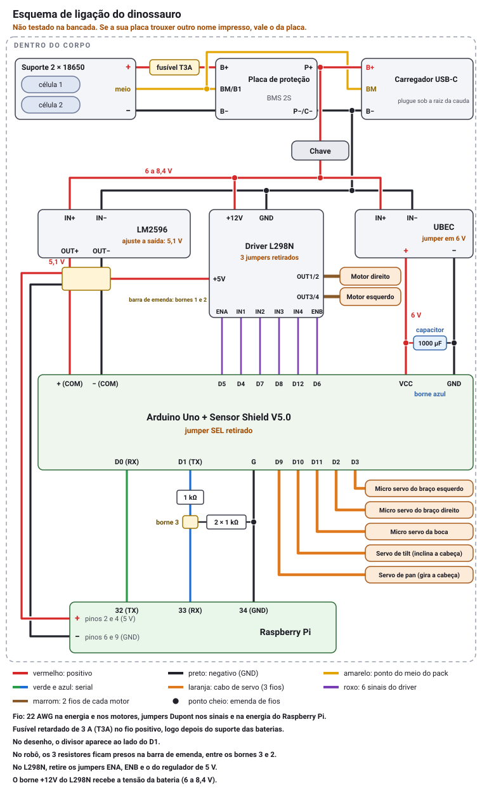

# Ligação elétrica do dinossauro

<!-- GERADO:idiomas -->
[🇧🇷 Português](LIGACAO.md) · [🇺🇸 English](LIGACAO.en.md) · [🇪🇸 Español](LIGACAO.es.md)
<!-- /GERADO -->

**Não testado na bancada.** Este esquema saiu das fichas dos componentes; nenhum fio foi ligado ainda num robô montado.
Confira cada ligação com o multímetro antes de ligar a chave. Se a sua placa trouxer um nome impresso diferente do
que está aqui, vale o nome da placa.

Página com o mesmo esquema: https://inematds.github.io/robos-impressos/guia/dino/#energia

Toda a solda do robô é feita na bancada, nos preparos 1, 2 e 3. Na montagem só há bornes e encaixes. Os passos
numerados dos 4 preparos são os mesmos da página.

## Segurança com bateria de lítio

- **Polaridade:** vermelho no positivo, preto no negativo. Meça com o multímetro antes de cada ligação nova. Fio invertido queima a placa na hora.
- **Ajuste antes de ligar a carga:** LM2596 em 5,1 V e UBEC em 6 V, medidos com o multímetro, sem o Raspberry Pi, sem o Arduino, sem o driver e sem os servos ligados.
- **Curto pega fogo:** solde com as células FORA do suporte e isole cada emenda com termo-retrátil. Nenhum metal pode ficar à mostra.
- **Fusível:** 3 A, retardado (marcado T3A), no fio positivo, a poucos centímetros do suporte das baterias.
- **Células iguais:** as duas 18650 da mesma marca, do mesmo modelo e novas. Célula amassada, inchada ou quente vai para a coleta de pilhas, não para o robô.
- **Primeira carga:** fique por perto, com o robô sobre uma superfície que não queima.

## O que alimenta o quê

- **Pack 2S:** duas células 18650 em série, de 6 V (vazio) a 8,4 V (cheio). Passa pelo fusível e pela placa de proteção (BMS).
- **Carregador USB-C:** fica ligado na saída da placa de proteção, antes da chave. O robô carrega desligado, por uma fonte USB-C de 15 W ou mais. Ele fica numa mesinha do chassi, atrás, com o plugue entrando por um rasgo sob a raiz da cauda.
- **Chave:** corta o positivo que vai para os dois conversores e para o driver dos motores. Fica por baixo do piso, entre as pernas.
- **LM2596, ajustado em 5,1 V:** a saída vai a uma barra de emenda dentro do corpo. Dela saem os fios do Raspberry Pi (pinos 2 e 4, 6 e 9), o par do Arduino (pinos + e − do conector COM do Sensor Shield) e o fio da lógica do driver (borne +5V do L298N).
- **UBEC em 6 V:** alimenta só os servos (2 servos MG996R (pan e tilt) e 3 micro servos (boca e 2 braços)), pelo borne azul do Sensor Shield, com o jumper SEL retirado.
- **Driver L298N:** recebe a tensão da bateria (6 a 8,4 V) e liga os 2 motores das rodas. O driver tira cerca de 2 V: os motores, que são de 3 a 6 V, recebem de 4 a 6,4 V.
- **Negativo (GND):** é um só para o robô inteiro.

Por que o Arduino recebe os 5,1 V do LM2596, e não a tensão da bateria: a entrada VIN do Arduino Uno pede de 7 a 12 V
([ficha do Arduino Uno R3](https://docs.arduino.cc/resources/datasheets/A000066-datasheet.pdf)) e o pack passa boa
parte da descarga abaixo de 7 V.

Por que o Raspberry Pi recebe a energia pelos pinos, e não pela porta USB-C: na bandeja, a porta USB-C dele fica a
cerca de 1 mm da parede do rack e o plugue não entra. É uma ligação comum, mas não foi testada neste robô. São 2 fios
no positivo e 2 no negativo para dividir a corrente entre os contatos.

## A barra de emenda

É uma barra de bornes de parafuso (tipo sindal) que fica solta dentro do corpo. Você usa 3 bornes dela:

- **Borne 1, os 5,1 V:** de um lado, o fio vermelho que vem do LM2596. Do outro, os 2 jumpers vermelhos do Raspberry Pi, o jumper que vai ao pino + do conector COM do shield e o fio que vai ao borne +5V do driver.
- **Borne 2, o negativo:** de um lado, o fio preto do LM2596 e uma ponta do par de resistores. Do outro, os 2 jumpers pretos do Raspberry Pi e o jumper que vai ao pino − do conector COM.
- **Borne 3, a serial:** de um lado, os resistores do divisor. Do outro, o fio azul que vem do Raspberry Pi.

São 4 fios no mesmo borne 1: torça as pontas juntas antes de apertar, ou use 2 bornes vizinhos unidos por um pedaço de fio.

## Tabela de ligações, fio a fio

<!-- GERADO:ligacoes -->
### Bateria, proteção e carga

| De | Para | Cor | Fio | Atenção |
|---|---|---|---|---|
| Suporte das baterias: fio vermelho (positivo do pack) | Porta-fusível de 3 A e, depois dele, ilha B+ da placa de proteção | vermelho | 22 AWG | O fusível fica a poucos centímetros do suporte. |
| Suporte das baterias: fio preto (negativo do pack) | Ilha B− da placa de proteção | preto | 22 AWG |  |
| Suporte das baterias: lâmina de metal que une as 2 células (ponto do meio) | Ilha do meio da placa de proteção (BM ou B1) | amarelo | 22 AWG | É o 3º fio. Solde-o na lâmina com as células FORA do suporte. |
| Ilha do meio da placa de proteção (BM ou B1) | Ilha BM do carregador USB-C | amarelo | 22 AWG | Sem este fio o carregador não equilibra as duas células. |
| Ilha B+ do carregador USB-C | Saída positiva da placa de proteção (P+; se a placa não tiver P+, é a própria ilha B+) | vermelho | 22 AWG | O carregador fica antes da chave: o robô carrega desligado. |
| Ilha B− do carregador USB-C | Saída negativa da placa de proteção (P−; na placa da loja consultada, a ilha C−) | preto | 22 AWG | Não ligue na ilha B− da placa de proteção: a carga tem de passar pela proteção. |

### Chave, conversores e alimentação dos motores

| De | Para | Cor | Fio | Atenção |
|---|---|---|---|---|
| Saída positiva da placa de proteção (P+ ou B+) | Chave liga/desliga e, depois dela, 3 fios: entrada IN+ do LM2596, fio vermelho de entrada do UBEC e borne de alimentação dos motores do L298N (marcado +12V ou VS) | vermelho | 22 AWG | A chave corta só o positivo. O borne do driver recebe a tensão da bateria (6 a 8,4 V), apesar do nome +12V. |
| Saída negativa da placa de proteção (P−; na placa da loja consultada, a ilha C−) | Entrada IN− do LM2596, fio preto de entrada do UBEC e borne GND do L298N | preto | 22 AWG | Este é o negativo comum (GND) de todo o robô. |

### 5 V: Raspberry Pi, Arduino e lógica do driver

| De | Para | Cor | Fio | Atenção |
|---|---|---|---|---|
| Saída OUT+ do LM2596 (5,1 V) | Barra de emenda, borne 1 | vermelho | 22 AWG, curto | Ajuste os 5,1 V ANTES de ligar qualquer coisa do outro lado da barra. |
| Saída OUT− do LM2596 | Barra de emenda, borne 2 | preto | 22 AWG, curto |  |
| Barra de emenda, borne 1 (5,1 V) | Raspberry Pi: pinos 2 e 4 (5 V), um fio em cada pino | vermelho | 2 jumpers Dupont: uma ponta cortada e descascada no borne, a outra com o conector fêmea no pino | São 2 fios para dividir a corrente. Meça 5,1 V e a polaridade na barra antes de encaixar: por estes pinos, tensão errada ou fio trocado queima o Raspberry Pi. |
| Barra de emenda, borne 2 (negativo) | Raspberry Pi: pinos 6 e 9 (GND), um fio em cada pino | preto | 2 jumpers Dupont: uma ponta cortada e descascada no borne, a outra com o conector fêmea no pino |  |
| Barra de emenda, borne 1 (5,1 V) | Pino + do conector COM do Sensor Shield | vermelho | jumper Dupont com uma ponta cortada e descascada | É por aqui que o Arduino recebe energia. Antes, com o Uno só na USB e o jumper SEL retirado, confirme com o multímetro que esse pino marca cerca de 5 V e que o pino V do D9 marca 0 V. Um pino errado aqui põe os 6 V dos servos no Raspberry Pi. |
| Barra de emenda, borne 2 (negativo) | Pino − do conector COM do Sensor Shield | preto | jumper Dupont com uma ponta cortada e descascada |  |
| Barra de emenda, borne 1 (5,1 V) | Borne +5V do L298N | vermelho | 22 AWG, cerca de 15 cm | Só com o jumper do regulador de 5 V do L298N RETIRADO (o jumper ao lado dos bornes de alimentação). Com ele posto, o regulador do driver e o LM2596 ficam um contra o outro. |

### 6 V: servos

| De | Para | Cor | Fio | Atenção |
|---|---|---|---|---|
| Fio vermelho de saída do UBEC (6 V) | Borne azul VCC do Sensor Shield | vermelho | fio do UBEC, com o plugue de 3 pinos cortado | Jumper SEL do shield RETIRADO e jumper do UBEC em 6 V. A saída do UBEC vem com um plugue de servo: corte o plugue e descasque os fios. O vermelho é o positivo. |
| Fio preto ou marrom de saída do UBEC | Borne azul GND do Sensor Shield | preto | fio do UBEC, com o plugue de 3 pinos cortado | Se o plugue tiver um terceiro fio, branco ou laranja, isole a ponta dele com termo-retrátil: ele não é ligado. |
| Capacitor de 1000 µF: perna comprida (+) | Borne azul VCC; a perna da listra (−) vai no borne azul GND | sem fio | pernas do capacitor | Capacitor invertido estoura. |
| Servo de pan (no deck do chassi) | Conector D9 do Sensor Shield | cabo do servo | cabo de 3 fios do servo | G = marrom ou preto, V = vermelho, S = laranja ou amarelo. |
| Servo de tilt (no berço, dentro do pescoço) | Pela face chata da coluna e pelo rasgo do garfo, até o conector D10 do Sensor Shield | cabo do servo | cabo de 3 fios do servo, com extensão de 30 cm se não alcançar | Mesma ordem de cores do D9. Deixe folga para a cabeça girar 60° para cada lado. |
| Micro servo da boca (na mesa da cabeça) | Com a extensão de 30 cm, pela face chata da coluna, até o conector D11 do Sensor Shield | cabo do servo | cabo de 3 fios do servo + extensão de 30 cm | Mesma ordem de cores do D9. |
| Micro servo do braço direito (na orelha do chassi) | Conector D2 do Sensor Shield | cabo do servo | cabo de 3 fios do servo | Mesma ordem de cores do D9. |
| Micro servo do braço esquerdo (na orelha do chassi) | Conector D3 do Sensor Shield | cabo do servo | cabo de 3 fios do servo | Mesma ordem de cores do D9. |

### Motores das rodas e driver L298N

| De | Para | Cor | Fio | Atenção |
|---|---|---|---|---|
| Motor direito: os 2 terminais | Bornes OUT1 e OUT2 do L298N | vermelho e preto | 22 AWG, cerca de 20 cm, soldados no motor | Se a roda girar ao contrário do esperado, troque os 2 fios desse motor no borne. |
| Motor esquerdo: os 2 terminais | Bornes OUT3 e OUT4 do L298N | vermelho e preto | 22 AWG, cerca de 20 cm, soldados no motor |  |
| L298N: pino ENA (com o jumper retirado) | Pino S do D5 do Sensor Shield | qualquer | jumper Dupont fêmea-fêmea | Velocidade do motor direito. Só o pino S: o pino V do shield tem os 6 V dos servos. |
| L298N: pinos IN1 e IN2 | Pino S do D4 (IN1) e pino S do D7 (IN2) | qualquer | 2 jumpers Dupont fêmea-fêmea | Sentido do motor direito. |
| L298N: pinos IN3 e IN4 | Pino S do D8 (IN3) e pino S do D12 (IN4) | qualquer | 2 jumpers Dupont fêmea-fêmea | Sentido do motor esquerdo. |
| L298N: pino ENB (com o jumper retirado) | Pino S do D6 do Sensor Shield | qualquer | jumper Dupont fêmea-fêmea | Velocidade do motor esquerdo. |

### Serial entre o Raspberry Pi e o Arduino

| De | Para | Cor | Fio | Atenção |
|---|---|---|---|---|
| Raspberry Pi: pino 32 (GPIO12, TX) | Pino S do D0 (RX) do Sensor Shield | verde | jumper Dupont fêmea-fêmea inteiro | Direto: os 3,3 V do Pi já valem como nível alto para o Arduino. |
| Raspberry Pi: pino 34 (GND) | Pino G do D0 do Sensor Shield | preto | jumper Dupont fêmea-fêmea inteiro |  |
| Raspberry Pi: pino 33 (GPIO13, RX) | Borne 3 da barra de emenda | azul | jumper Dupont: conector fêmea no pino, a outra ponta cortada e descascada | Este fio nunca vai direto no D1: são 5 V num pino de 3,3 V. |
| Barra de emenda, borne 3 | Resistor de 1 kΩ e, depois dele, pino S do D1 (TX) do Sensor Shield | azul | metade de um jumper, soldada na perna do resistor, com o conector fêmea no shield | Montado na bancada, no preparo 3. |
| Barra de emenda, borne 3 | 2 resistores de 1 kΩ em série e, depois deles, borne 2 da barra (negativo) | sem fio | pernas dos resistores | Os 3 resistores formam o divisor: 5 V viram 3,3 V. |
<!-- /GERADO -->

## Preparo 1: solde a energia e ajuste as duas tensões

Faça na bancada, com o chassi impresso ao lado. A chave é a primeira peça a entrar no chassi, e entra antes de ser
soldada no resto. Os nomes das ilhas mudam de placa para placa. No carregador são B+, BM e B−. Na placa de proteção da
loja consultada só o verso tem nomes: B+, B1 (meio), B− e C−. Pela foto, a C− é a saída negativa e a saída positiva é a
própria B+; é leitura de foto, não confirmada: confira com o multímetro. No Sensor Shield da mesma loja, a foto mostra
o conector COM com 4 pinos em pé (TX, RX, − e +) e o jumper SEL ao lado do borne azul.

<!-- GERADO:prep1 -->
1. Solde o 3º fio (amarelo) na lâmina de metal que une as duas células, com as células fora do suporte.
2. Solde 2 fios vermelhos de 15 cm nos 2 terminais da chave. Passe as pontas livres pelo recorte do piso do chassi, de baixo para cima, e encaixe a chave no recorte, por baixo. Faça isso ANTES de soldar a chave no resto: ligada ao chicote, ela não passa pelo recorte de 13,5 × 9 mm.
3. Se os motores vieram sem fios, solde 2 fios de 20 cm (um vermelho e um preto, 22 AWG) nos 2 terminais de cada motor.
4. Com o chassi ao lado servindo de gabarito do comprimento dos fios, ligue o suporte, o fusível, a placa de proteção e o carregador, conforme a tabela de ligações. O carregador fica na mesinha de trás do chassi, com a boca USB-C para trás. Deixe uns 8 cm de folga nos fios do suporte, para ele sair por trás na hora de trocar as células.
5. Solde uma ponta da chave na saída positiva da placa de proteção. Na outra ponta junte 3 fios vermelhos: a entrada IN+ do LM2596, o fio vermelho de entrada do UBEC e um fio de 15 cm que vai ao borne de alimentação dos motores do driver. Na saída negativa da placa de proteção junte 3 fios pretos: a entrada IN− do LM2596, o fio preto de entrada do UBEC e um fio de 15 cm para o borne GND do driver. Isole cada emenda com termo-retrátil.
6. Na saída do LM2596, solde 2 fios curtos e aperte as outras pontas na barra de emenda: o vermelho no borne 1, o preto no borne 2. Não ligue mais nada nas saídas.
7. Ponha as células no suporte, conferindo o lado do positivo, e ligue a chave.
8. Com o multímetro na barra de emenda, gire o parafuso de ajuste do LM2596 com a chave de fenda até marcar 5,1 V. São várias voltas.
9. Meça a saída do UBEC: tem de marcar 6 V. Se marcar 5 V, mude o jumper dele para 6 V.
10. Desligue a chave.
<!-- /GERADO -->

## Preparo 2: grave o programa e ponha os 5 servos em 90°

O programa é o sketch [centrar_servos.ino](firmware/centrar_servos/centrar_servos.ino). Ele leva os 5 servos para
o centro e os mantém lá, com os motores das rodas desligados.

<!-- GERADO:prep2 -->
1. Abra o sketch `centrar_servos.ino` na Arduino IDE. Ligue o Arduino Uno ao computador pelo cabo USB, sem o shield e sem bateria.
2. No menu Ferramentas, escolha a placa Arduino Uno e a porta em que ela apareceu. Clique em Carregar.
3. Tire o cabo USB, encaixe o Sensor Shield no Uno e retire o jumper SEL do shield: é a capinha de plástico sobre 2 pinos, ao lado do borne azul.
4. Ligue o cabo USB de novo, só para medir com o multímetro. O conector COM do shield tem 4 pinos em pé, marcados TX, RX, − e +. Entre o + e o − tem de dar cerca de 5 V. No conector D9, entre o pino V e o pino G, tem de dar 0 V.
5. Se o V do D9 marcar 5 V, o jumper SEL ainda está posto. Se o + do COM não marcar 5 V, o seu shield é diferente do da foto da loja: procure outro pino marcado + ou 5V que marque 5 V com o SEL retirado. Um pino errado aqui põe os 6 V dos servos no Raspberry Pi.
6. Tire o cabo USB.
7. A saída do UBEC vem com um plugue de servo de 3 pinos: corte o plugue e descasque os fios. O vermelho é o positivo e o preto (ou marrom) é o negativo. Se houver um terceiro fio, branco ou laranja, isole a ponta dele com termo-retrátil. Aperte o vermelho no VCC e o preto no GND do borne azul. No mesmo borne vai o capacitor de 1000 µF, com a perna comprida no VCC.
8. Pegue 2 jumpers, corte o conector de uma ponta de cada um e descasque. Aperte um no borne 1 da barra de emenda, do lado oposto ao do conversor, e encaixe o conector dele no pino + do conector COM. O outro vai do borne 2 ao pino − do mesmo conector. Os pinos TX e RX, ao lado, ficam vazios: 5 V num deles chegam ao Raspberry Pi pelo fio da serial.
9. Ligue o servo de pan no D9, o de tilt no D10, o da boca no D11, o do braço direito no D2 e o do braço esquerdo no D3: fio marrom ou preto no G, vermelho no V, laranja ou amarelo no S.
10. Ligue a chave: os 5 servos vão para o centro (90°) e o LED do Uno pisca uma vez por segundo.
11. Desligue a chave. Daqui em diante não gire os eixos dos servos com a mão.
12. Desfaça as ligações de teste para a montagem: tire os servos do shield, solte do borne azul os fios do UBEC e o capacitor e tire os 2 jumpers do conector COM. Marque cada cabo de servo com fita e o nome do pino. Tire as 2 células do suporte: elas só voltam na montagem, no passo da bateria.
<!-- /GERADO -->

Três avisos:

- Não alimente os servos pelos 5 V da USB. A porta USB dá 0,5 A e um servo MG996R pede mais do que isso ao partir.
- Nunca ligue o cabo USB do computador com a bateria ligada: as duas fontes ficariam em paralelo.
- 90° é o meio do curso do servo. A boca fechada é o meio do servo dela: o estriado tem passos de uns 17° (valor usual, não confirmado), então escolha o dente mais próximo; o ajuste fino fica para o programa da fase 2.

O sketch compila para o Arduino Uno (arduino-cli, core arduino:avr, biblioteca Servo). Ele ainda não foi
rodado num robô montado.

## Preparo 3: prepare os cabos do Raspberry Pi, o divisor e os fios do driver

O Raspberry Pi e o Arduino ficam em bandejas, um sobre o outro, dentro do corpo. Eles conversam por 3 fios: verde, azul
e preto. O Pi recebe a energia por mais 4 fios. Neste preparo você deixa esses 7 fios prontos e marcados, monta o
divisor de 3 resistores na barra de emenda e separa os 6 fios de sinal do driver. São 16 jumpers no robô inteiro: 4 da
energia do Pi, 3 da serial, 1 cortado ao meio para o divisor, 2 da energia do Arduino (preparo 2) e 6 do driver. Um kit
de 40 sobra. Faça este preparo com as células fora do suporte.

<!-- GERADO:prep3 -->
1. Separe 3 jumpers fêmea-fêmea para a serial: um verde, um azul e um preto (ou marque 3 de outra cor com fita). O verde e o preto ficam inteiros. No azul, corte o conector de uma ponta e descasque 6 mm: essa ponta vai num borne.
2. Agora o divisor. Solde 2 resistores de 1 kΩ um no outro, perna com perna, e cubra a emenda com termo-retrátil. Esse par vale 2 kΩ.
3. Corte um jumper ao meio. Solde a ponta cortada de uma das metades numa perna do 3º resistor e cubra com termo-retrátil. O conector fêmea dessa metade é o que vai no D1.
4. Na barra de emenda, do lado do conversor, aperte no borne 3 a perna livre do 3º resistor junto com uma ponta do par de 2 kΩ. Aperte a outra ponta do par no borne 2, junto com o fio preto que já está lá. Dobre a ponta de cada perna antes de apertar, para o parafuso morder.
5. Confira com o multímetro, em ohms: entre o conector fêmea do jumper do D1 e o borne 3, cerca de 1 kΩ; entre o borne 3 e o borne 2, cerca de 2 kΩ.
6. Separe mais 4 jumpers para a energia do Raspberry Pi, 2 vermelhos e 2 pretos (ou marque com fita). Corte o conector de uma ponta de cada um e descasque 6 mm. Aperte os 2 vermelhos juntos no borne 1 da barra de emenda, do lado oposto ao do conversor, e os 2 pretos juntos no borne 2.
7. Corte um fio vermelho de 15 cm (22 AWG) e aperte uma ponta dele no borne 1 da barra, junto com os 2 jumpers vermelhos: a outra ponta vai ao borne +5V do driver, na montagem.
8. Ache os pinos no Raspberry Pi: o pino 1 é o do canto, do lado do cartão microSD, na fileira de dentro; o pino 40 fica no canto oposto, na fileira da borda. Os ímpares ficam na fileira de dentro e os pares na fileira da borda. Os pinos 2, 4 e 6 são os 3 primeiros da fileira da borda; o pino 9 é o 5º da fileira de dentro; os pinos 32 e 34 são o 16º e o 17º da fileira da borda; o pino 33 é o 17º da fileira de dentro.
9. Marque cada conector com fita e o número do pino: 2 e 4 nos vermelhos, 6 e 9 nos pretos da energia, 32 no verde, 33 no azul, 34 no preto da serial. Um vermelho no pino errado põe 5 V num pino de sinal e queima o Raspberry Pi.
10. Separe 6 jumpers fêmea-fêmea inteiros para os sinais do driver e marque as pontas: ENA-D5, IN1-D4, IN2-D7, IN3-D8, IN4-D12 e ENB-D6.
11. Guarde os cabos: eles entram no Raspberry Pi, no shield e no driver na montagem, tudo por borne ou encaixe, sem solda. Atenção: nos conectores de 3 pinos do shield, os fios da serial e do driver usam só o pino S (e o pino G, no fio preto da serial). O pino do meio (V) fica sempre vazio: com o jumper SEL retirado ele tem os 6 V dos servos, e 6 V num desses fios queimam o Raspberry Pi ou o driver.
<!-- /GERADO -->

Sobre o Raspberry Pi sobram cerca de 17 mm até a bandeja de cima (medida do modelo, não confirmada). O conector Dupont
comum tem cerca de 16,5 mm em pé: dobre os fios logo acima dele. Se não couber, solde os fios numa barra de pinos fêmea
baixa, com os fios saindo de lado.

Onde fica o pino 1 e por que o número do pino não é o número do GPIO:
[documentação da Raspberry Pi](https://github.com/raspberrypi/documentation/blob/master/documentation/asciidoc/computers/raspberry-pi/gpio-on-raspberry-pi.adoc).
No Pi já ligado, o comando `pinout` desenha o mapa dos pinos.

## Preparo 4: grave o cartão microSD e ligue a serial

O cartão é gravado no seu computador, com um leitor de cartão microSD. Depois você fala com o Raspberry Pi pela rede,
por SSH: digita os comandos no seu computador e eles rodam no Pi.

<!-- GERADO:prep4 -->
1. Instale no computador o Raspberry Pi Imager, o programa gratuito da Raspberry Pi, e ponha o cartão no leitor.
2. No Imager, escolha o modelo do seu Pi, o sistema Raspberry Pi OS (64-bit) e o cartão.
3. Antes de gravar, abra as configurações do Imager: dê um nome ao Pi (por exemplo `robo`), crie um usuário e uma senha, ponha o nome e a senha do seu Wi-Fi e ative o SSH. Grave.
4. Ponha o cartão no Raspberry Pi e ligue-o na bancada, fora do robô, por uma fonte USB-C de 5 V e 3 A. Espere uns 2 minutos.
5. No computador, abra o terminal: no Windows é o programa PowerShell; no Mac e no Linux, o Terminal.
6. Digite `ssh usuario@robo.local`, trocando `usuario` e `robo` pelos nomes que você criou. Responda `yes` na primeira vez e digite a senha.
7. Se `robo.local` não responder, abra a página do seu roteador, ache o Pi na lista de aparelhos ligados e use o número dele (o endereço IP), por exemplo `ssh usuario@192.168.0.50`.
8. Quando o terminal mostrar o nome do Pi, você está dentro dele. Ligue a serial: digite `sudo nano /boot/firmware/config.txt`, vá até o fim do arquivo e acrescente uma linha: `dtoverlay=uart5` no Raspberry Pi 4, ou `dtoverlay=uart4-pi5` no Raspberry Pi 5. Salve com Ctrl+O e Enter, saia com Ctrl+X.
9. Digite `sudo poweroff`, espere o LED verde do Pi parar de piscar e tire a fonte. Dentro do robô o Raspberry Pi não usa mais a porta USB-C: ele recebe os 5,1 V pelos pinos.
<!-- /GERADO -->

Fontes: documentação da Raspberry Pi, no GitHub: [SSH](https://github.com/raspberrypi/documentation/blob/master/documentation/asciidoc/computers/remote-access/ssh.adoc) e [como achar o endereço do Pi](https://github.com/raspberrypi/documentation/blob/master/documentation/asciidoc/computers/remote-access/find-your-ip-address.adoc).
A linha da serial vem da [lista de overlays do firmware do Raspberry Pi](https://github.com/raspberrypi/firmware/blob/master/boot/overlays/README).
Depois de reiniciar, o nome da porta aparece com `ls /dev/ttyAMA*`. O programa que usa essa serial é da fase 2.

## Como o Raspberry Pi conversa com o Arduino

Os dois conversam por uma serial (UART) de 3 fios. Um cabo USB entre eles não cabe no rack.

- **No Arduino:** pinos D0 (RX) e D1 (TX), que são a serial de verdade da placa. Ela não atrapalha o sinal dos servos.
- **No Raspberry Pi:** pino 32 (GPIO12, TX), pino 33 (GPIO13, RX) e pino 34 (GND).
- **Número do pino e número do GPIO:** "pino 32" é a posição na fileira de 40 pinos, contada a partir do canto do cartão microSD. "GPIO12" é o nome do sinal que sai por esse pino. Os dois números não são iguais.
- **Tensão:** o Arduino trabalha em 5 V e o Pi em 3,3 V. O fio que vai do Arduino para o Pi passa por um divisor de 3 resistores de 1 kΩ, que baixa 5 V para 3,3 V. O fio que vai do Pi para o Arduino é direto.
- **Para gravar o Arduino pelo USB:** tire antes os 2 fios da serial do D0 e do D1. Eles usam os mesmos pinos do USB.

## O driver dos motores

O L298N liga, desliga e inverte os 2 motores das rodas.

- **Jumpers do módulo:** tire os 3. Os dois dos pinos ENA e ENB, porque a velocidade vem do Arduino. E o do regulador de 5 V, porque abaixo de uns 7 V de bateria esse regulador não segura os 5 V: a lógica do driver recebe os 5,1 V da barra de emenda, pelo borne +5V.
- **Velocidade:** ENA no D5 (motor direito) e ENB no D6 (motor esquerdo). A biblioteca dos servos tira a saída de velocidade (PWM) dos pinos 9 e 10 do Arduino Uno; os pinos 5 e 6 continuam com ela.
- **Sentido:** IN1 no D4 e IN2 no D7 (motor direito); IN3 no D8 e IN4 no D12 (motor esquerdo).
- **Só o pino S:** em cada conector de 3 pinos do shield, o fio do driver entra no pino S. O pino V tem os 6 V dos servos.
- **Motor ao contrário:** se uma roda girar para trás quando devia ir para a frente, troque os 2 fios desse motor no borne.

O programa que faz o robô andar é da fase 2. O sketch desta fase só mantém os motores desligados.

## Os cabos que sobem para a cabeça

Na fase 1 sobem 2 cabos de servo (tilt e boca). Eles descem pela face chata da coluna do berço, passam pelo rasgo da base do
garfo e pelo rasgo do deck, até o Arduino. Na fase 2 passam pelo mesmo caminho o cabo flat da câmera e os fios dos
sensores da cabeça.

1. Ligue a extensão de 30 cm no cabo do micro servo da boca, antes de pôr a cabeça no pescoço.
2. Prenda os cabos na face chata da coluna com uma abraçadeira frouxa ou fita.
3. Deixe uma barriga de uns 5 cm dentro da gola: a cabeça gira 60° para cada lado e inclina.
4. Antes de fechar, gire a cabeça com a mão até os dois extremos, devagar, com a chave desligada: nenhum cabo pode esticar nem prender no garfo.

Os comprimentos foram estimados pelo modelo. Esta passagem nunca foi ensaiada com as peças impressas.

## Corrente, fio e fusível

Os valores abaixo são calculados a partir das fichas, não medidos.

- Uso normal: entre 2,5 e 3 A saindo do pack. O Raspberry Pi puxa cerca de 1 A em 5,1 V, os servos menos de 1,5 A em 6 V e os 2 motores cerca de 0,3 A cada um, andando (valor usual, não confirmado).
- Pico: perto de 8 A, com o LM2596 em 2 A, o UBEC nos 3 A de limite, os 2 motores travados (cerca de 1,5 A cada um, valor usual, não confirmado) e o pack em 6,5 V.
- Chave KCD11-101: 3 A em 250 V~ e 6 A em 125 V~ ([ficha de loja](https://eletronicamaker.com.br/produto/mini-chave-gangorra-kcd11-101-liga-desliga-3a-250v-vm-c)). A ficha não traz valor para corrente contínua.
- Fusível de 3 A, retardado (marcado T3A ou T3,15A): é o menor valor da chave. Ele aguenta os picos curtos da partida dos servos e dos motores e abre na sobrecarga que dura (comportamento usual desse tipo de fusível, não confirmado).
- **Este é o ponto fraco da parte elétrica.** O uso normal fica perto dos 3 A, e o fusível pode abrir quando o robô fizer força: subindo um tapete, com a roda presa ou com a cabeça forçando. Se ele abrir, não ponha um maior: a chave não aguenta. Uma chave de 6 A ou mais pede outro recorte na peça; é uma pendência do projeto.
- Servos travados todos ao mesmo tempo pedem 2 × 1,4 A dos MG996R mais 3 × cerca de 0,7 A dos micro servos, perto de 5 A: mais do que os 3 A do UBEC. O programa da fase 2 tem de parar cada servo antes do fim do curso.
- Fio 22 AWG (0,33 mm²) em toda a energia e nos motores.
- O LM2596 aguenta cerca de 2 A contínuos sem dissipador (valor usual, não confirmado). Use o Raspberry Pi 4, ou o Pi 5 sem acessórios USB.
- Se o Raspberry Pi acusar subtensão, encurte os 4 jumpers de energia e confira o ajuste. Para ver, digite `vcgencmd get_throttled` no Pi: a resposta boa é `throttled=0x0`.

## Calor dentro do corpo

O Raspberry Pi 4 fica fechado no corpo, que é de PLA e não tem abertura de ventilação. É um risco não medido.

- O PLA amolece perto de 60 °C (valor usual, não confirmado).
- O Pi reduz a velocidade quando o processador fica entre 80 e 85 °C ([documentação da Raspberry Pi](https://github.com/raspberrypi/documentation/blob/master/documentation/asciidoc/computers/raspberry-pi/frequency-management.adoc)).
- Cole os dissipadores adesivos nos chips do Pi antes de montá-lo.
- Com o robô ligado há meia hora, digite `vcgencmd measure_temp` no Pi. Se passar de 70 °C, abra furos de ventilação na traseira.

## Primeira vez que você liga o robô montado

1. Chave desligada e rodas fora do chão: apoie o robô num calço. Com o multímetro em continuidade, confira que o positivo e o negativo do pack não estão em curto.
2. Antes de encaixar os conectores no Raspberry Pi, ligue a chave e meça na barra de emenda: 5,1 V entre os bornes 1 e 2, com o vermelho no positivo. Meça 6 V no borne azul. Desligue.
3. Encaixe os conectores do Raspberry Pi, conferindo o número de cada pino, e ligue a chave de novo.
4. O LED do Arduino pisca, os 5 servos seguram o centro, as rodas ficam paradas e o LED de energia do Raspberry Pi acende.
5. Se nada acender, desligue e confira o fusível.

## O que ainda não foi testado

<!-- GERADO:riscos -->
- Nada foi impresso nem montado ainda. A parte elétrica não foi testada na bancada: ela saiu das fichas dos componentes.
- Seis peças pedem suporte de impressão: crânio, corpo, traseira, mandíbula, garfo do pescoço e berço do tilt. O suporte fica por dentro ou por baixo, fora do rosto, mas ninguém o tirou ainda de uma peça de verdade.
- Os arquivos 3MF das mesas nunca foram abertos no Bambu Studio. Se algum não abrir, use os STL.
- A chave liga/desliga é de 3 A e, pela conta das fichas, o uso normal chega perto disso (entre 2,5 e 3 A com as rodas andando, a cabeça e os braços mexendo). O fusível de 3 A protege a chave e pode abrir quando o robô fizer força. Uma chave maior pede mudar o recorte da peça: é uma pendência do projeto.
- O Raspberry Pi recebe os 5,1 V pelos pinos de 5 V, porque na bandeja a porta USB-C dele fica encostada na parede do rack. É uma ligação comum, mas não foi testada neste robô: fio trocado ou tensão errada nesses pinos queima o Pi. Meça antes de encaixar.
- Sobre o Raspberry Pi sobram cerca de 17 mm até a bandeja de cima (medida do modelo, não confirmada). O conector Dupont comum tem cerca de 16,5 mm em pé e pode não caber. Plano B: soldar os fios numa barra de pinos fêmea baixa, com os fios saindo de lado.
- O cupom de teste não confere a janela do servo MG996R. Confira o servo no berço do tilt, que sai numa das primeiras mesas, antes das impressões longas.
- O porta-fusível, a barra de emenda e os 3 resistores da serial não têm lugar modelado: ficam soltos dentro do corpo, isolados com termo-retrátil.
- Os comprimentos dos cabos (servos da cabeça, extensões e jumpers) foram estimados pelo modelo. A cabeça gira e inclina e puxa esses cabos: deixe folga e confira os dois extremos antes de fechar.
- O horn do micro servo de cada braço não está no modelo 3D: o teste de montagem não prova que o corpo desce com ele no lugar. Monte o horn apontando para trás e para cima e só gire depois.
- O Arduino vai atravessado na bandeja e o USB dele fica de lado: para regravar o programa é preciso puxar a bandeja.
- As medidas marcadas como NC vêm de anúncios de loja. Meça a sua peça antes de imprimir a parte que encosta nela.
- O estriado do micro servo tem passos de uns 17° (valor usual, não confirmado): o horn da boca e os dos braços podem não cair exatamente na posição de 90°. Escolha o dente mais próximo; o ajuste fino é no programa, na fase 2.
- Calor: o Raspberry Pi fica fechado no corpo, que é de PLA e não tem abertura de ventilação. O PLA amolece perto de 60 °C e o Pi reduz a velocidade a partir de 80 °C. Cole os dissipadores e meça com o comando `vcgencmd measure_temp`. Se passar de 70 °C, abra furos de ventilação na traseira.
<!-- /GERADO -->

## Glossário

<!-- GERADO:glossario -->
- **GPIO:** A fileira de 40 pinos do Raspberry Pi, onde se ligam os fios de energia e de sinal. Neste guia, "pino 32" é a posição do pino na fileira; "GPIO12" é o nome do sinal que sai por ele.
- **UBEC:** Conversor pequeno, usado em aeromodelos, que baixa a tensão da bateria para um valor fixo. Aqui, 6 V para os servos.
- **BMS:** Placa de proteção da bateria de lítio. Desliga a bateria antes de ela descarregar demais, carregar demais ou entrar em curto.
- **2S:** Duas células de lítio ligadas em série, uma depois da outra. As tensões somam: de 6 V (vazio) a 8,4 V (cheio).
- **Horn:** A peça de plástico que encaixa no eixo do servo e gira com ele. Os 2 servos grandes usam o horn redondo, em forma de disco; os micro servos, o de 1 braço.
- **Inserto a quente:** Bucha de latão com rosca por dentro. Entra no furo do plástico empurrada com o ferro de solda e vira uma rosca de metal.
- **NC:** Não confirmado: uma medida que veio de anúncio de loja e ainda não foi conferida com a peça na mão.
- **Fatiador:** O programa que transforma o arquivo 3D nas camadas que a impressora imprime. O da Bambu Lab se chama Bambu Studio.
- **SSH:** Jeito de usar o Raspberry Pi pela rede: você digita os comandos no terminal do seu computador e eles rodam no Pi, sem ligar teclado nem monitor nele.
- **UART (serial):** Ligação de dados simples: um fio para falar (TX) e um para ouvir (RX). É por ela que o Raspberry Pi manda ordens ao Arduino.
- **Jumper SEL:** Capinha de plástico sobre 2 pinos do Sensor Shield, ao lado do borne azul, com a marca SEL. Posta, ela liga os 5 V do Arduino aos conectores dos servos. Retirada, os servos recebem só o que entra pelo borne azul.
- **Borne:** Conector de parafuso: o fio entra no furo e o parafuso aperta. No Sensor Shield é o bloco azul marcado GND e VCC.
- **Sketch:** O nome que a Arduino dá a um programa. Você abre o arquivo na Arduino IDE e grava na placa pelo cabo USB.
- **Shield:** Placa que encaixa por cima do Arduino, nos pinos dele, e acrescenta conectores. Aqui, o Sensor Shield dá os conectores dos servos.
- **AWG:** Medida da grossura do fio. Quanto menor o número, mais grosso: o 20 AWG é mais grosso que o 22 AWG.
- **GND:** O negativo do circuito, também chamado de terra. Todos os negativos do robô são ligados entre si.
- **Dupont:** Fio fino que já vem com um conector de encaixe em cada ponta, do tamanho dos pinos das placas. Também é chamado de jumper.
- **Step-down:** Conversor que baixa a tensão. Aqui, o LM2596 baixa a tensão da bateria para 5,1 V.
- **Termo-retrátil:** Tubinho de plástico que encolhe com calor. Você veste sobre a emenda de solda e aquece: ele aperta e isola.
- **Ponte H (L298N):** Placa que liga, desliga e inverte os motores das rodas a mando do Arduino. Também é chamada de driver de motores.
- **Micro servo:** Servo pequeno, de 9 gramas (SG90 ou MG90S). Aqui ele abre a boca e move os braços.
- **Pan e tilt:** Os dois movimentos da cabeça: pan é girar para os lados, tilt é inclinar para cima e para baixo.
- **ToF:** Sensor que mede distância pelo tempo que a luz leva para ir e voltar. É da fase 2.
- **Suporte (de impressão):** Material extra que o fatiador imprime embaixo de uma parte da peça que nasceria no ar. Você arranca depois de imprimir. Suporte em árvore é o tipo que sobe em galhos finos e sai mais fácil.
<!-- /GERADO -->

O que comprar: [LISTA-DE-COMPRAS.md](LISTA-DE-COMPRAS.md). Como imprimir: [IMPRIMIR.md](IMPRIMIR.md).
