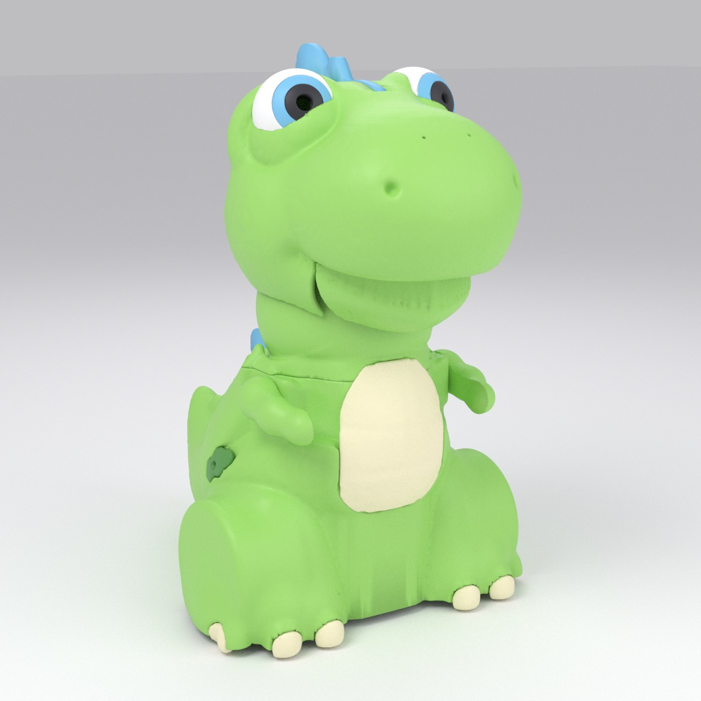

# Dinossauro (`dino`)

Robô de 30 cm para imprimir na Bambu Lab A1 e montar em casa. Roda sobre 2 rodas escondidas nas coxas e uma esfera de apoio atrás. A cabeça gira ±60° e inclina de −15° a +20°; a boca abre 12°; os 2 braços sobem e descem (−15° a +20°). Dentro vão um Raspberry Pi, um Arduino Uno, 2 servos MG996R, 3 micro servos, 2 motores com redução e um pack de duas baterias 18650 que carrega por USB-C. Fase 1 = corpo montado e ligado; o programa vem depois, na fase 2.

**Nada foi impresso ainda, e a parte elétrica não foi testada na bancada.** As peças foram conferidas por 11 testes
no computador (resultado no fim).

<!-- GERADO:numeros -->
- Altura montado: 300,0 mm.
- Peças impressas: 34 (33 arquivos diferentes), em 12 mesas.
- Filamento: 1002 g. Tempo de impressão: 39,9 h. As duas contas são estimativas por volume, sem fatiador.
- Insertos M3 a quente: 13.
<!-- /GERADO -->
- Tamanho: 194 mm de largura (nas coxas) × 293 mm da cauda ao focinho × 300 mm de altura. Massa estimada do robô montado: 1,6 kg.

| Para | Onde |
|---|---|
| Entender as decisões do projeto | [PLANO.md](PLANO.md) |
| Comprar | [LISTA-DE-COMPRAS.md](LISTA-DE-COMPRAS.md) · [English](LISTA-DE-COMPRAS.en.md) · [Español](LISTA-DE-COMPRAS.es.md) |
| Imprimir | [IMPRIMIR.md](IMPRIMIR.md) · [English](IMPRIMIR.en.md) · [Español](IMPRIMIR.es.md) |
| Ligar os fios | [LIGACAO.md](LIGACAO.md) · [English](LIGACAO.en.md) · [Español](LIGACAO.es.md) |
| Pôr os servos no centro | [firmware/centrar_servos/centrar_servos.ino](firmware/centrar_servos/centrar_servos.ino) |
| Baixar tudo | [dino-stl.zip](https://github.com/inematds/robos-impressos/raw/main/projetos/dino/dino-stl.zip) (STL, 3MF das mesas, sketch e guias nos 3 idiomas) |
| STL, 3MF, mesas | `projetos/dino/stl/`, `projetos/dino/3mf/`, `projetos/dino/mesas/` (+ as peças comuns de `comum/pecas/stl/`) |
| Imagens | `projetos/dino/imagens/` (renders do modelo: montado, explodido, esqueleto, mesas e 4 vistas) |
| Modelo | `projetos/dino/modelo.py`, `comum/cad/comum/` (casca, cabeça, esqueleto), seção `DINO` de `comum/cad/parametros.py` |
| Ver o robô e seguir o guia | https://inematds.github.io/robos-impressos/guia/dino/ (também em `/guia/en/dino/` e `/guia/es/dino/`) |



## Montagem

Antes de montar, faça os 4 preparos da bancada descritos em [LIGACAO.md](LIGACAO.md): energia soldada e ajustada
(5,1 V e 6 V), programa gravado no Arduino com os 5 servos em 90°, cabos do Raspberry Pi e divisor prontos, cartão
microSD gravado. Toda a solda fica nesses preparos; na montagem só há bornes e encaixes. Depois assente os 13
insertos M3 a quente e siga a ordem abaixo, que é a que o verificador testou (teste 9): cada peça entra pelo lado
indicado sem bater no que já está montado.

### Parafusos

<!-- GERADO:parafusos -->
| Onde fica | Qtd | Parafuso | Onde rosqueia |
|---|---|---|---|
| Motores das rodas nas paredes do chassi | 4 | M3 × 30 + porca | porca do lado de dentro da parede |
| Servo de pan no deck | 4 | M3 × 12 + porca | porca por baixo do deck |
| Servo de tilt no berço | 4 | M3 × 12 + porca | porca por dentro do berço |
| Pino do berço, no lado esquerdo do garfo | 1 | M3 × 10 | inserto no garfo |
| Driver L298N na travessa | 4 | M3 × 8 | direto no plástico (furo de 2,7 mm) |
| Capa da esfera de apoio (por baixo) | 2 | M3 × 8 | inserto no chassi |
| Corpo nos postes do chassi (por trás das coxas) | 2 | M3 × 16 | inserto nos postes do chassi |
| Gola no corpo (por cima) | 3 | M3 × 10 | inserto na borda do corpo |
| Traseira (por baixo) | 2 | auto-atarraxante 3 × 8 mm, cabeça abaulada | direto no piso do chassi (furo de 2,7 mm) |
| Arduino Uno na bandeja | 4 | M3 × 8 | direto no plástico (furo de 2,7 mm) |
| Raspberry Pi na bandeja | 4 | M2,5 × 8 auto-atarraxante | direto no plástico (furo de 2,2 mm) |
| Mesa da cabeça no crânio (por baixo) | 3 | M3 × 12 | inserto no crânio |
| Mesa da cabeça na coluna do berço (por cima) | 2 | M3 × 10 | inserto no topo do berço |
| Horn redondo dos 2 servos MG996R | 8 | M2 × 8 auto-atarraxante | nos furos do horn |
| Micro servos da boca e dos 2 braços | 6 | parafuso que vem com o servo | direto no plástico (furo de 1,7 mm) |
<!-- /GERADO -->

### Passo a passo

<!-- GERADO:passos -->
| # | Passo | Entra | Parafusos e atenção |
|---|---|---|---|
| 1 | chassi | por cima | Antes deste passo, faça os 4 preparos da bancada (energia ajustada, 5 servos em 90°, cabos do Raspberry Pi e divisor prontos, cartão gravado) e assente os 13 insertos a quente: 2 nos postes do chassi, 2 no ressalto da esfera, 3 na borda do corpo, 3 no crânio, 2 no topo do berço e 1 no garfo. |
| 2 | motor direito | pela direita | 2 × M3 × 30 com porca, pelos rasgos da parede. A ponta de dentro do eixo passa pelo furo da parede. Leve os 2 fios do motor pelo furo de 6 mm, à frente dele, até o lugar do driver. |
| 3 | motor esquerdo | pela esquerda | Igual ao direito. |
| 4 | step-down 5 V (parede esquerda, abraçadeira) | pela esquerda | O conversor já vem soldado no chicote do preparo 1. 1 abraçadeira; fica em pé na face de fora da parede esquerda do rack, com o parafuso de ajuste à mostra. |
| 5 | UBEC 6 V (parede direita, abraçadeira) | pela direita | 1 abraçadeira, em pé na face de fora da parede direita do rack. |
| 6 | BMS 2S (no piso, sob o lugar do L298N) | por cima | 1 abraçadeira. A placa de proteção já está soldada no chicote e fica deitada no piso. |
| 7 | chave (por baixo do piso) | por baixo | Já está no lugar desde o preparo 1: encaixada por baixo, com os 2 fios passando pelo recorte. |
| 8 | roda direita | pela direita | Encaixa por pressão no eixo do motor. Se a roda trouxer parafuso, aperte-o pelo centro. |
| 9 | roda esquerda | pela esquerda | Igual à direita. |
| 10 | esfera de apoio + capa | por baixo | A esfera entra no soquete por baixo e a capa prende com 2 × M3 × 8. A esfera tem de girar solta. |
| 11 | driver L298N (pela frente da torre) | pela frente | Antes, tire do módulo os 3 jumpers: ENA, ENB e o do regulador de 5 V. 4 × M3 × 8 na travessa. Aperte nos bornes: os 2 fios de cada motor, o vermelho e o preto do chicote (alimentação dos motores e GND) e o fio de 5,1 V que vem do borne 1 da barra de emenda. Encaixe os 6 jumpers de sinal nos pinos ENA, IN1, IN2, IN3, IN4 e ENB e deixe as outras pontas soltas, marcadas com fita. |
| 12 | servo de pan | por cima | 4 × M3 × 12 com porca, eixo para cima. O servo já está em 90° (preparo 2): não gire o eixo com a mão. |
| 13 | servo do braço direito | pela direita | Micro servo na orelha do chassi, eixo para fora, com os 2 parafusos do kit. Já está em 90° (preparo 2). Encaixe o horn de 1 braço apontando para trás e para cima: apontado para a frente ele raspa no corpo quando o corpo desce. |
| 14 | servo do braço esquerdo | pela esquerda | Igual ao direito. |
| 15 | carregador USB-C (na mesinha de trás, fita dupla-face) | por cima | Fita dupla-face, com a boca USB-C para trás. Já está soldado no chicote. |
| 16 | corpo desce por cima do chassi | por cima | Cole antes a barriga, os 6 dedos e as 2 manchas nos assentos planos (as manchas só na fase 2, se você for pôr os sensores laterais). O corpo desce por cima do chassi. 2 × M3 × 16 horizontais, por trás das coxas, nos insertos dos postes. Na frente não há parafuso: quem trava a frente é o encaixe com a traseira. |
| 17 | garfo (por dentro da boca do corpo) | por cima | Prenda o horn redondo do servo de pan por baixo do garfo, com 4 × M2 × 8 pelos rasgos. Com o servo em 90°, encaixe o garfo no eixo com os montantes para os lados e aperte o parafuso central do servo pelo furo do meio. |
| 18 | berço + servo de tilt | por cima | Na bancada: servo de tilt em pé no berço, 4 × M3 × 12 com porca, e o horn redondo encaixado no eixo. Desça o berço entre os montantes do garfo até o horn assentar no rebaixo do montante direito (abra os montantes 1 mm com os dedos). Prenda o horn por FORA, com 4 × M2 × 8 pelos rasgos e o parafuso central do servo pelo furo de 9 mm. No montante esquerdo entra o M3 × 10, pelo inserto: a ponta dele é o pino do berço. Aperte até encostar e volte um quarto de volta, porque a cabeça inclina nele. Passe o cabo do servo pela face chata da coluna e pelo rasgo da base do garfo. |
| 19 | gola | por cima | A gola assenta na borda do corpo. 3 × M3 × 10 por cima, nos insertos da borda. Passe por dentro dela o cabo do servo de tilt (e, na fase 2, o cabo flat da câmera). |
| 20 | cubo + braço direito | pela direita | O cubo entra pelo furo do ombro e abraça o horn do micro servo. Prenda-o com o parafuso central do servo. O braço encaixa no cubo por pressão, pelas 2 faces chatas, sem parafuso por fora. |
| 21 | cubo + braço esquerdo | pela esquerda | Igual ao direito. |
| 22 | bateria (entra por trás, por cima do carregador, e desce no piso) | por cima | O suporte já está soldado no chicote desde o preparo 1, sem as células. Ele entra por trás, passa por cima do carregador e desce no piso; prenda com fita dupla-face. Com a chave desligada, ponha agora as 2 células, conferindo o lado do positivo com o multímetro. Daqui em diante o chicote tem tensão: não deixe ponta de fio solta encostar em metal. |
| 23 | bandeja do Pi | por trás | Na bancada: Raspberry Pi na bandeja com 4 × M2,5 × 8, blocos USB para trás, cartão microSD já gravado (preparo 4) e dissipadores colados. Encaixe os conectores ANTES de deslizar a bandeja: vermelhos nos pinos 2 e 4, pretos nos pinos 6 e 9, verde no 32, azul no 33 e preto da serial no 34. Dobre os fios logo acima dos conectores: sobra pouca altura sobre o Pi. É o trilho de baixo. |
| 24 | bandeja do Uno | por trás | Na bancada: Arduino Uno com o shield na bandeja, 4 × M3 × 8, atravessado (o USB fica de lado). Deslize a bandeja no trilho de cima e refaça no shield as ligações do preparo 2: fios do UBEC e capacitor no borne azul, os 2 jumpers da barra no + e no − do conector COM, os 5 servos (D9, D10, D11, D2 e D3). Ligue os 6 sinais do driver (D5, D4, D7, D8, D12 e D6, só no pino S) e a serial: verde no S do D0, preto no G do D0 e o jumper do divisor no S do D1. No D0 e no D1, o pino do meio (V) fica vazio: ele tem os 6 V dos servos. Faça essas ligações com a bandeja ainda para fora, apoiada na entrada do trilho, e só então empurre-a até o fim, acomodando os fios. Esta manobra nunca foi ensaiada com as peças impressas. |
| 25 | traseira (com a crista das costas) | por trás | Encaixe a crista das costas no rasgo da traseira (pressão ou cola). A traseira entra por trás e a borda dela encaixa no lábio do corpo. 2 parafusos auto-atarraxantes de 3 × 8 mm por baixo. |
| 26 | mesa dentro do crânio (na bancada) | por baixo | Micro servo da boca na mesa, com os 2 parafusos do kit, já em 90°. A mesa entra por baixo, para dentro do crânio: 3 × M3 × 12 nos insertos. Mandíbula, com a boca fechada: o braço do horn entra entre as 2 nervuras (lado direito) e o pino da mesa entra no soquete cego (lado esquerdo), por pressão. Olhos e íris: pressão ou cola. Pupilas: só pressão. O alto-falante é da fase 2. |
| 27 | cabeça no pescoço | por cima | Ligue a extensão de 30 cm no cabo do servo da boca e desça-a pela face chata da coluna, junto com o cabo do servo de tilt. A cabeça desce até a mesa assentar na coluna do berço: 2 × M3 × 10 por cima, pelos 2 furos do alto do crânio. A crista da cabeça tampa os furos: encaixe por pressão, sem cola. |
<!-- /GERADO -->

## Abrir para manutenção

Trocar a bateria ou mexer nas placas não exige tirar a cabeça: sai só a traseira (anca e cauda), com 2 parafusos por baixo.

<!-- GERADO:abrir -->
| # | Passo | Parafusos e atenção |
|---|---|---|
| 1 | ABRIR: traseira sai | Solte os 2 parafusos de baixo e puxe a traseira para trás. A cabeça fica no lugar. |
| 2 | ABRIR: bandeja do Uno sai | Desencaixe os conectores do shield, marcando cada um com fita e o nome do pino, e solte do borne azul os fios do UBEC. Puxe a bandeja para trás. |
| 3 | ABRIR: bandeja do Pi sai | Desencaixe os conectores dos pinos do Raspberry Pi e puxe a bandeja para trás. |
| 4 | ABRIR: bateria sai | Desligue a chave antes. O suporte sobe 15 mm, passa por cima do carregador e sai por trás. |
<!-- /GERADO -->

## Energia e ligação

Pack 2S (2 × 18650, 6 a 8,4 V) → fusível retardado de 3 A (T3A) → placa de proteção BMS 2S → chave (KCD11-101, 3 A) → três linhas:

- **5,1 V do Raspberry Pi, do Arduino e da lógica do driver:** conversor LM2596 (cerca de 2 A contínuos). O Pi recebe
  pelos pinos 2 e 4 (5 V) e 6 e 9 (GND); o Arduino, pelos pinos + e − do conector COM do Sensor Shield.
- **6 V dos servos:** UBEC de 3 A, pelo borne azul do Sensor Shield (jumper SEL retirado), com capacitor de 1000 µF.
  Servos: pan no D9, tilt no D10, boca no D11, braço direito no D2 e braço esquerdo no D3.
- **Motores das rodas:** driver L298N, com a tensão da bateria. Sinais: ENA no D5, IN1 no D4, IN2 no D7, IN3 no D8,
  IN4 no D12 e ENB no D6.
- **Carga:** módulo USB-C com balanceamento, antes da chave, numa mesinha do chassi, atrás, com o plugue entrando por um rasgo sob a raiz da cauda, com um 3º fio no ponto que une as
  duas células.
- **Raspberry Pi ↔ Arduino:** serial (UART) de 3 fios. Pi: pinos 32 (TX), 33 (RX) e 34 (GND). Arduino: D0 e D1, com um
  divisor de 3 resistores de 1 kΩ, preso na barra de emenda, no fio que vai do Arduino para o Pi.

O esquema, a tabela fio a fio e os avisos de segurança estão em [LIGACAO.md](LIGACAO.md). Nada disso foi testado na
bancada.

## Verificação

Saída real de `.venv/bin/python comum/cad/verificar.py dino` (cópia completa em `verificacao-saida.txt`):

<!-- GERADO:verificacao -->
```
== verificação: dino
  [PASSOU] 1 contagem: 33 peças distintas, 34 no total (esperado 34); faltando 0; sobrando 0
  [PASSOU] 2 malha: 33 STL fechados, 1 corpo cada
  [PASSOU] 3 mesa: todas cabem em 256 x 256 x 256 mm; maior dimensão 194.1 mm (corpo)
  [PASSOU] 4 parede: corpo 2.27–2.62 mm; gola 2.89–9.75 mm; cabeça 2.31–2.55 mm (mínimo exigido 2.0)
  [PASSOU] 5 interferência: 59 sólidos (33 impressos + 26 componentes), 12 poses, 0 sobreposições; 2 encaixe(s) previsto(s) fora da conta: motor-tt-dir x roda-dir (eixo do motor entra no cubo da roda); motor-tt-esq x roda-esq (eixo do motor entra no cubo da roda)
  [PASSOU] 6 teste negativo: 'chassi' deslocada 3 mm em X → 15 sobreposições acusadas (tem que ser > 0)
  [PASSOU] 7 peça solta: as 33 peças montadas encostam (≤ 1.5 mm) em outra
  [PASSOU] 8 equilíbrio: massa estimada 1597 g; CG neutro em x=-0.3 y=-18.7 z=108.2 mm, margem 18.7 mm (tomba com 10°); pior pose 'tilt-baixo': margem 14.9 mm (8°); mínimo exigido 10 mm
  [PASSOU] 9 caminho: 31 passos (montagem + abertura para manutenção), cada peça entra ou sai pela direção declarada sem atravessar o que está montado
  [PASSOU] 10 imprimibilidade: 33 peças distintas: 27 saem sem suporte; 6 com suporte declarado: cranio (12051 mm² = 9.8 %, ponte de 65 mm, 2 ponto(s) no ar), corpo (2514 mm² = 2.2 %, ponte de 20 mm, 2 ponto(s) no ar), traseira (1596 mm² = 2.4 %, ponte de 24 mm, 1 ponto(s) no ar), garfo-pescoco (1488 mm² = 16.1 %, ponte de 21 mm), berco-tilt (516 mm² = 7.0 %, ponte de 21 mm), mandibula (455 mm² = 4.9 %); 0 REPROVADA(S) (declaradas sem suporte, mas com área sem apoio acima de max(30 mm², 0.2 % da área) a mais de 45° ou ponto que nasce no ar)
  [PASSOU] 11 negativo impr.: 'chassi' na orientação declarada: 158 mm² sem apoio (limite 163); girada 180° em X → 11537 mm² = 14.1 % (acusou; tem que acusar)
```
<!-- /GERADO -->

## Como regenerar

```
.venv/bin/python comum/cad/gerar.py dino                      # STL, 3MF, mesas, montagem.json
.venv/bin/python comum/cad/verificar.py dino                  # 11 testes
.venv/bin/python guia/src/pagina_robo.py docs dino pt     # blocos GERADO destes arquivos
.venv/bin/python guia/src/pagina_robo.py traduzir dino    # EN e ES pelo inema-traduz (só o que mudou)
.venv/bin/python guia/src/pagina_robo.py docs dino        # versões .en.md e .es.md
.venv/bin/python guia/src/pagina_robo.py esquema dino     # ligacao.<idioma>.svg
.venv/bin/python guia/src/pagina_robo.py zip dino         # dino-stl.zip
.venv/bin/python guia/src/pagina_robo.py conferir dino    # links, idiomas, zip
```

Os arquivos `*.en.md`, `*.es.md` e `ligacao.*.svg` são gerados: mude o texto em português (ou
`guia/src/robos/dino.dados.json`) e rode os comandos acima.

## Pendências

- Imprimir e montar: comece pelo cupom de teste.
- Testar a parte elétrica na bancada (nenhum fio foi ligado ainda).
- A chave de 3 A é o ponto fraco da parte elétrica: o uso normal calculado fica perto do limite. Uma chave maior pede mudar o recorte da peça.
- Medidas NC dos componentes (micro servo, motores, rodas, esfera, driver, sensores da fase 2): medir e corrigir `comum/cad/parametros.py`.
- Abrir os 3MF das mesas no Bambu Studio e tirar o suporte das 6 peças que pedem suporte.
- Conferir os comprimentos dos parafusos M3 e dos cabos com as peças na mão.
- Conferir se os conectores cabem em pé sobre o Raspberry Pi, sob a bandeja de cima.
- Calor: o Raspberry Pi fica fechado num corpo de PLA sem ventilação; medir a temperatura em uso.
- Porta-fusível, barra de emenda, resistores da serial, amplificador de áudio e sensor de movimento ainda não têm fixação modelada.
- O horn do micro servo de cada braço não está no modelo 3D: falta provar que o corpo desce com ele montado.
- O Arduino vai atravessado na bandeja (USB de lado): para regravar é preciso puxar a bandeja.
- Acabamento: o canto de trás do queixo fica recortado; entre as pernas a barriga desce reta até perto do chão; os braços são lisos, sem os dedinhos; há uma tampa reta na base da gola, acima de cada ombro.
